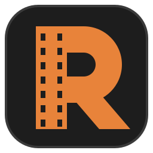

  

<h1 align="center">Rodaje</h1>

  Editor de video nativo para Windows: rápido, por capas, con la comodidad de los editores móviles y la precisión de uno profesional. 
  Compilado de antemano con Native AOT: no necesita .NET ni nada instalado aparte. Con instalador o portable.

  
  
  
  
  

## Qué hace

- **Edición por capas** al cuadro exacto: cortar, recortar, ripple, roll, slip, slide, insertar y sobrescribir, edición de tres y cuatro puntos, clips compuestos, marcadores, audio y video enlazados, reemplazar y volver a enlazar medios. Todo se deshace con Ctrl+Z; autoguardado y recuperación tras un cierre inesperado.
- **Velocidad y reversa:** constante o por curva, congelar cuadro y reversa exacta, con el tono del audio conservado.
- **Imagen en la GPU:** corrección de color con ruedas y curvas, comparación antes/después, LUT `.cube`, croma, máscaras, recorte con proporción, desenfoque, nitidez, viñeta, modos de mezcla, transformación con keyframes y transiciones.
- **Títulos y subtítulos** editables sobre el visor, con plantillas; escritos a mano o generados por la IA, que guarda el tiempo de cada palabra para corregir, dividir y unir.
- **Audio:** volumen por clip y mezcla con LUFS, ecualizador, compresor, ducking y voz en off.
- **Exportación:** MP4, MOV, MKV y WebM; H.264 y HEVC por GPU, AV1, VP9 y ProRes; AAC, Opus y PCM; normalización a LUFS, capítulos, formatos verticales y verificación del archivo final. Varias versiones a la vez y una cola que sobrevive a cerrar la app.
- **IA local por módulos:** subtítulos (Whisper), traducción, texto a voz, reducción de ruido, silencios y ritmo, estabilización, color automático, quitar el fondo, reencuadre automático e importación de CinemaDNG. Todo corre en el equipo: nada se envía a internet.
- **Complementos:** transiciones, filtros y módulos se instalan y actualizan desde la app, con un catálogo firmado y la huella de cada archivo verificada.
- **Atajos configurables** de teclado y ratón, con tres estilos de partida.
- **Flujo de trabajo:** proxies automáticos, espacios de trabajo, pantalla completa y segunda pantalla, carpetas vigiladas, zonas seguras de redes sociales y un recorrido inicial.

## Descargar

Última versión en [Releases](https://github.com/Dathinel/rodaje/releases):

- **Instalador** (`Rodaje-<versión>-instalador.exe`): por usuario, sin permisos de administrador. Crea el acceso en Inicio y abre los `.rodaje`.
- **Portable** (`-portable.zip`): descomprime y abre `Rodaje.exe`. No toca el registro; para quitarlo, borra la carpeta.
- **Completo** (`-completo.zip`): el portable con complementos, módulos y modelos de IA.

**Requisitos:** Windows 10 versión 2004 (19041) o posterior, u 11, de 64 bits (x64), con una GPU con DirectX 11. La decodificación por hardware (H.264 y HEVC) acelera la edición; sin ella se decodifica en la CPU.

## Compilar

El entorno (SDK de .NET 10 y FFmpeg LGPL, con versiones y huellas fijadas) se descarga dentro del proyecto, en `.entorno\`; no se instala nada fuera de la carpeta. Native AOT necesita Visual Studio Build Tools con la carga de C++.

| Para | Haz |
|---|---|
| Compilar y abrir el editor | Doble clic en `Rodaje.bat` (la primera vez prepara el entorno y publica en `dist\Rodaje\`) |
| Correr las pruebas | Doble clic en `Probar.bat`; `Probar.bat cobertura`, `aot` o `aceptacion` para las variantes |
| Cualquier comando de `dotnet` | `build\dotnet-local.cmd <argumentos>` |
| Armar instalador, zip y notas | `build\distribuir.ps1` |

Variables de entorno opcionales en [docs/variables-entorno.md](docs/variables-entorno.md).

## Evidencias

Medido en un Ryzen 7 7435HS con RTX 3050 Laptop:

| Prueba | Resultado |
|---|---|
| Pruebas automáticas | Más de 5 000, en Windows y en Linux (núcleo, paquetes y reproducción) en cada cambio |
| Arranque | Ventana visible en **50 ms** en caliente y **215 ms** en frío |
| Salto exacto al cuadro | **2 864 de 2 864** saltos aleatorios en el cuadro exacto, en H.264 y HEVC, por GPU y por software |
| Sincronía audio/video | **0 cuadros de error en 10 minutos** |
| Exportación | 1 min 1080p de dos capas con efectos a H.264 por GPU en **9 s** (~200 fps) |
| Native AOT | **0 advertencias** |

## Documentación

- **[Guía de usuario](docs/guia/README.md):** [instalar](docs/guia/instalar.md), [tu primer proyecto](docs/guia/primer-proyecto.md), [edición](docs/guia/edicion.md), [imagen](docs/guia/imagen.md), [audio](docs/guia/audio.md), [títulos y subtítulos](docs/guia/titulos-y-subtitulos.md), [IA local](docs/guia/ia-local.md), [exportar](docs/guia/exportar.md), [complementos](docs/guia/complementos.md), [atajos](docs/guia/atajos.md) y [solución de problemas](docs/guia/solucion-de-problemas.md).
- **Para contribuir:** [CONTRIBUTING.md](CONTRIBUTING.md) (entorno, pruebas, estilo, DCO y pull requests) y [CODE_OF_CONDUCT.md](CODE_OF_CONDUCT.md).
- **Cómo está hecho:** índice completo en [docs/README.md](docs/README.md): arquitectura por capas, formatos `.rodaje` y `.paquete`, protocolo de módulos, distribución, decisiones y fondo legal.

## Licencia

[GNU GPLv3 con términos adicionales](LICENSE) (Sección 7): puedes usar, estudiar, modificar, redistribuir y vender Rodaje con el código fuente bajo la misma licencia, conservando el crédito visible en la interfaz y en las páginas de descarga o venta. Los complementos que se conectan por las interfaces públicas pueden llevar la licencia que elija su autor. El nombre «Rodaje» y sus logotipos no se licencian con el código ([TRADEMARK.md](TRADEMARK.md)).

Licencias de terceros en [LICENCIAS.md](LICENCIAS.md) y [THIRD-PARTY-NOTICES.txt](THIRD-PARTY-NOTICES.txt). Seguridad en [SECURITY.md](SECURITY.md); contribuciones en [CONTRIBUTING.md](CONTRIBUTING.md).
