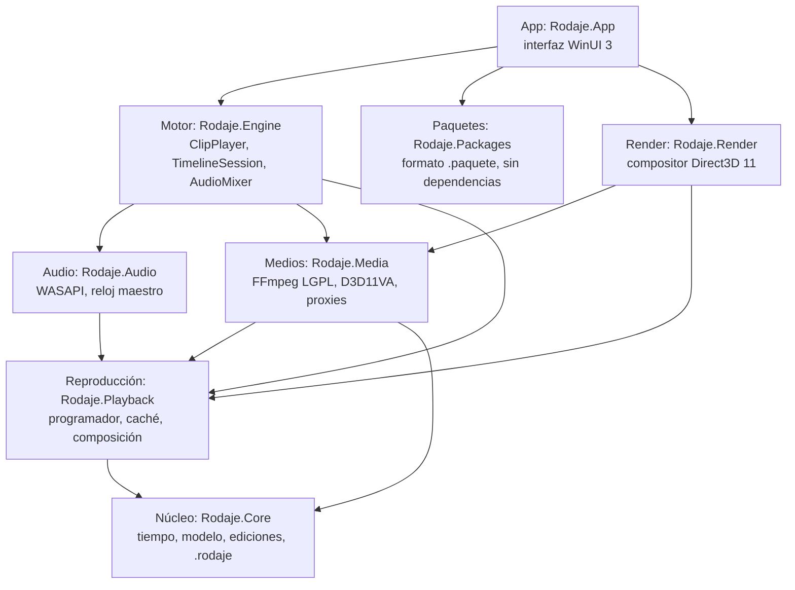

# Arquitectura de Rodaje

Rodaje es un editor de video nativo para Windows escrito en C# sobre .NET 10. Se entrega como un ejecutable Native AOT autocontenido y sin instalador. El código se reparte en capas, cada una en su propio proyecto y apoyada solo en las de abajo. Cada documento describe una capa tal como está hoy, con sus archivos, su lógica y cómo se prueba.



| Capa | Documento | En una frase |
|---|---|---|
| Núcleo | [nucleo.md](nucleo.md) | Tiempo exacto en ticks, modelo del proyecto con efectos, transiciones y velocidad, unas 50 operaciones de edición con deshacer por instantáneas y el formato `.rodaje` |
| Medios | [medios.md](medios.md) | FFmpeg LGPL verificado, GPU compartida con D3D11VA, seek exacto al cuadro, análisis y proxies |
| Audio | [audio.md](audio.md) | Salida WASAPI que da el reloj maestro y sobrevive a la pérdida del dispositivo |
| Reproducción | [reproduccion.md](reproduccion.md) | Qué cuadro se muestra en cada refresco, siguiendo al audio sin bloquear nunca |
| Motor | [motor.md](motor.md) | Varias capas con pre-roll, varios decodificadores por medio, presupuesto de VRAM, mezcla y proxies |
| Exportación | [exportacion.md](exportacion.md) | La orquestación: plan, audio con LUFS, motor fuera de línea → compositor → conversor → `ffmpeg.exe`, verificación, modos de rendimiento y cancelación |
| Render | [render.md](render.md) | Composición en Direct3D 11 sin copias, con el color y la geometría de cada capa |
| Paquetes | [formato-paquete.md](../formato-paquete.md) | Manifiesto, instalación segura y catálogo de los complementos, para compartir con los demás programas |
| App | [app.md](app.md) | El contrato de la interfaz WinUI 3: `EditorSession`, comandos y eventos, atajos, ajustes, avisos, miniaturas y complementos |
| Vistas | [app-vistas.md](app-vistas.md) | Qué hace cada vista: biblioteca, reproductor y medidores, línea de tiempo, inspector, atajos y complementos |

## Núcleo, contenido e IA

El ejecutable trae solo el código del motor y un conjunto fijo de primitivas: transformar, opacidad, recorte y modos de mezcla; color y LUT; desenfoque y máscara; texto con borde y sombra; fundidos; ganancia y fundidos de audio. Lo demás va fuera y se instala o no (D-031):

```
Rodaje.exe        lanzador; el programa va en app\
app\paquetes\     contenido sin código: transiciones, filtros, estilos de texto, plantillas
app\modulos\      IA local: procesos aparte con sus modelos
```

- **Paquetes** ([formato-paquete.md](../formato-paquete.md)): un zip con `paquete.json` y sus recursos, nunca código, con su licencia declarada. Un proyecto guarda `paquete@versión/elemento`; si el paquete falta, el proyecto abre igual, avisa y ofrece instalarlo.
- **Módulos de IA** ([protocolo-modulos.md](../protocolo-modulos.md)): procesos aparte que hablan por una tubería con JSON y reciben cuadros y audio por memoria compartida. Un modelo que se queda sin memoria cierra su módulo, no el editor; el ejecutable sigue pequeño y AOT, y cada módulo lleva su licencia. **La IA no edita:** lo que devuelve se convierte en comandos del núcleo, se ve antes de aplicarse y se deshace con Ctrl+Z.
- **Distribución:** zip base (el editor) y completo (con paquetes, módulos y modelos), más el gestor de complementos de la app, que baja lo mismo desde un catálogo firmado ([descarga.md](../descarga.md), [arranque-y-distribucion.md](../arranque-y-distribucion.md)).
- **Sin plugins con código dentro del proceso:** Native AOT no carga ensamblados en tiempo de ejecución; lo que necesite código va como módulo.

## Reglas que atraviesan todas las capas

- **La interfaz no toca el modelo.** Todo cambio es un comando del núcleo (`Edits` + `UndoStack`), así que todo se deshace con Ctrl+Z, también lo que haga la IA.
- **El audio manda.** El video sigue al reloj de la salida de audio: si el equipo no alcanza, se pierde un cuadro, nunca una muestra.
- **Nada espera en el camino de render.** `Tick` muestra lo mejor que hay; abrir, decodificar y cerrar archivos ocurre en otros hilos.
- **Un solo dispositivo D3D11** compartido por FFmpeg y el compositor: los cuadros decodificados se muestrean sin copiarlos.
- **Compatible con Native AOT** desde el primer día: nada de reflexión; JSON e interop COM generados en compilación; advertencias tratadas como errores.
- **Solo FFmpeg LGPL**, cargado por ruta absoluta y verificado, porque el código no es GPL ([`legal.md`](../legal.md)).
- **Lo que falta no rompe.** Sin GPU se decodifica en CPU, sin dispositivo de audio el reloj es el del sistema y un medio roto deja su capa vacía; todo con mensajes en español.

## Herramientas y pruebas

| Comando | Qué hace |
|---|---|
| `Probar.bat` | Restaura, compila y corre todas las pruebas ([`build/probar.ps1`](../../build/probar.ps1)); `-Filtro texto` corre solo las que coinciden. Las de la categoría `TiempoReal` corren en una segunda pasada, solas, para que la carga de las demás no las falsee |
| `Probar.bat cobertura` | Lo mismo, más la cobertura de `Rodaje.Core` |
| `Probar.bat aot` | Publica y ejecuta la prueba de humo del núcleo con Native AOT ([`publicar-aot-prueba.ps1`](../../build/publicar-aot-prueba.ps1)) |
| `Probar.bat aceptacion` | Criterios de la fase 2 con video y audio reales, en serie ([`aceptacion.ps1`](../../build/aceptacion.ps1)) |
| `Rodaje.bat` | Publica y abre el editor ([`app.ps1`](../../build/app.ps1)); `app.ps1 -Medir N` mide arranque y reproducción |
| `build\dotnet-local.cmd <args>` | El SDK de `.entorno\` con cualquier argumento de `dotnet` |

- **Módulo común.** Los scripts comparten [`build/comun.psm1`](../../build/comun.psm1): localizan el entorno y sus marcas de instalación completa, fijan las variables del SDK local, añaden vswhere al PATH, llaman a dotnet con registro, crean la carpeta de cada corrida y leen los `.trx`.
- **Entorno.** El SDK y FFmpeg viven en `.entorno\`, con versiones y huellas fijadas en [`preparar-entorno.ps1`](../../build/preparar-entorno.ps1). Las variables `RODAJE_*` están en [`variables-entorno.md`](../variables-entorno.md).
- **Proyectos.** Las pruebas viven en `tests/`, un proyecto por capa más `Rodaje.Acceptance.Tests` y `Rodaje.AotSmoke`. La biblioteca de apoyo [`tests/Rodaje.TestMedia`](../../tests/Rodaje.TestMedia) genera medios con el número de cuadro dibujado y reúne en `Skip.cs` los atributos que omiten una prueba, con su motivo, cuando falta hardware o la variable de las pruebas largas.

## Problemas de compatibilidad conocidos

- **Windows PowerShell deshabilitado** (pasa en versiones recortadas como AtlasOS). `Probar.bat` lo detecta. Los scripts usan `-ExecutionPolicy Bypass` solo para su proceso.
- **Descargas cortadas.** Se escriben como `.part` y solo se aceptan completas y con la huella correcta: basta repetir.
- **Native AOT** necesita `link.exe` de Visual Studio Build Tools 2022 con la carga de C++.
- **Paquetes NuGet** fijados en `packages.lock.json`: un cambio sin actualizarlos hace fallar la restauración a propósito.
- **Filtros con `&` y `dotnet-local.cmd`.** cmd.exe corta el filtro en el `&`, y como el .cmd reenvía los argumentos, `^&` no alcanza. Desde PowerShell funciona `--filter 'Categoria=TiempoReal^^^&FullyQualifiedName~Timeline'` o el filtro con comillas dentro: `--filter '"Categoria=TiempoReal&FullyQualifiedName~Timeline"'`.
- **Espacios de nombres en las pruebas.** `Rodaje.X.Tests.Timing` tapa a `Rodaje.Core.Timing`; en las pruebas se usa el nombre completo o un `using`.
- **Carpetas sincronizadas** (OneDrive). Pueden bloquear el `File.Replace` del guardado atómico. Si pasa, guardar falla con un error y el proyecto anterior queda intacto.

## Otros documentos

- [Formato de proyecto](../formato-proyecto.md)
- [Decisiones](../decisiones.md)
- [Fondo legal](../legal.md)
- [Protocolo de módulos](../protocolo-modulos.md) y [descarga de complementos](../descarga.md)
- [Variables de entorno](../variables-entorno.md)
