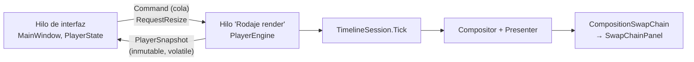

# App: `Rodaje.App` y el visor provisional

Hay dos ejecutables que juntan [Motor](motor.md) y [Render](render.md) en una ventana. `Rodaje.Visor` es la ventana Win32 provisional de las fases 2 y 3 y se borra cuando la app la reemplace. `Rodaje.App` será la interfaz final en WinUI 3 (fase 4, en construcción). Este documento describe el estado actual; el diseño aprobado es la maqueta de [D-018](../decisiones.md).

## `Rodaje.App` (WinUI 3)

Hoy contiene el **sondeo** de la fase 4 ([`docs/sondeo-winui.md`](../sondeo-winui.md)). El sondeo confirmó que WinUI 3 se publica sin paquete MSIX, autocontenido y con Native AOT, con 0 advertencias y 0 refrescos perdidos con 4 capas. El Windows App SDK ocupa unos 57 MB junto al exe y sus términos están en [`LICENCIAS.md`](../../LICENCIAS.md).

- **Proyecto.** `Rodaje.exe` es `net10.0-windows10.0.26100.0` para win-x64, con `WindowsPackageType=None`, Windows App SDK autocontenido y `PublishAot`.
  - `EnableMsixTooling` se deja activo: sin él no se genera `resources.pri` y la app muere al arrancar.
  - Usa los paquetes sueltos `WinUI`, `Foundation` e `InteractiveExperiences` en lugar del metapaquete, que trae 38 MB de IA que no se usan.
- **Hilos.** La interfaz nunca espera al render.

- **[`Player/PlayerEngine.cs`](../../src/Rodaje.App/Player/PlayerEngine.cs)** es dueño del `GpuDevice`, la `TimelineSession`, el compositor y la cadena de intercambio.
  - Al reproducir espera el aviso de la cadena (latencia 1), hace `Tick`, compone y presenta.
  - En pausa solo repinta si cambió algo.
  - Compone al tamaño de la secuencia, o a la mitad si el panel es más chico que eso.
- **[`Player/CompositionSwapChain.cs`](../../src/Rodaje.App/Player/CompositionSwapChain.cs)** usa una cadena FLIP_DISCARD para composición con objeto de espera, ajustada a la escala del panel. [`SwapChainPanelNative.cs`](../../src/Rodaje.App/Player/SwapChainPanelNative.cs) llama a `SetSwapChain` por la vtable, sin `ComImport`, lo que es compatible con AOT.
- **[`Program.cs`](../../src/Rodaje.App/Program.cs)** tiene un `Main` propio: arranca el motor antes que WinUI y escribe los errores en `rodaje-error.txt` junto al exe.
- **[`AppOptions.cs`](../../src/Rodaje.App/AppOptions.cs)** acepta archivos, `--medir N`, `--registro`, `--sin-audio` y `--ui-hz`. Sin archivos busca el clip de prueba en `TestResults\media-cache`.
- **[`MainWindow.xaml`](../../src/Rodaje.App/MainWindow.xaml)** es la maqueta: barra de título propia, riel, vista previa, propiedades y una línea de tiempo de muestra. Espacio se intercepta antes que los controles.
- **[`Player/DemoProject.cs`](../../src/Rodaje.App/Player/DemoProject.cs)** arma el proyecto en memoria (fondo con audio y los demás videos como imagen en imagen) o abre un `.rodaje`.
- **Medición.** [`Diagnostics/Metrics.cs`](../../src/Rodaje.App/Diagnostics/Metrics.cs) junto con [`herramientas/sondeo-winui.ps1`](../../herramientas/sondeo-winui.ps1) publican en `dist\sondeo-winui` y miden arranque, ritmo y latencias. La app todavía no tiene proyecto de pruebas.

**Lo que sigue:** el armazón (servicios, tema y atajos), la línea de tiempo con la pista principal magnética, biblioteca, inspector de keyframes, medidores y paneles. `CompositionSwapChain` pasa a Render. Cuando la interfaz esté usable, Daniel la prueba.

## `Rodaje.Visor` (provisional)

Es una ventana Win32 publicada con Native AOT en `dist\Rodaje-visor\` por [`herramientas/visor.ps1`](../../herramientas/visor.ps1), que también copia las DLL de FFmpeg LGPL y el `ffmpeg.exe` de los proxies. La abren `Rodaje.bat` y `ABRIR.bat visor`.

- **Bucle.** Un solo hilo con `MsgWaitForMultipleObjectsEx` sobre el objeto de espera de la cadena. Sesión, composición y presentación corren en el hilo de la ventana, y Windows detiene el bucle mientras se arrastra la ventana.
- **Argumentos** ([`VisorArguments.cs`](../../src/Rodaje.Visor/VisorArguments.cs)): `[videos | proyecto.rodaje] [--prueba s] [--registro ruta] [--sin-audio] [--cpu] [--proxies [siempre]]`. Sin argumentos abre un diálogo para elegir archivos.
- **Teclas** (detalle en [`docs/prueba-visor.md`](../prueba-visor.md)):
  - Espacio reproduce o pausa; ←/→ avanza un cuadro y Shift+←/→ salta 5 s.
  - 1-9 oculta o muestra una pista; Ctrl+1-9 selecciona una capa.
  - Alt+flechas mueve la capa, +/− la escala, R la rota 15° y O cambia la opacidad.
  - Ctrl+Z/Y deshace y rehace, Ctrl+S guarda, F pone pantalla completa e I muestra las estadísticas.
- **Ediciones.** [`LayerEdits.cs`](../../src/Rodaje.Visor/LayerEdits.cs) edita `rodaje.transform` con comandos del `UndoStack` y claves de fusión: es el primer uso real del núcleo desde una ventana.
- **Recorrido automático.** `--prueba` ([`AutomatedRun.cs`](../../src/Rodaje.Visor/AutomatedRun.cs)) reproduce, oculta, edita, deshace, hace seek y pasos, guarda y vuelve a abrir, e imprime las estadísticas. Con `visor.ps1 -Prueba 20 video.mp4` lo corre desde la consola.
- **Pruebas.** `tests/Rodaje.Visor.Tests` comprueba cómo se arma el proyecto de demostración con dos videos, un audio y dos imágenes.
