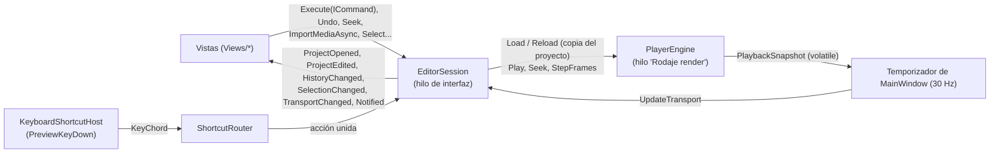

# App: el contrato de `Rodaje.App`

`Rodaje.App` es la interfaz del editor en WinUI 3 (fase 4): junta [Motor](motor.md) y [Render](render.md) en una ventana. Este documento es el contrato entre la sesión y las vistas, lo que hay que respetar para tocar o sumar una vista; qué hace cada una está en [Vistas](app-vistas.md). El diseño aprobado es la maqueta de [D-018](../decisiones.md). El visor Win32 de las fases 2 y 3 se retiró (D-022).

## Proyecto

Sin paquete MSIX, autocontenida y con Native AOT (el [sondeo](../archivo/sondeo-winui.md) lo confirmó). `herramientas\app.ps1` la publica en `dist\Rodaje\` con FFmpeg LGPL y la abre; la usan `Rodaje.bat` y `app.ps1 -Medir N`, que reproduce, mide y cierra. El Windows App SDK ocupa unos 57 MB junto al exe y sus términos están en [`LICENCIAS.md`](../../LICENCIAS.md).

`Rodaje.exe` es `net10.0-windows10.0.26100.0` para win-x64, con `WindowsPackageType=None`, Windows App SDK autocontenido y `PublishAot`. `EnableMsixTooling` se deja activo (sin él no hay `resources.pri`), y se usan los paquetes sueltos `WinUI`, `Foundation` e `InteractiveExperiences` en vez del metapaquete.

| Carpeta | Qué hay | Depende de WinUI |
|---|---|---|
| `Services/` | `EditorSession`, `TimelineState`, atajos (`Shortcuts/`), ajustes (`Settings/`), inspector (`Inspector/`), miniaturas y formas de onda (`Media/`), complementos (`Packages/`), `IPlaybackEngine`, `IMediaProber`, `IEditorDialogs`, `EditorNotification` | **No**: `tests/Rodaje.App.Tests` compila estos archivos tal cual, así que usar WinUI aquí rompe las pruebas |
| `Views/Timeline/Logic/` | La lógica de la línea de tiempo (ventana, regla, filas, clic, ajuste, arrastres, soltar medios) | **No**: también la compilan las pruebas |
| `Shell/` | `MainWindow` (distribución, páginas modales y barra de avisos), `TitleBar`, `KeyboardShortcutHost`, `PaneSplitter`, `ShellDialogs` y `FileDialogs`, `EditorServices` e `IEditorView`, `MeasurementRun` | Sí |
| `Theme/` | `Palette.xaml` (colores de D-018 y claves de WinUI redefinidas), `Typography.xaml`, `Controls.xaml` (esquinas de 2 px y transiciones de 60 ms) | Sí |
| `Views/<Área>/` | Una vista por carpeta: `Library`, `Player`, `Meters`, `Inspector`, `Timeline`, `Shortcuts`, `Plugins` | Sí |

## Cómo se habla con el editor



- **Una sola fuente de verdad.** `EditorSession` tiene el `Project`, la secuencia que se ve, el `UndoStack`, la selección, el transporte que publica el render, el archivo y si hay cambios. Solo se usa desde el hilo de la interfaz (`VerifyAccess`).
- **Solo comandos.** Las vistas leen el modelo pero lo cambian con `Execute`. Los gestos largos van entre `BeginGesture` y `EndGesture` para deshacerse en un paso, y `BreakMerge` corta la fusión al soltar un deslizador.
- **El render nunca lee el modelo que se edita.** Cada cambio llega a `PlayerEngine` como `Project.Clone()`; el hilo de render solo aplica la última copia pendiente (`TimelineSession.Reload`).
- **Rutas.** En memoria, las rutas de los medios son absolutas; al guardar se escriben relativas a la carpeta del `.rodaje` (`ProjectPaths`).
- **Importar.** `ImportMediaAsync` lee los archivos fuera del hilo de la interfaz y los agrega a la biblioteca en un paso; la secuencia vacía toma el formato del primer video. `AppendToTimeline` pone un medio al final de la pista principal con su audio enlazado. Los archivos de la línea de comandos se leen mientras se crea la ventana (`PrefetchingProber`).
- **Avisos.** `Session.Notify(gravedad, título, mensaje, acción?)` emite un `EditorNotification`. La ventana lo muestra en una sola barra, por encima de las páginas modales, y lo anuncia al lector de pantalla. La `NotificationAction` opcional («Deshacer», «Abrir») pone un botón que cierra el aviso y la ejecuta. Los informativos se cierran solos a los 6 s, o a los 10 s si tienen botón.
- **Cerrar.** Con cambios sin guardar se pregunta (Guardar, No guardar, Cancelar).

## Atajos (`Services/Shortcuts`)

- **Catálogo.** `ShortcutRegistry` guarda las acciones (`EditorShortcuts.Catalog` más lo que registre cada vista), cada una con sus teclas de fábrica en tres estilos: Rodaje, Ágil y Clásico (`ShortcutPreset`). Si un estilo no da teclas, usa las de Rodaje.
- **Cambios de la persona.** Se guardan por estilo en `%LOCALAPPDATA%\Rodaje\atajos.json`, solo las diferencias con fábrica. Los nombres de estilo anteriores se leen y se reescriben con los nuevos (`ShortcutPresetNames.TryParse`).
- **Router.** `ShortcutRouter` une cada acción con quien la ejecuta (gana el último que puede) y decide qué hacer con cada tecla. Con el foco en un campo de texto solo pasan las acciones `WorksInTextInput`. `Suspend()` lo apaga mientras se captura una tecla.
- **Menús y botones.** Lanzan las acciones por su identificador (`Shortcuts.Invoke(id)`), así muestran la tecla vigente.
- **`ShortcutCustomizer`.** Asigna, quita y restablece teclas. Si una tecla choca, las intercambia y devuelve un `ShortcutChange` con su aviso y lo necesario para deshacerlo.
- **Teclas de signos.** Los archivos y el catálogo nombran las teclas VK_OEM_* por su posición estadounidense («Alt+[»). Para mostrarlas, `KeyNames.DisplayLayout` consulta la distribución activa (`MapVirtualKeyEx`): en un teclado español esa misma tecla se ve «Alt+'».

## Ajustes (`Services/Settings`)

`ajustes.json` guarda carpetas, recientes, tamaños de paneles y ventana, estilo de atajos, proxies, caída de los medidores, márgenes seguros y las preferencias de la línea de tiempo. `ajustes.json` y `atajos.json` se escriben de forma atómica; si están dañados, se apartan con el sufijo `.dañado` y se avisa. Un estilo de atajos desconocido vuelve a Rodaje sin dar el archivo por dañado.

## Miniaturas y formas de onda (`Services/Media`)

`IClipVisuals` es lo que la biblioteca y la línea de tiempo usan para dibujar medios. Las llamadas se hacen desde el hilo de la interfaz y nunca esperan: devuelven lo que ya está en memoria, piden lo que falta y, cuando llega, `Changed` avisa (también en el hilo de la interfaz) para que se vuelva a pedir.

```csharp
event EventHandler<ClipVisualsChangedEventArgs>? Changed;                 // MediaId, Kind (Thumbnails | Waveform)
Filmstrip GetFilmstrip(string mediaId, Time sourceStart, Time sourceEnd, int count, int height);
WaveformSlice GetWaveform(string mediaId, Time sourceStart, Time sourceEnd, int buckets);
BgraImage? GetThumbnail(string mediaId, Time sourceTime, int height);
```

- **Miniaturas.** `ThumbnailDecoder` (en `Rodaje.Media`) decodifica en la CPU sin filtro de desbloqueo y saltándose los cuadros que nadie usa como referencia, y reduce con swscale a BGRA. Va en la CPU a propósito: no toca el presupuesto de VRAM de la reproducción ([D-021](../decisiones.md)) y una miniatura 1080p sale en unos 50 ms.
- **Rejilla.** Los instantes de una tira se ajustan a una rejilla de potencias de dos y los altos a unas pocas clases (32 a 256): al hacer zoom o desplazar casi todo ya está hecho.
- **Hilos.** Uno de baja prioridad para miniaturas, con hasta tres decodificadores que se cierran tras 20 s sin uso, y otro para formas de onda. La tanda de pedidos más reciente va primero.
- **Cachés.** En memoria, 128 MB; en disco, `cache\miniaturas` (512 MB) y `cache\ondas` (128 MB), con la huella del original en el nombre.
- **Formas de onda.** `WaveformPeaks` guarda mínimo y máximo por cada 256 muestras a 48 kHz y niveles reducidos de 4 en 4; mientras se calcula crece por el final y se puede leer a la vez.
- **Dos contratos por unificar.** La línea de tiempo usa por ahora su propio `Views/Timeline/IClipVisuals`, que `Views/Shared/TimelineClipVisuals` cumple con `ClipVisuals`; `Views/Shared/BgraBitmaps` convierte un `BgraImage` en `WriteableBitmap` una vez por imagen.

## Complementos (`Services/Packages`)

`PackageService` junta el catálogo que viaja en el ejecutable (`catalogo.json`), lo instalado y el instalador de [`Rodaje.Paquetes`](../formato-paquete.md); lee el disco fuera del hilo de la interfaz y avisa con `Changed`. `LibraryElements` decide qué muestra cada categoría de la biblioteca: lo que trae el motor (con «Próximamente» lo que llega en la fase 5), lo de los paquetes y lo propio.

## Cómo se suma una vista

1. Un `UserControl` en `Views/<Área>/` que implementa `IEditorView`; `MainWindow` (o el anfitrión, como `InspectorView`) lo crea desde XAML y llama a `Attach(EditorServices)` una vez. `EditorServices` trae `Session`, `Shortcuts` (con su `ShortcutRegistry`), `Settings`, `Player`, `Shell`, `Visuals` y `Packages`.
2. En `Attach` se suscribe a los eventos de `services.Session`, registra sus acciones con `services.ShortcutRegistry.Register(new ShortcutAction(...))` y las une con `services.Shortcuts.Bind(id, ejecutar, puedeEjecutar)`. Los botones llaman a `services.Shortcuts.Invoke(id)`.
3. Avisa con `services.Session.Notify`, nunca con un `InfoBar` propio.
4. Solo `x:Bind` (con `Bindings.Update()` al final de `Attach`) y colores del tema (`StaticResource`), nunca sueltos.
