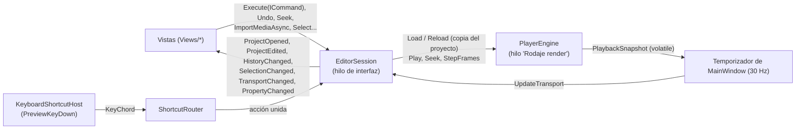

# App: `Rodaje.App` y el visor provisional

Hay dos ejecutables que juntan [Motor](motor.md) y [Render](render.md) en una ventana. `Rodaje.Visor` es la ventana Win32 provisional de las fases 2 y 3 y se borra cuando la app la reemplace. `Rodaje.App` será la interfaz final en WinUI 3 (fase 4, en construcción). Este documento describe el estado actual; el diseño aprobado es la maqueta de [D-018](../decisiones.md).

## `Rodaje.App` (WinUI 3)

Es la interfaz final, sin paquete MSIX, autocontenida y con Native AOT (el [sondeo](../sondeo-winui.md) lo confirmó). `herramientas\app.ps1` la publica en `dist\Rodaje\` con FFmpeg LGPL y la abre; la usan `Rodaje.bat` y `app.ps1 -Medir N`, que reproduce, mide y cierra. El Windows App SDK ocupa unos 57 MB junto al exe y sus términos están en [`LICENCIAS.md`](../../LICENCIAS.md).

- **Proyecto.** `Rodaje.exe` es `net10.0-windows10.0.26100.0` para win-x64, con `WindowsPackageType=None`, Windows App SDK autocontenido y `PublishAot`. `EnableMsixTooling` se deja activo (sin él no hay `resources.pri`), y se usan los paquetes sueltos `WinUI`, `Foundation` e `InteractiveExperiences` en vez del metapaquete.

### Carpetas

| Carpeta | Qué hay | Depende de WinUI |
|---|---|---|
| `Services/` | `EditorSession` (fuente única de verdad), `TimelineState`, atajos (`Shortcuts/`), ajustes (`Settings/`), `IPlaybackEngine`, `IMediaProber`, `IEditorDialogs` | **No**: `tests/Rodaje.App.Tests` compila estos archivos tal cual, así que usar WinUI aquí rompe las pruebas |
| `Shell/` | `MainWindow` (distribución con separadores), `TitleBar`, `KeyboardShortcutHost` (atajos en el túnel de la raíz), `PaneSplitter`, `ShellDialogs` y `FileDialogs` (diálogos de Windows por su vtable), `EditorServices` e `IEditorView`, `MeasurementRun` | Sí |
| `Theme/` | `Palette.xaml` (colores de D-018 y claves de WinUI redefinidas), `Typography.xaml`, `Controls.xaml` (estilos con esquinas de 2 px y transiciones de 60 ms) | Sí |
| `Views/<Área>/` | Una vista por carpeta: `Library`, `Player` (con `PlayerEngine` y la cadena de intercambio), `Meters`, `Inspector` (pestañas `Properties`, `Filters`, `History`, `Jobs`), `Timeline`, `Shortcuts`, `Plugins` | Sí |

### Cómo se habla con el editor

- **Una sola fuente de verdad.** `EditorSession` tiene el `Project`, la secuencia que se ve, el `UndoStack`, la selección, el transporte que publica el render, el archivo y si hay cambios. Solo se usa desde el hilo de la interfaz (`VerifyAccess`). Las vistas leen el modelo pero lo cambian solo con comandos (`Execute`); los gestos largos van entre `BeginGesture` y `EndGesture` para deshacerse en un paso, y `BreakMerge` corta la fusión al soltar un deslizador.
- **El render nunca lee el modelo que se edita.** Cada cambio llega a `PlayerEngine` como `Project.Clone()`; el hilo de render solo aplica la última copia pendiente (`TimelineSession.Reload`).
- **Rutas.** En memoria, las rutas de los medios son absolutas; al guardar se escriben relativas a la carpeta del `.rodaje` (`ProjectPaths`).
- **Importar.** `ImportMediaAsync` lee los archivos fuera del hilo de la interfaz y los agrega a la biblioteca en un paso; la secuencia vacía toma el formato del primer video. Doble clic en la biblioteca llama a `AppendToTimeline` (al final de la pista principal, con el audio enlazado). Los archivos de la línea de comandos se leen mientras se crea la ventana (`PrefetchingProber`) y se ponen seguidos en la pista principal.
- **Atajos.** `ShortcutRegistry` guarda el catálogo (`EditorShortcuts.Catalog` más lo que registre cada vista) con teclas por estilo (Rodaje, CapCut, Vegas) y los cambios de la persona por estilo en `%LOCALAPPDATA%\Rodaje\atajos.json`. `ShortcutRouter` une cada acción con quien la ejecuta (gana el último que puede) y decide qué hacer con cada tecla: con el foco en un campo de texto solo pasan las acciones marcadas `WorksInTextInput`. Los menús lanzan acciones por su identificador, así muestran la tecla vigente.
- **Ajustes.** `ajustes.json` guarda carpetas, recientes, tamaños de paneles y ventana, estilo de atajos y proxies. Los dos archivos se escriben de forma atómica y, si están dañados, se apartan con el sufijo `.dañado`.
- **Cerrar.** Con cambios sin guardar se pregunta (Guardar, No guardar, Cancelar).

### Cómo se suma una vista

1. Un `UserControl` en `Views/<Área>/` que implementa `IEditorView`; `MainWindow` (o el anfitrión, como `InspectorView`) lo crea desde XAML y llama a `Attach(EditorServices)` una vez.
2. En `Attach` se suscribe a los eventos de `services.Session`, registra sus acciones con `services.ShortcutRegistry.Register(new ShortcutAction(...))` y las une con `services.Shortcuts.Bind(id, ejecutar, puedeEjecutar)`. Los botones llaman a `services.Shortcuts.Invoke(id)`.
3. Solo `x:Bind` (con `Bindings.Update()` al final de `Attach`) y colores del tema (`StaticResource`), nunca sueltos.

## `Rodaje.Visor` (provisional)

Es una ventana Win32 publicada con Native AOT en `dist\Rodaje-visor\` por [`herramientas/visor.ps1`](../../herramientas/visor.ps1), que también copia las DLL de FFmpeg LGPL y el `ffmpeg.exe` de los proxies. La abre `ABRIR.bat visor`.

- **Bucle.** Un solo hilo con `MsgWaitForMultipleObjectsEx` sobre el objeto de espera de la cadena. Sesión, composición y presentación corren en el hilo de la ventana, y Windows detiene el bucle mientras se arrastra la ventana.
- **Argumentos** ([`VisorArguments.cs`](../../src/Rodaje.Visor/VisorArguments.cs)): `[videos | proyecto.rodaje] [--prueba s] [--registro ruta] [--sin-audio] [--cpu] [--proxies [siempre]]`. Sin argumentos abre un diálogo para elegir archivos.
- **Teclas** (detalle en [`docs/prueba-visor.md`](../prueba-visor.md)):
  - Espacio reproduce o pausa; ←/→ avanza un cuadro y Shift+←/→ salta 5 s.
  - 1-9 oculta o muestra una pista; Ctrl+1-9 selecciona una capa.
  - Alt+flechas mueve la capa, +/− la escala, R la rota 15° y O cambia la opacidad.
  - Ctrl+Z/Y deshace y rehace, Ctrl+S guarda, F pone pantalla completa e I muestra las estadísticas.
- **Ediciones.** [`LayerEdits.cs`](../../src/Rodaje.Visor/LayerEdits.cs) edita `rodaje.transform` con comandos del `UndoStack` y claves de fusión: es el primer uso real del núcleo desde una ventana.
- **Recorrido automático.** `--prueba` ([`AutomatedRun.cs`](../../src/Rodaje.Visor/AutomatedRun.cs)) reproduce, oculta, edita, deshace, hace seek y pasos, guarda y vuelve a abrir, e imprime las estadísticas. Con `visor.ps1 -Prueba 20 video.mp4` lo corre desde la consola.
- **Pruebas.** `tests/Rodaje.Visor.Tests` comprueba cómo se arma el proyecto de demostración con dos videos, un audio y dos imágenes.
