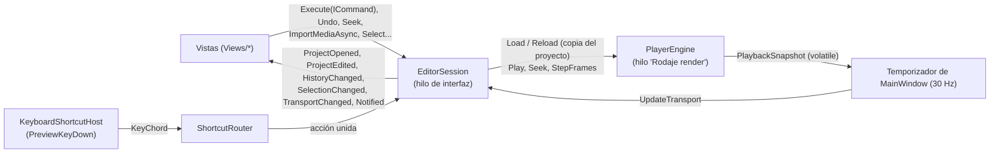

# App: el contrato de `Rodaje.App`

`Rodaje.App` es la interfaz del editor en WinUI 3 (fase 4): junta [Motor](motor.md) y [Render](render.md) en una ventana. Este documento es el contrato entre la sesión y las vistas, lo que hay que respetar para tocar o sumar una vista; qué hace cada una está en [Vistas](app-vistas.md). El diseño aprobado es la maqueta de [D-018](../decisiones.md). El visor Win32 de las fases 2 y 3 se retiró (D-022).

## Proyecto

Sin paquete MSIX, autocontenida y con Native AOT (el [sondeo](../archivo/sondeo-winui.md) lo confirmó). `herramientas\app.ps1` la publica en `dist\Rodaje\` con FFmpeg LGPL y la abre; la usan `Rodaje.bat` y `app.ps1 -Medir N`, que reproduce, mide y cierra. El Windows App SDK ocupa unos 57 MB junto al exe y sus términos están en [`LICENCIAS.md`](../../LICENCIAS.md).

`Rodaje.exe` es `net10.0-windows10.0.26100.0` para win-x64, con `WindowsPackageType=None`, Windows App SDK autocontenido y `PublishAot`. `EnableMsixTooling` se deja activo (sin él no hay `resources.pri`), y se usan los paquetes sueltos `WinUI`, `Foundation` e `InteractiveExperiences` en vez del metapaquete.

| Carpeta | Qué hay | Depende de WinUI |
|---|---|---|
| `Services/` | `EditorSession`, módulos de IA (`Modules/`: `ModuleManager`, `ModuleCatalog`, `VramBudget`, `ModuleProposal`), `TimelineState`, atajos (`Shortcuts/`), ajustes (`Settings/`), inspector y velocidad (`Inspector/`: `SpeedEditor`, `SpeedMath`, `SpeedCommands`, `TitleEditor`; los atajos de velocidad están en `EditorSession.Speed` y los de títulos en `EditorSession.Titles`), títulos (`Titles/`: `ClipLabels`, `TitleStyles`, `TitleDrag`, `StyleColors`), efectos y contenido (`Effects/`), miniaturas y formas de onda (`Media/`), complementos (`Packages/`), `IPlaybackEngine`, `IMediaProber`, `IEditorDialogs`, `EditorNotification` | **No**: `tests/Rodaje.App.Tests` compila estos archivos tal cual, así que usar WinUI aquí rompe las pruebas |
| `Views/Timeline/Logic/` | La lógica de la línea de tiempo (ventana, regla, filas, clic, ajuste, arrastres, soltar medios) | **No**: también la compilan las pruebas |
| `Views/Export/Logic/` | La lógica del diálogo de exportar y de su cola (`ExportDialogModel`, `ExportSettingsEditor`, `ExportJobList`, `IExportRunner`) | **No**: también la compilan las pruebas |
| `Shell/` | `MainWindow` (distribución, páginas modales y barra de avisos), `TitleBar`, `KeyboardShortcutHost`, `PaneSplitter`, `DialogGate` (un solo `ContentDialog` a la vez), `ShellDialogs` y `FileDialogs`, `EditorServices` e `IEditorView`, `MeasurementRun`, `MeasurementScenarios` | Sí |
| `Theme/` | `Palette.xaml` (colores de D-018 con el contraste de D-027 y claves de WinUI redefinidas), `Typography.xaml`, `Controls.xaml` (esquinas de 2 px y transiciones de 60 ms) | Sí |
| `Views/<Área>/` | Una vista por carpeta: `Library`, `Player`, `Meters`, `Inspector`, `Timeline`, `Shortcuts`, `Plugins`, `Export` | Sí |

## Cómo se habla con el editor



- **Una sola fuente de verdad.** `EditorSession` tiene el `Project`, la secuencia que se ve, el `UndoStack`, la selección, el transporte que publica el render, el archivo y si hay cambios. Solo se usa desde el hilo de la interfaz (`VerifyAccess`).
- **Solo comandos.** Las vistas leen el modelo pero lo cambian con `Execute`. Los gestos largos van entre `BeginGesture` y `EndGesture` para deshacerse en un paso, y `BreakMerge` corta la fusión al soltar un deslizador.
- **El render nunca lee el modelo que se edita.** Cada cambio llega a `PlayerEngine` como `Project.Clone()`; el hilo de render solo aplica la última copia pendiente (`TimelineSession.Reload`).
- **Rutas.** En memoria, las rutas de los medios son absolutas; al guardar se escriben relativas a la carpeta del `.rodaje` (`ProjectPaths`).
- **Importar.** `ImportMediaAsync` lee los archivos fuera del hilo de la interfaz y los agrega a la biblioteca en un paso; la secuencia vacía toma el formato del primer video. `AppendToTimeline` pone un medio al final de la pista principal con su audio enlazado. Los archivos de la línea de comandos se leen mientras se crea la ventana (`PrefetchingProber`).
- **Selección.** Clips (`SelectedClipIds`) o una transición (`SelectedTransitionId`), nunca las dos: elegir una vacía la otra, y `SelectionChanged` avisa de ambas. Supr borra lo seleccionado.
- **Contenido de paquetes.** `EffectContentFactory.CreateOrNull(packages)` (en `Shell/EditorServices.cs`) da el `IEffectContent` que reciben `EditorServices.Content` y el motor (`PlayerEngine.SetContent`). La implementación se conecta desde `Services/Effects` completando el método parcial `Create`; sin ella queda nulo y el motor sigue sin LUT y con las transiciones de paquete como fundido cruzado.
- **Avisos.** `Session.Notify(gravedad, título, mensaje, acción?)` emite un `EditorNotification`. La ventana lo muestra en una sola barra, por encima de las páginas modales, y lo anuncia al lector de pantalla. La `NotificationAction` opcional («Deshacer», «Abrir») pone un botón que cierra el aviso y la ejecuta. Los informativos se cierran solos a los 6 s, o a los 10 s si tienen botón.
- **Cerrar.** Con cambios sin guardar se pregunta (Guardar, No guardar, Cancelar).

## Atajos (`Services/Shortcuts`)

- **Catálogo.** `ShortcutRegistry` guarda las acciones (`EditorShortcuts.Catalog` más lo que registre cada vista), cada una con sus teclas de fábrica en tres estilos: Rodaje, Ágil y Clásico (`ShortcutPreset`). Si un estilo no da teclas, usa las de Rodaje.
- **Cambios de la persona.** Se guardan por estilo en `%LOCALAPPDATA%\Rodaje\atajos.json`, solo las diferencias con fábrica. Los nombres de estilo anteriores se leen y se reescriben con los nuevos (`ShortcutPresetNames.TryParse`).
- **Router.** `ShortcutRouter` une cada acción con quien la ejecuta (gana el último que puede) y decide qué hacer con cada tecla. Con el foco en un campo de texto solo pasan las acciones `WorksInTextInput`. `Suspend()` lo apaga mientras se captura una tecla.
- **Menús y botones.** Lanzan las acciones por su identificador (`Shortcuts.Invoke(id)`), así muestran la tecla vigente.
- **`ShortcutCustomizer`.** Asigna, quita y restablece teclas. Si una tecla choca, las intercambia y devuelve un `ShortcutChange` con su aviso y lo necesario para deshacerlo.
- **Teclas de signos.** Los archivos y el catálogo nombran las teclas VK_OEM_* por su posición estadounidense («Alt+[»). Para mostrarlas, `KeyNames.DisplayLayout` consulta la distribución activa (`MapVirtualKeyEx`): en un teclado español esa misma tecla se ve «Alt+'».

## Ajustes (`Services/Settings`)

`ajustes.json` guarda carpetas, recientes, tamaños de paneles (de fábrica, biblioteca 280 px y panel derecho 380 px; con la ventana estrecha ceden, primero la biblioteca, para que el reproductor conserve sus 320 px y nada se salga, y vuelven al ensancharla) y ventana, estilo de atajos, proxies, caída de los medidores, márgenes seguros, las preferencias de la línea de tiempo y lo de exportar (`AppSettings.Export`: últimos ajustes, preajuste, rendimiento, carpeta, «Avanzado» abierto y preajustes propios). `ajustes.json` y `atajos.json` se escriben de forma atómica; si están dañados, se apartan con el sufijo `.dañado` y se avisa. Un estilo de atajos desconocido vuelve a Rodaje sin dar el archivo por dañado.

## Miniaturas y formas de onda (`Services/Media`)

`IClipVisuals` es lo que la biblioteca y la línea de tiempo usan para dibujar medios. Las llamadas se hacen desde el hilo de la interfaz y nunca esperan: devuelven lo que ya está en memoria, piden lo que falta y, cuando llega, `Changed` avisa (también en el hilo de la interfaz) para que se vuelva a pedir.

```csharp
event EventHandler<ClipVisualsChangedEventArgs>? Changed;                 // MediaId, Kind (Thumbnails | Waveform)
Filmstrip GetFilmstrip(string mediaId, Time sourceStart, Time sourceEnd, int count, int height);
WaveformSlice GetWaveform(string mediaId, Time sourceStart, Time sourceEnd, int buckets);
BgraImage? GetThumbnail(string mediaId, Time sourceTime, int height);
BgraImage? GetNearestThumbnail(string mediaId, Time sourceTime, Time spacing, int height);   // la tira de la línea de tiempo
```

- **Miniaturas.** `ThumbnailDecoder` (en `Rodaje.Media`) decodifica en la CPU sin filtro de desbloqueo y saltándose los cuadros que nadie usa como referencia, y reduce con swscale a BGRA. Va en la CPU a propósito: no toca el presupuesto de VRAM de la reproducción ([D-021](../decisiones.md)) y una miniatura 1080p sale en unos 50 ms.
- **Rejilla.** Los instantes de una tira se ajustan a una rejilla de potencias de dos y los altos a unas pocas clases (32 a 256): al hacer zoom o desplazar casi todo ya está hecho.
- **Hilos.** Uno de baja prioridad para miniaturas, con hasta tres decodificadores que se cierran tras 20 s sin uso, y otro para formas de onda. La tanda de pedidos más reciente va primero.
- **Cachés.** En memoria, 128 MB; en disco, `cache\miniaturas` (512 MB) y `cache\ondas` (128 MB), con la huella del original en el nombre.
- **Formas de onda.** `WaveformPeaks` guarda mínimo y máximo por cada 256 muestras a 48 kHz y niveles reducidos de 4 en 4; mientras se calcula crece por el final y se puede leer a la vez.
- **Un solo contrato.** La biblioteca y la línea de tiempo usan `Services/Media/IClipVisuals`, que la ventana asigna a `TimelineView.ClipVisuals`. Las tiras se piden con `GetNearestThumbnail` (devuelve la más cercana en memoria mientras falta la exacta) y las formas de onda con `GetWaveform`, un tramo por punto dibujado. `Views/Shared/BgraBitmaps` convierte un `BgraImage` en `WriteableBitmap` una vez por imagen.

## Complementos (`Services/Packages`)

`PackageService` junta el catálogo que viaja en el ejecutable (`catalogo.json`), lo instalado y el instalador de [`Rodaje.Paquetes`](../formato-paquete.md); lee el disco fuera del hilo de la interfaz y avisa con `Changed`. `MissingContent.Attach` avisa («Faltan paquetes») al abrir un proyecto que referencia paquetes no instalados y cuando al abierto le faltan por desinstalar. `LibraryElements` decide qué muestra cada categoría de la biblioteca: lo que trae el motor (sacado del registro de efectos; el texto llega con los títulos), lo de los paquetes y lo propio.

- **Arrastrar una transición.** Lleva `rodaje/elemento` y además `rodaje/transicion` (`TransitionDrag.DragFormat`) con el mismo texto: el tipo de una transición propia (`rodaje.wipe`) o la referencia `paquete@versión/elemento` de una de paquete. Quien la suelta usa `TransitionDrag.TryParse(texto)` y `CreateCommand(secuencia, clipQueSale)`, que pone tipo y preajuste en un solo paso del historial.

## Efectos y contenido (`Services/Effects`)

- **`EffectContent`** implementa `IEffectContent` para el motor: `EffectContentFactory` (en `Services/Effects`, fuera de las pruebas) lo arma con `AppEffectContent.Create` y la ventana lo pasa a `EditorServices.Content` y a `PlayerEngine.SetContent`; el inspector le une la sesión (`AppEffectContent.AttachSession`) para la carpeta del proyecto y los avisos. `TryGetLut` es una búsqueda en un diccionario; si falta, la lee en un hilo del pool y avisa con `Changed`. Lo que no se pudo leer no se reintenta hasta `Invalidate` (al cambiar los paquetes). Las curvas de una transición de paquete se leen al armar el plan y quedan en memoria. `ContentRefresh` pasa el `Changed` (hilo del pool) al hilo de render: `Redraw` si solo terminó una LUT, `Rebuild` si cambiaron los paquetes y hay que rearmar el plan.
- **`IContentLoader`** lee el contenido por referencia; `InstalledContentLoader` lo hace sobre lo instalado y los lectores de `Rodaje.Paquetes`. Solo usa `PackageContentStore.ResolveLocalReferences` para las referencias locales de filtros y efectos; no hay otra tienda en medio. Al instalar o desinstalar, `AppEffectContent` engancha `packages.Changed` a `EffectContent.Invalidate()`.
- **LUT sueltas.** «Cargar .cube…» guarda `file:` más la ruta con `/`, relativa a la carpeta del `.rodaje` si se puede (`LutReference`).
- **`EffectCommands`** son ediciones de un solo paso que el núcleo no trae sueltas: modo de mezcla y LUT creando el efecto si falta, y aplicar filtros y efectos de paquete copiados con `options.source` (reaplicar el mismo los reemplaza; las curvas de un efecto se colocan al principio, al final o a lo largo del clip medidos en la línea de tiempo, se encogen si no caben y las posiciones se escalan a la secuencia; cada keyframe se guarda con el mapeo del clip, así que a 2× una entrada de 1 s sigue durando 1 s).
- **`ElementApplier`** aplica un elemento de la biblioteca al clip seleccionado; una transición va al corte donde termina el clip o, si no hay, al de su inicio; un estilo de texto, al título seleccionado o a uno nuevo en el cursor.
- **Estilos de texto.** `IContentLoader.LoadTextStyle` lee el `rodaje.textstyle` (lector en `Rodaje.Paquetes`, que no conoce el núcleo) y `TitleStyles.FromPreset` lo copia al modelo con `source` (D-029). El motor nunca lo busca.

## Módulos de IA (`Services/Modules`)

`ModuleManager` (en `EditorServices.Modules`) corre los módulos del [protocolo](../fase-7.md) como procesos aparte y nunca deja que editen: devuelven datos y la app los convierte en una `ModuleProposal`.

- **Descubrimiento.** `ModuleCatalog.DefaultRoots()`: `%LOCALAPPDATA%\Rodaje\complementos\modulos`, `modulos\` junto al exe y, si Rodaje corre desde el repositorio, `modules\` (el exe más reciente bajo `bin\`). Lee `module.vramMb` y `module.runtime`; se refresca al cambiar los paquetes.
- **Procesos.** Uno por módulo, abierto con la primera llamada y cerrado tras 2 min sin llamadas; todos en un Job Object «matar al cerrar»; tubería solo del usuario actual. Con una llamada en curso, `ping` cada 5 s; sin respuesta en 10 s se mata (`ModuleHungException`). Al cerrar la ventana se pide `shutdown` y se mata lo que no sale.
- **VRAM.** `VramBudget`: los módulos usan hasta 5/8 de la VRAM (la vista previa tiene 3/8), un pesado (≥1 GB) a la vez; para abrir uno que no entra se cierran los ociosos que estorban, o se espera. Mientras corre uno de GPU la vista previa baja a proxies y Mitad con el mismo `PreviewYield` de exportar.
- **Voz con modelo.** `ModuleVoiceDetector` implementa `IVoiceActivityDetector` con `detectar-voz` (Silero, modulo-audio-ia) y alimenta a la vez al detector de energía, que responde si el módulo falta o falla. «Reducir ruido» (`Views/Analysis`, lógica en `Logic/NoiseReduction.cs`) guarda el WAV limpio en `<proyecto>.medios\`.
- **Trabajos.** Cada `RunAsync` es una fila de `ModuleJobList` (Trabajos → IA) con etapa, avance, tiempo restante y cancelar. Un fallo se avisa con un texto sin trazas que termina en «El proyecto no cambió».

```csharp
// Una llamada simple:
ModuleResult r = await services.Modules!.InvokeAsync("modulo-subtitulos", "subtitulos", parametros, "Subtítulos de «Entrevista»");

// Varias llamadas como un trabajo, con audio o cuadros que decodifica el editor:
Segmentos s = await services.Modules!.RunAsync("modulo-subtitulos", "Subtítulos de «Entrevista»", async call =>
{
    SharedBufferRef audio = await ModuleMedia.WriteAudioAsync(call, media.Path, clip.SourceIn, clip.SourceOut, 16_000, 1, 0, 0.1);
    ModuleResult res = await call.InvokeAsync("subtitulos", parametros, [audio], progressFrom: 0.1, progressTo: 1);
    return Leer(res.Value);                       // call.Map(búfer) para leer lo que el módulo escribió
}, cancellationToken);

// Cuadros: una región por lote; ModuleMedia.WriteFrame(decodificador, región, desplazamiento, tiempo, ladoMayor).

// El resultado nunca edita solo: se muestra y se aplica en un paso del historial.
services.Proposals!.Show(new ModuleProposal("Subtítulos automáticos", sesion.SequenceId,
    [.. s.Select(x => new PreviewMark(PreviewMarkKind.Clip, x.Start, x.End, x.Text))],
    project => [.. ComandosDeTitulos(project, s)]));   // se construye contra el proyecto al aplicar
services.Proposals.Apply();                            // un solo Ctrl+Z lo deshace
```

Los tiempos del módulo (segundos del búfer entregado) se llevan a la secuencia con `ModuleTime.ToSequence(clip, inicioDelBúfer, segundos, fps)`, que respeta velocidad y reversa y ajusta al cuadro.

## Cómo se suma una vista

1. Un `UserControl` en `Views/<Área>/` que implementa `IEditorView`; `MainWindow` (o el anfitrión, como `InspectorView`) lo crea desde XAML y llama a `Attach(EditorServices)` una vez. `EditorServices` trae `Session`, `Shortcuts` (con su `ShortcutRegistry`), `Settings`, `Player`, `Shell`, `Visuals`, `Packages`, `Content` (LUT y transiciones de paquete para el motor) y `Exports` (la cola de exportaciones), más `SetPreviewQuality`.
2. En `Attach` se suscribe a los eventos de `services.Session`, registra sus acciones con `services.ShortcutRegistry.Register(new ShortcutAction(...))` y las une con `services.Shortcuts.Bind(id, ejecutar, puedeEjecutar)`. Los botones llaman a `services.Shortcuts.Invoke(id)`.
3. Avisa con `services.Session.Notify`, nunca con un `InfoBar` propio.
4. Solo `x:Bind` (con `Bindings.Update()` al final de `Attach`) y colores del tema (`StaticResource`), nunca sueltos.
