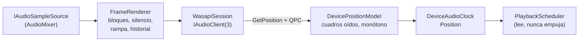
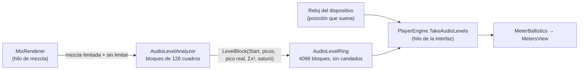

# Audio: `Rodaje.Audio`

Salida de audio WASAPI en modo compartido, por eventos, que además da el reloj maestro de la reproducción. Es `net10.0-windows`, `IsAotCompatible`, y todo su COM es interop generado en compilación (`[GeneratedComInterface]`, `[LibraryImport]`), sin reflexión. Depende de [Reproducción](reproduccion.md) y la usa el [Motor](motor.md). El mezclador de pistas no vive aquí: es `AudioMixer` del motor, que implementa la fuente de muestras.

## Contratos (`AudioTypes.cs`, `AudioOutput.cs`)

- **`IAudioSampleSource.Read(Span<float>)`** entrega float32 estéreo intercalado a la frecuencia de salida y devuelve cuántos cuadros escribió. Se llama siempre desde el hilo de audio y no debe bloquear: lo que falte se rellena con silencio. `Seek(Time)` avisa de un salto.
- **`IAudioOutput`** ofrece:
  - `Clock`: el transporte se maneja con `Start`, `Pause` y `Seek` del reloj;
  - `HasDevice` y `FallbackReason`;
  - `Device`;
  - `Volume`, con rampa;
  - `Stats`: cuadros, underruns, errores de la fuente, reinicios del dispositivo y tiempos de espera de control;
  - el evento `DeviceChanged`, que llega por el ThreadPool, nunca desde el hilo de audio.
- **`AudioOutputOptions`** trae estos valores por omisión: 48 kHz, búfer de 20 ms, baja latencia preferida (periodo de 5 ms), `ExtraLatency` para Bluetooth y volumen.
- **`AudioOutput.Open(source, options)`** es la fábrica. Intenta [`WasapiOutput`](../../src/Rodaje.Audio/WasapiOutput.cs) y, si no hay dispositivo usable (`AudioDeviceUnavailableException`), devuelve una salida muda con `SystemClock` y el motivo en `FallbackReason`. Así un equipo sin audio reproduce video igual. Los demás errores no se tapan.

## Cómo funciona `WasapiOutput`

- **Un solo hilo de audio** ("Rodaje audio", prioridad alta, COM MTA, MMCSS "Pro Audio"). Todo el COM vive ahí. El hilo espera el evento del dispositivo o una orden y luego aplica controles, atiende avisos de Windows y llena el búfer.
- **Control sin candados compartidos.** `Start`, `Pause` y `Flush` del reloj llegan como órdenes numeradas que el hilo aplica y confirma (con un tope de 2 s, contado en `ControlTimeouts`). El hilo de alta prioridad nunca espera un candado del llamador.
- **Llenado.** `GetCurrentPadding`, `GetBuffer`, `FrameRenderer.Render` y `ReleaseBuffer`. [`FrameRenderer`](../../src/Rodaje.Audio/FrameRenderer.cs) lee en bloques de 1024 cuadros. Si la fuente se queda corta rellena con silencio (cuenta underruns), y si lanza da silencio sin tumbar el hilo. También aplica una rampa de volumen de unos 10 ms, adapta estéreo a mono o a más canales y guarda unos 0,5 s de historial.
- **Baja latencia.** Si la frecuencia del mezclador coincide y existe `IAudioClient3`, [`WasapiSession`](../../src/Rodaje.Audio/Interop/WasapiSession.cs) usa `InitializeSharedAudioStream` con el periodo mínimo. Si no, usa `Initialize` compartido con conversión automática cuando hace falta remuestrear. Los HRESULT se traducen a mensajes en español: Audiosrv detenido (pasa en AtlasOS), modo exclusivo, dispositivo desconectado...

## El reloj maestro

[`DeviceAudioClock`](../../src/Rodaje.Audio/DeviceAudioClock.cs) es un `SampleCountingClock`. Su posición es el destino del último seek más los cuadros **oídos**, que da [`DevicePositionModel`](../../src/Rodaje.Audio/DevicePositionModel.cs):

- Toma cada lectura de `IAudioClock::GetPosition` con su marca QPC e interpola con el reloj de pared entre lecturas. El resultado es suave y monótono.
- La interpolación tiene dos topes: lo ya escrito y un máximo de extrapolación (búfer + periodo + 5 ms), por si el dispositivo se atasca.
- Una lectura que retrocede sostiene el valor, y tras `Start` ignora la posición repetida hasta que el dispositivo se mueve de verdad.
- Descuenta `ExtraLatency`.

Un seek (`DoFlush`) detiene y vacía el cliente, avisa a la fuente y abre un segmento nuevo con discontinuidad.

## Pérdida o cambio de dispositivo

Un `IMMNotificationClient` marca el aviso y despierta el hilo, y cualquier HRESULT de error al renderizar lleva a `Reopen`:

1. Cierra la sesión, suma `DeviceRestarts` y pasa a **modo libre**: el reloj sigue con el reloj de pared, sin parar ni saltar, y la fuente se consume a ese ritmo.
2. Intenta abrir el dispositivo predeterminado (como mucho 3 reaperturas anidadas) y, sin dispositivo, reintenta cada segundo o con cada aviso de Windows.
3. Al volver, repite desde el historial lo que estaba en cola sin oírse y continúa el segmento sin discontinuidad.
4. Avisa con `DeviceChanged`. Un cambio del dispositivo predeterminado también reabre.

`Dispose` detiene el hilo con 4 s de tope; si el controlador lo dejó colgado, no cierra los handles a propósito.

## Volumen y fundidos

El volumen lo aplica `MixRenderer` del motor, antes del limitador y de los medidores, con el `GainPlan` de cada clip:

- **Ganancia en dB:** la del `rodaje.audio` del clip (keyframes en tiempo del origen). La de la pista va en su fader, después de sus inserciones (ver [Mezclador](#mezclador-e-inserciones)). −60 dB o menos es silencio.
- **Bloques de 64 muestras** alineados a la línea de tiempo: la ganancia se evalúa en los bordes y se interpola en línea recta; los fundidos de potencia constante (sin(πt/2) al entrar, cos(πt/2) al salir) van exactos por muestra.
- **Transiciones de audio:** los dos clips suenan a la vez, el que sale alargado media duración y el que entra adelantado otra media, con fundidos complementarios; una transición reemplaza el fundido propio de ese lado. Lo que no existe antes del principio del medio es silencio.
- **Cambios sin saltos.** Tras una edición la mezcla se rehace desde 30 ms por delante de lo que ya se leyó; cada clip que sonaba parte de la ganancia que tenía y llega a la nueva a 4 dB por bloque (60 dB en 20 ms).
- **Medido** (`AudioGainTests`): −6 dB = 0,5012; error de los fundidos 3·10⁻⁸; un cruce de ruido rosa conserva la potencia dentro de 0,33 dB (ventanas de 0,5 s); el mayor salto entre muestras al cambiar el volumen es 0,079 dB; el cambio se oye a los 50,7 ms de pedirlo, más el búfer del dispositivo.

## Velocidad (`Timeline/Retime/`)

Un clip con velocidad llega a la mezcla con `AudioClipPlan.Retime` (`AudioRetime`: su `ClipTimeMap` y si mantiene el tono); a 1× sin reversa ni congelado es nulo y el clip va por el camino rápido de siempre. `MixRenderer` lo lee con [`RetimedReader`](../../src/Rodaje.Engine/Timeline/Retime/RetimedReader.cs), que vive en el lector del medio mientras muestre el mismo origen en cada instante (`ClipTimeMap.SameCourse`, y el mismo paso de WSOLA): una edición en otra parte o dividir el clip, con velocidad constante o con curva, no cambian ni una muestra. Al pasar a otro trozo, `Adopt` cambia el recorrido sin rehacer la cadena. Los trozos seguidos de un clip dividido, sin transición entre medias, comparten en el plan el mapeo de todos juntos (`AudioRetime.Joined`, con `ClipTimeMap.Join`): la lectura adelantada sigue la curva y no la velocidad del borde de cada trozo. Todo el código es propio (nada de rubberband ni GPL).

- **Posición atada al mapeo.** [`SampleMap`](../../src/Rodaje.Engine/Timeline/Retime/SampleMap.cs) da el origen de cada muestra con `ClipTimeMap.ExtendedSource`, exacto cada 64 muestras e interpolado entre ellas: la deriva es 0 por construcción y una curva no necesita nada aparte.
- **Mantener tono: WSOLA** ([`Wsola`](../../src/Rodaje.Engine/Timeline/Retime/Wsola.cs)). Trozos de 1024 muestras (2048 por encima de 4×) con Hann, solapados a la mitad; el trozo `k` sale en `k · 512` de la línea de tiempo y su centro se busca a ±256 muestras de `map(k · 512 + 512)`. Búsqueda gruesa sobre la mezcla mono diezmada ×4 con `Vector<float>`, afinada a la muestra y con el pico interpolado (parábola): el trozo se lee en esa posición con fracción con un sinc de 32 coeficientes. Sin la fracción cada empalme de un tono redondea la fase hacia el mismo lado y el tono se desafina (439,6 Hz en lugar de 440 a 2×). El fundido conserva la potencia según la correlación de los dos trozos. **Ataques tras silencio:** si el trozo anterior acaba en silencio (por debajo de −60 dBFS) no hay nada que continuar, así que el trozo se coloca para que el primer sonido a su alcance suene justo donde manda el mapeo, entra sin fundido y los trozos siguientes lo continúan tal cual durante 25 ms; si el ataque toca a un trozo posterior, este termina antes. Tras un salto la cadena arranca 250 ms antes y recuerda sus últimos 128 trozos, así que volver a mezclar lo recién oído repite exactamente lo mismo. Por encima de 8× sigue sonando, granuloso, y el inspector lo avisa.
- **Sin mantener tono: cinta** ([`VarispeedResampler`](../../src/Rodaje.Engine/Timeline/Retime/VarispeedResampler.cs)). Sinc enventanado con Kaiser (β 8,6), 32 coeficientes y 256 fases, sin estado. Por encima de 1× el corte baja con la velocidad y el filtro se estira hasta ×4; las tablas se calculan una vez por velocidad (1/16 de octava) y se comparten.
- **Lectura del medio** ([`SourceWindow`](../../src/Rodaje.Engine/Timeline/Retime/SourceWindow.cs)): planos L/R; decodifica seguido mientras el salto sea menor de 250 ms y busca si es mayor; solo mueve memoria cuando se llena.
- **Ganancia y congelado.** Los keyframes de volumen del clip se evalúan en el origen del mapeo (van con el material); un congelado es silencio. `AudioPlan.SoundsLike` compara también la velocidad y «mantener tono».
- **Reversa.** `SampleMap` da la posición en el sentido de reproducción y `SourceWindow` lee hacia atrás por bloques de 0,5 s. Medido con un AAC decodificado por FFmpeg ([`AudioReverseMediaTests`](../../tests/Rodaje.Engine.Tests/Timeline/AudioReverseMediaTests.cs)): a 1× la salida es la decodificación seguida leída al revés muestra a muestra (error máximo 3,7·10⁻⁶, igual en el último segundo: deriva 0); manteniendo el tono a 0,5× y 2× el tono queda en 440,000 ± 0,001 Hz, y como cinta se mueve con la velocidad (220 y 660 Hz); el mayor salto entre muestras es 1,004–1,007 veces el del seno ideal, sin chasquidos en las uniones de bloque.

Medido (`AudioRetimeTests`, 11-oct; el tiempo en Release, CPU del hilo con la máquina cargada):

| Criterio | Pedido | Medido |
|---|---|---|
| Tono de 440 Hz a 0,5×, 0,75×, 1,5×, 2× y 4× | ± 0,5 Hz | 440,000 Hz en todos |
| THD+N de 997 Hz, 0,5×–2× | ≤ −35 dB | −75,5 a −82,0 dB (`atempo`: −29,1 a −38,5 dB) |
| Cinta: 1 kHz a 2× | 2 kHz ± 1 Hz, espurias ≤ −60 dB | 2000,000 Hz, −147 dB (0,5×: −87,8; 1,5×: −92,8) |
| Cinta: 18 kHz a 2× (se plegaría a 12 kHz) | — | −89,7 dB |
| Ruido rosa a 0,5×, 1,5× y 2× | RMS ± 0,5 dB | +0,28, +0,01 y −0,09 dB |
| Chasquidos (seno de 440 Hz, 0,5×–8×, curva 1×→3×→0,5×) | salto ≤ 1,1× el ideal | 1,000–1,001× |
| Tren de clics a 1,5× durante 60 s | número y posición ± 5 ms | 900 de 900, error máximo 0,00 ms, sin deriva |
| Chirp de cada segundo (`AudioCode`), 8 fases | error medio ≤ 1 ms | 0,25×: +0,31; 0,5×: +0,10; 0,75×: +0,04; 1,5×: −0,04 ms (cinta: 0) |
| Tras un seek (voz sintética con pausas) | correlación ≥ 0,999 pasados 250 ms | 1,00000 (también en el mismo instante del salto) |
| Dividir un clip a 1,5× | — | idéntico muestra a muestra |
| Dividir en tres un clip con «Montaje», «Bala» (con tono) o «Entrada rápida» (sin tono) | — | idéntico muestra a muestra |
| Bloque de 1024 cuadros estéreo | ≤ 0,15 ms | 0,036–0,10 ms (WSOLA 0,06–0,10; cinta 0,04–0,09) |
| Cambio de velocidad reproduciendo (1× → 2×), hasta que se oye | ≤ 60 ms | 30,0 ms de la mezcla + 20 del búfer = 50 ms, con y sin mantener tono: es el margen de 30 ms que la mezcla conserva tras cada edición |

Con un tono puro sostenido, un seek en frío puede dejar la salida con otra fase que la reproducción continua (WSOLA encadena cada trozo con el anterior); no se oye y se corrige sola en la primera pausa (tras silencio el trozo no depende de los anteriores).

## Medidores de nivel (`Metering/`)

La mezcla se calcula hasta 500 ms por delante de lo que suena, así que medirla al producirse daría los picos medio segundo antes de oírlos. Por eso cada bloque medido lleva la muestra de la línea de tiempo donde empieza, y quien dibuja pide los niveles de la posición que da el reloj del dispositivo.

- **`AudioLevelAnalyzer`** mide por bloques de 128 cuadros (2,7 ms): pico por canal, suma de cuadrados para el RMS, pico real con [`TruePeakDetector`](../../src/Rodaje.Audio/Metering/TruePeakDetector.cs) (sobremuestreo ×4 con sinc enventanado de 16 coeficientes por fase, 48 multiplicaciones por muestra) y si la suma pasó de 0 dBFS antes del limitador suave. Un salto de posición (seek o una edición que se vuelve a mezclar) cierra el bloque y reinicia el pico real.
- **`AudioLevelRing`** tiene un escritor (el hilo de la mezcla) y lectores en cualquier hilo, sin candados ni reservas: cada entrada lleva un número de secuencia que el escritor invalida antes de escribirla y publica después, y el lector descarta lo que cambió mientras lo copiaba. Como tras una edición o un seek la mezcla vuelve a escribir posiciones, el lector recorre de lo más nuevo a lo más viejo y de cada bloque toma solo lo que no tapan los más nuevos.
- **`TimelineSession.MeasureAudio(desde, hasta, ventanaRms)`** da los picos de `(desde, hasta]` y el RMS de la ventana; se puede llamar desde cualquier hilo. `PlayerEngine` publica en cada vuelta del render la posición del reloj con su marca de tiempo, y la interfaz la extrapola al instante en que dibuja.
- **`MeterBallistics`** (subida instantánea, caída configurable de 20 dB/s, pico retenido 1,5 s, saturación que queda encendida) y **`MeterScale`** (deflexión IEC 60268-18) son lógica pura para la vista.

Con un dispositivo simulado (búfer de 20 ms) y los chirps de `AudioCode`, el pico aparece entre 1,4 ms antes (un bloque) y 0,6 ms después de que la señal pasa el umbral en la posición del reloj, también con un AAC real; la mezcla iba unos 300 ms por delante (`AudioLevelSyncTests`).

## Sonoridad y «Normalizar» (EBU R128)

- **Cuentas comunes** ([`Metering/Loudness.cs`](../../src/Rodaje.Audio/Metering/Loudness.cs)): `KWeightingFilter` (BS.1770-4 a 48 kHz), `Loudness.Gated` (puertas de −70 LUFS y relativa) y `LoudnessIntegrator`. Las usan el medidor de la exportación (`LoudnessMeter`) y los medidores en vivo.
- **En vivo.** `AudioLevelAnalyzer` suma también la potencia ponderada K de cada bloque (`LevelBlock.Weighted`); `AudioLevelRing.WeightedPower` y `TimelineSession.MeasureLoudnessPower` dan la momentánea (400 ms) y la corta (3 s) de lo que suena. `MetersView` muestra la corta y la integrada desde el último clic (un bloque de 400 ms cada 100 ms mientras suena) y en la ayuda la momentánea, la integrada y la ganancia maestra; el pico real ya estaba.
- **Por clip.** «Normalizar» en la sección Audio del inspector (−14, −16, −23 LUFS u otro): `OfflineAudio.MeasureClip` mide el clip solo (su volumen y su velocidad; sin pista, fundidos, transiciones, ganancia maestra ni limitador) y `Edits.ShiftGain` sube o baja su `gainDb` (valor y keyframes, así la envolvente conserva su forma) en un paso, para todos los clips de audio seleccionados.
- **Mezcla.** Menú contextual de los medidores: mide la secuencia con `OfflineAudio.MeasureLoudness` y fija `Sequence.MasterGainDb` (−60 a +24 dB, sin pasar de −1 dBTP) con `Edits.SetMasterGain`. `MixRenderer` la aplica antes del limitador y de los medidores; un cambio llega con la misma rampa que el volumen de los clips (4 dB cada 64 muestras) y tras un seek ya está aplicada, igual que en la exportación.
- **Medido** (`AudioLoudnessTests`, señales de EBU Tech 3341): casos 1–5 integrados a −22,993/−32,993/−23,014/−23,014/−22,979 LUFS (tolerancia ±0,1), iguales fuera de línea y en vivo; momentánea y corta del caso 1, −22,99. Pico verdadero de fs/4 a −6 dBFS con fase 0/45/60/67,5°: −6,021/−5,908/−6,072/−5,997 dBTP (pedido −6,4 a −5,8). Un clip a −20 dBFS con +3 dB mide −16,993 y normalizado a −14 da −14,000; la mezcla a −26 normalizada a −16 da −16,003, y al quitar la maestra el mayor salto entre muestras es 0,983 veces el del seno.

## Ecualizador y compresor (`Processing/`)

- **Efectos** `rodaje.equalizer` (código 20: corte de graves de 12 dB/oct, estante de graves, campanas de medios y presencia, estante de agudos; sin keyframes) y `rodaje.compressor` (21; umbral, relación y mezcla con keyframes). Van en clips, en pistas de audio y en la mezcla (`Sequence.MasterEffects`, después de la ganancia maestra y antes del limitador suave). Un efecto de audio no pasa por la composición: admite hasta 32 parámetros (`EffectDefinition.MaxAudioParameters`). Los interruptores del compresor valen 0 o 1; la pista del sidechain va en la opción `sidechain`.
- **DSP propio** ([`Biquad`](../../src/Rodaje.Audio/Processing/Biquad.cs), fórmulas del «Audio EQ Cookbook» en forma directa transpuesta II con estado `double`; [`AudioEffectChain`](../../src/Rodaje.Audio/Processing/AudioEffectChain.cs): ecualizador y luego compresor; [`CompressorSettings`](../../src/Rodaje.Audio/Processing/CompressorSettings.cs); [`TruePeakLimiter`](../../src/Rodaje.Audio/Processing/TruePeakLimiter.cs)). El compresor, en este orden:
  - **Detector:** pico o RMS (media exponencial de los cuadrados con su ventana), sobre el propio audio o una **llave externa**, con un **pasa altos** opcional; estéreo **enlazado** (el canal más fuerte) o por canal.
  - **Curva:** rodilla suave de Giannoulis, Massberg y Reiss (JAES 2012), relación hasta ∞:1 (100 en el parámetro); **compensación automática** = la mitad de la reducción a 0 dBFS.
  - **Tiempos:** ataque y relajación en dB; la **relajación automática** suma una envolvente lenta (ataque 250 ms, relajación ×5) que sigue a lo que pide la curva: tras un golpe corto no se carga y suelta rápido; tras una compresión sostenida sostiene la reducción.
  - **Anticipación** de 0 a 10 ms: el audio sale retrasado eso y el detector ve el golpe antes.
  - **Multibanda:** tres bandas con cruces Linkwitz-Riley de 4.º orden (dos Butterworth en cascada; la banda grave pasa además por el pasa todo del segundo cruce, así la suma es un pasa todo: plana). Cada banda se comprime aparte (umbral general más su desplazamiento, su ganancia); con llave externa todas la escuchan.
  - **Mezcla en paralelo** y, al final, el **limitador de pico verdadero**: para cada muestra la ganancia que deja en el techo los dos tramos entre muestras que la tocan (sobremuestreo ×4 con el filtro del medidor, solo cuando hay algo cerca del techo), el mínimo de las últimas 49 y una media móvil de la misma longitud; 1 ms de anticipación más los 8 del filtro, recuperación de 60 ms y 0,05 dB de margen.
- **Estado.** Todo lo que decide la salida está en `AudioEffectChain.State`, cuyo tamaño depende de la forma (bandas, anticipación, limitador); `Configure` cambia coeficientes sin tocarlo y solo lo rehace si cambia la forma. `Bypass` (A/B) y `ListenSidechain` no lo tocan: salen de una línea aparte con el mismo retraso, así que la escucha se cambia sin saltos y no afecta a lo que se exporta.
- **En la mezcla** (`MixRenderer.RunChain`). La cadena de un clip, una pista, un compuesto o la mezcla pide su entrada **adelantada su retraso** (`AudioEffectChain.Latency`): su salida cae exactamente en su sitio de la línea de tiempo. Si la cadena no sigue a lo último que procesó (un seek), empieza de cero y se **ceba** con ese tramo. Un clip lee su medio más allá de su final si hace falta (y donde no hay, silencio). Las **pistas sidechain** de un mismo nivel se mezclan primero y por delante (`AudioTrackPlan.KeyAhead`, la mayor anticipación de quien las escucha) en un búfer propio que se guarda y restaura como las cadenas; una pista que es llave no admite a su vez sidechain y la mezcla no admite llave externa. Los **keyframes** van por bloques de 64 muestras alineados a la línea de tiempo: umbral y relación fijos en cada uno y la mezcla en línea recta, en el tiempo del origen en un clip y de la secuencia en una pista o la mezcla; el resultado no depende de cómo se parta la lectura. `MixRenderer` guarda el estado de cada cadena al empezar cada lectura (64 lecturas); tras una edición `BufferedAudioSource.Rewind(alignToChunk)` vuelve a un borde de lectura y la cadena retoma el estado que tenía ahí.
- **Medidor y escucha.** `TimelineSession.MonitorDynamics(DynamicsMonitor)` elige el compresor que se mira (clave del clip, `pista:` o `mezcla:`) y si suena su sidechain o sin comprimir; un cambio de escucha rebobina la mezcla 30 ms para oírse enseguida. La cadena que se mira publica cada 256 muestras su entrada, salida y reducción en un `DynamicsMeterRing` (mismo protocolo sin candados que `AudioLevelRing`) con la posición en que suena; `PlayerEngine.TakeDynamics` lo lee en la posición del reloj y la pestaña **Dinámica** (`DynamicsPanel`, `DynamicsEditor`) lo dibuja a 30 Hz.
- **Medido** (`AudioEffectChainTests`, `CompressorTests`, `AudioEffectsMixTests`, `CompressorMixTests`, 12-oct):

| Criterio | Pedido | Medido |
|---|---|---|
| Curva estática (−20 dB 4:1 rodilla 6; −10 ∞:1 sin y con rodilla; −30 2:1 rodilla 12 en RMS), de −60 a 0 dBFS | contra la teoría | error 0,00000 dB en las cuatro |
| Ataque 10 ms / relajación 100 ms (−20 dB, 4:1, escalón de 7,5 dB) | 63 % y 37 % | 4,747 dB (4,741) y 2,759 dB (2,759) |
| Relajación automática: hasta bajar de 1 dB | rápida tras un golpe, lenta tras compresión larga | 120,9 ms tras 30 ms de golpe, 604,3 ms tras 3 s (sin automática: 120,9) |
| Anticipación 5 ms, ∞:1 en −20 dB, escalón de −40 a −6 dBFS | retraso exacto, sin sobrepasar | retraso de 240 muestras exacto; sobrepasa 0,09 dB (sin anticipación 13,71) |
| Anticipación y limitador en clip, pista, mezcla y los tres | compensados en la línea de tiempo | clics en las muestras 36 000 y 84 000 exactas, valor 0,5 exacto |
| Pasa altos del detector a 200 Hz, seno de 50 Hz a −6 dBFS | los graves no disparan | reducción 0,00 dB (sin filtro 10,10) |
| Llave externa de −6 dBFS, −30 dB 10:1 | según la curva | la música baja 21,58 dB (curva 21,58); con la llave en silencio, 0,000 |
| Sidechain en la mezcla: voz de 1 kHz a −6 dBFS sobre música continua | ducking real | −21,07 dB durante la voz; al empezar la palabra −20,73 dB con 10 ms de anticipación (0,00 sin ella); el medidor marca 21,09 dB |
| Suma de las tres bandas (200 y 3000 Hz), 31 frecuencias de 20 Hz a 20 kHz | ±0,05 dB | error máximo 0,0304 dB |
| Limitador, techo −1 dBTP: fs/4 a 45° (+6 y 0 dBTP), cuadrada a 0 dBFS, ruido a +6, impulsos, barrido a +3 | no pasar de −1 dBTP | −1,042 dBTP lo peor; por debajo del techo sale tal cual (retraso exacto) |
| Keyframes: umbral 0 → −40 dB en el clip y mezcla 100 → 0 % en la pista | según los keyframes | error ≤ 0,00002 a 1, 2 y 3 s |
| A/B y escucha del sidechain | alineados | error 3·10⁻⁸ y 0 |
| Vista previa (mezcla adelantada, lecturas de 17 a 2048 cuadros, dos recargas) frente al WAV exportado, 3 s con sidechain, anticipación, multibanda, limitador y keyframes en clip, pista y mezcla | igual muestra a muestra | 0 muestras distintas de 288 000 |
| Bloque de 1024 cuadros (Release, el mejor de 5 tandas) | sin reservas | una banda 0,054 ms; con anticipación de 10 ms y limitador 0,097; multibanda completo (RMS, automáticos, llave filtrada, mezcla) 0,41 y con limitador 0,47; más el ecualizador de 5 bandas 0,51 ms; 0 bytes reservados |
## Mezclador e inserciones

- **Cadena de inserciones** ([`AudioEffectChain`](../../src/Rodaje.Audio/Processing/AudioEffectChain.cs)): las inserciones de un clip, pista, bus o la mezcla en el **orden de la pila**, cada una una etapa (`IAudioStage`) con su estado guardable. El ecualizador y el compresor son dos etapas más ([`EqualizerCompressorStage`](../../src/Rodaje.Audio/Processing/EqualizerCompressorStage.cs), el código de antes). La latencia de la cadena es la suma de las etapas; el sidechain lo escucha el primer compresor, retrasado lo que retrasan las etapas de antes. Al reordenar, cada etapa que sigue conserva su estado (la cola de una reverb no se corta). `BypassedInserts` es el A/B por inserción: la etapa sigue procesando una copia y sale la entrada con su retraso. Las líneas largas (reverb, delay, tono) no se copian en cada lectura: se indexan por la cuenta de muestras ([`SampleRing`](../../src/Rodaje.Audio/Processing/SampleRing.cs)) y guardan 1,37 s más que su retardo, lo que la mezcla puede volver atrás.
- **Efectos** (todo propio): puerta/expansor ([`Gate`](../../src/Rodaje.Audio/Processing/Gate.cs): detector de picos con caída de 10 ms, histéresis, retención, ganancia en dB suavizada); de-esser ([`DeEsser`](../../src/Rodaje.Audio/Processing/DeEsser.cs): detector con pasa altos de 4.º orden, 6:1, banda alta `x − pasa bajos(x)` que suma exacta); reverb ([`Reverb`](../../src/Rodaje.Audio/Processing/Reverb.cs): predelay, 4 pasa todo de difusión y FDN de 8 líneas con Householder, `g = 10^(−3L/(RT60·fs))`, amortiguación en el lazo, ancho M/S); delay ([`Delay`](../../src/Rodaje.Audio/Processing/Delay.cs): ms o figura al tempo, filtros en el lazo, ping-pong); saturación ([`Saturation`](../../src/Rodaje.Audio/Processing/Saturation.cs): tanh con sesgo, ADAA de primer orden y un FIR de 3 coeficientes que compensa su caída de agudos); gráfico de 10 bandas ([`GraphicEqualizer`](../../src/Rodaje.Audio/Processing/GraphicEqualizer.cs), campanas de Q √2); tono ([`PitchShift`](../../src/Rodaje.Audio/Processing/PitchShift.cs): el esquema WSOLA de «Mantener tono» sobre la entrada en vivo, trozos de 1024 con Hann, búsqueda de ±256 gruesa ×4 y afinada con la fracción del pico, lectura con sinc Kaiser de 32 coeficientes cuyo corte baja al subir el tono; 1824 muestras de retraso); limitador ([`Limiter`](../../src/Rodaje.Audio/Processing/Limiter.cs), el `TruePeakLimiter` como inserción).
- **Fader** (`MixRenderer.ApplyFader`): volumen, paneo y balance de `rodaje.audio` después de las inserciones, por bloques de 64 muestras alineados a la línea de tiempo (la matriz de paneo de [`PanLaw`](../../src/Rodaje.Audio/Processing/PanLaw.cs) también se interpola). Tras una edición parte de lo que sonaba: el volumen a 4 dB por bloque y el paneo y el balance a 1/16 del recorrido. El paneo de un clip va con su volumen.
- **Buses y envíos** (`AudioPlan.Buses`, `AudioTrackPlan.Output`/`Sends`/`Direct`, armados en `TimelinePlan.Route` con los silencios y los solos). Las pistas de la secuencia principal se mezclan **por delante** en un búfer propio (`AheadTrack`, el mismo mecanismo que las llaves de sidechain) con lo que sale de su fader y, si tienen envíos pre-fader, lo de antes. Cada bus lee de ahí su tramo adelantado su retraso (`FillBus`), así un bus con limitador o tono queda en la misma muestra que lo que va directo. Después del bus, su fader y a la mezcla. Los buses de un compuesto no se usan.
- **Medidores por tira** (`MixRenderer.StripLevels`, solo en la vista previa): un `AudioLevelRing` por pista y bus con bloques de 256 cuadros de lo que sale de su fader; `TimelineSession.MeasureStrip` y `PlayerEngine.MeasureStrip` leen el tramo que suena según el reloj.
- **Sin reservas por lectura:** la mezcla entera (decodificadores, cadenas, buses, envíos, medidores) no reserva memoria en una lectura normal; solo al adoptar un plan nuevo.
- **Medido** (`InsertEffectsTests`, `MixerTests`, 12-oct; tiempos en Release):

| Criterio | Pedido | Medido |
|---|---|---|
| Ley de paneo (mono), 21 posiciones | √2·cos θ, √2·sin θ | error 6·10⁻⁸; centro 0,000 dB, a fondo +3,010 dB; en la mezcla, paneo −50: 0,326641 (teoría 0,326641) |
| Puerta: curva estática del expansor 1:2, de −80 a −10 dBFS | contra la teoría | error 0,0009 dB |
| Puerta: ataque 5 ms y cierre (retención 50 ms, relajación 100 ms) | 63 %; 77,74 ms hasta −1 dB | −29,31 dB (teoría −29,43); 77,71 ms |
| De-esser 6 kHz, −30 dB, 10 dB: voz de 300 Hz y eses de 7 kHz | la voz igual, las eses abajo | 300 Hz −0,004 dB; 7 kHz −7,09 dB; sin eses sale la entrada bit a bit |
| Limitador −1 dBTP con +12 dB sobre un seno de −6 dBFS | no pasar del techo | pico −1,050 dBFS; por debajo sale igual con su retraso exacto |
| Gráfico de 10 bandas: +6 dB en 1 kHz; curva de 10 bandas en 30 frecuencias | contra la función de transferencia | 6,000 dB; error 0,0000 dB |
| Saturación (+24 dB) | transparente a poco nivel, poco plegado | −0,007 dB a −60 dBFS; plegado bajo 7 kHz de un seno de 7919 Hz −43,1 dB (tanh directa −22,1) |
| Delay 250 ms al 50 %; 120 BPM | repeticiones exactas | 1; 0,5; 0,25 en las muestras 12 000, 24 000 y 36 000; negra 24 000, corchea con puntillo 18 000; ping-pong L, R, L |
| Reverb: RT60 1 s y 2,5 s (Schroeder, T30) | ±8 % | 0,993 s y 2,501 s; correlación L/R de la cola 0,026 y 0,010; mezcla 0 = entrada exacta |
| Tono ±semitonos sobre 440 Hz | ±0,05 Hz, THD+N ≤ −35 dB | +7: 659,256 Hz (659,255); −12: 220,001; +12: 880,001; −5: 329,626 (329,628); THD+N −42,9 a −46,7 dB; envolvente desplazada 0,0 ms; a 0 semitonos, la entrada exacta |
| Restaurar el estado de las 8 etapas nuevas | repetir lo mismo | bit a bit |
| Buses y envíos (3 pistas, 2 buses, pre y post fader, uno silenciado) | suma exacta | error 2,9·10⁻⁸ |
| Compensación de los buses (limitador, 56 muestras; tono, 1824) | todos los caminos en la misma muestra | clics en las muestras 24 000 y 72 000 exactas |
| Solo de pista, de bus y de una pista con envío | solo lo que corresponde | error 0 y 7·10⁻⁹ |
| Automatización: volumen −40 → 0 dB y paneo de lado a lado en 1 s | según los keyframes | error 4,3·10⁻⁷ |
| Vista previa (lecturas de 17 a 2048 cuadros, dos recargas) frente al WAV exportado, 3 s con buses, envíos, puerta, de-esser, saturación, gráfico, tono, delay, limitador, reverb, paneo automatizado y compresor en la mezcla | igual muestra a muestra | 0 muestras distintas de 288 000 |
| Bloque de 1024 cuadros con las 8 inserciones nuevas en cadena | sin reservas | 0,93 ms, 0 bytes |
| Bloque de 1024 cuadros de una mezcla típica: 8 pistas con ecualizador, compresor y fader, 3 buses (compresor, delay, reverb), envíos, medidores y limitador | sin reservas | 2,37 ms (9× tiempo real), 0 bytes |

## Voz en off (`Capture/`, `Engine/Recording/`)

- **Captura** ([`AudioCapture`](../../src/Rodaje.Audio/Capture/AudioCapture.cs)): `ListDevices` (entradas activas, la predeterminada primero) y `Open` dan una captura WASAPI compartida por eventos, convertida por Windows a float a 48 kHz y bajada a mono, en un hilo propio con MMCSS y búfer de 200 ms. Cada paquete llega con el instante QPC en que el dispositivo capturó su primera muestra.
- **Alineación** ([`VoiceOverRecorder`](../../src/Rodaje.Engine/Recording/VoiceOverRecorder.cs)): `heardAt(qpc)` da la posición que sonaba en ese instante (`PlayerEngine.HeardPositionAt`, desde la posición del reloj del dispositivo y su marca QPC; nula hasta que el reloj pasa del cursor). Con eso la toma descarta lo capturado antes de que suene la línea de tiempo y rellena con silencio hasta la primera muestra: la latencia de entrada y la de salida quedan compensadas, y la toma empieza exactamente en el cursor. Una discontinuidad de Windows se rellena con silencio para no adelantar lo que sigue. Escribe un WAV mono float con `WaveFileWriter`.
- **Interfaz.** Botón del micrófono en la cabecera de cada pista de audio (y «Grabar voz en off aquí…» en su menú) y «Grabar voz» en la barra de herramientas: micrófono, pista (o una «Voz en off» nueva), «Silenciar la pista mientras grabo», cuenta atrás de 3 s y luego reproduce y graba hasta «Detener» o Esc, con el tiempo y el nivel. La toma va a la carpeta de medios generados (`GeneratedMedia`) y entra con `EditorSession.InsertVoiceOver` en un paso (pista elegida si está libre en ese tramo; si no, una nueva). Silenciar la pista es una copia del proyecto para el reproductor, sin paso en el historial.
- **Medido** (`VoiceOverRecorderTests`, micrófono falso con salida que empieza a sonar en un instante dado): clics hechos al oír 12,5 s y 14,25 s caen en las muestras 24 000 y 108 000 de la toma (exacto) con la entrada empezando 300 ms antes, 137 ms después o con 30 ms perdidos a mitad. Con el micrófono real del equipo (`WasapiCaptureHardwareTests`, `RODAJE_PRUEBAS_LARGAS=1`): 48 000 muestras en 1 s en 100 paquetes, marcas QPC seguidas con un desvío máximo de 0,019 ms. La deriva entre los relojes de entrada y de salida no se corrige (unos ms por minuto con dispositivos distintos).

## Archivos

| Archivo | Qué hace |
|---|---|
| [`AudioTypes.cs`](../../src/Rodaje.Audio/AudioTypes.cs) | Contratos, opciones, estadísticas y excepciones |
| [`AudioOutput.cs`](../../src/Rodaje.Audio/AudioOutput.cs) | Fábrica con caída a la salida muda |
| [`WasapiOutput.cs`](../../src/Rodaje.Audio/WasapiOutput.cs) | Hilo de audio, control, llenado, reapertura y modo libre; `ProbeDefaultDevice` para decidir si corren las pruebas con hardware |
| [`DeviceAudioClock.cs`](../../src/Rodaje.Audio/DeviceAudioClock.cs) | El reloj sobre `IRenderTransport` |
| [`DevicePositionModel.cs`](../../src/Rodaje.Audio/DevicePositionModel.cs) | Posición oída suave, monótona y con segmentos |
| [`FrameRenderer.cs`](../../src/Rodaje.Audio/FrameRenderer.cs) | Bloques, silencio, rampa, canales e historial |
| [`Interop/Wasapi.cs`](../../src/Rodaje.Audio/Interop/Wasapi.cs) | Interfaces COM generadas, `LibraryImport` y estructuras |
| [`Interop/WasapiSession.cs`](../../src/Rodaje.Audio/Interop/WasapiSession.cs) | Abrir el dispositivo, formato, baja latencia y mensajes de error |

## Pruebas

[`tests/Rodaje.Audio.Tests`](../../tests/Rodaje.Audio.Tests) tiene dos niveles:

- **Sin hardware:** la caída a la salida muda, el reloj con un transporte falso (seek, pausa, reinicio y lecturas concurrentes monótonas), unos 14 casos del modelo de posición (jitter, atasco, retroceso, segmentos, modo libre) y el renderizador.
- **Con el dispositivo real** (`Hardware/WasapiHardwareTests`, en serie). Los atributos `[AudioDeviceFact]` y `[AudioToneFact]` de [`Skip.cs`](../../tests/Rodaje.TestMedia/Skip.cs) las omiten salvo con `RODAJE_PRUEBAS_LARGAS=1` (silencio) o `RODAJE_PRUEBAS_AUDIO=1` (un tono de 3 s). Miden:
  - deriva frente a QPC de 1000 ppm como mucho, residuo de 3 ms como mucho y 0 retrocesos;
  - pausa, seek y volumen;
  - pérdida del dispositivo sin saltos de más de 30 ms.

## Pruebas de aceptación

[`tests/Rodaje.Acceptance.Tests`](../../tests/Rodaje.Acceptance.Tests) se corre con `Probar.bat aceptacion`, que pone `RODAJE_PRUEBAS_LARGAS=1` y lanza las suites una tras otra.

- `FrameExactSeekTests`: seek exacto al cuadro en H.264 y HEVC, por D3D11VA y por software, con `GetFrame` y con `PlaybackScheduler.SeekToFrame`. El número de cuadro va dibujado en la imagen.
- `AvDriftTests`:
  - 10 minutos con reloj manual (nominal y ±0,1 %), con marcas de audio por segundo;
  - 30 s en tiempo real con el dispositivo a volumen 0;
  - con `-Completa` (`RODAJE_PRUEBAS_COMPLETAS=1`), los 10 minutos en tiempo real.

Las medidas salen como líneas `MEDIDA clave = valor` que [`build/aceptacion.ps1`](../../build/aceptacion.ps1) resume por criterio. El resultado registrado: 2864 de 2864 seeks exactos y 0 cuadros de deriva en 10 minutos.
