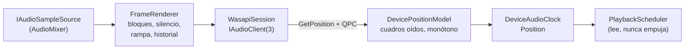
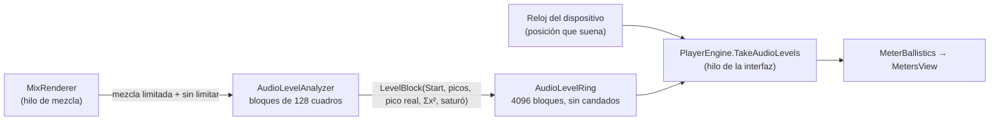

# Audio: `Rodaje.Audio`

Salida de audio WASAPI en modo compartido, por eventos, que además da el reloj maestro de la reproducción. Es `net10.0-windows`, `IsAotCompatible`, y todo su COM es interop generado en compilación (`[GeneratedComInterface]`, `[LibraryImport]`), sin reflexión. Depende de [Reproducción](reproduccion.md) y la usa el [Motor](motor.md). El mezclador de pistas no vive aquí: es `AudioMixer` del motor, que implementa la fuente de muestras.

## Contratos (`AudioTypes.cs`, `AudioOutput.cs`)

- **`IAudioSampleSource.Read(Span<float>)`** entrega float32 estéreo intercalado a la frecuencia de salida y devuelve cuántos cuadros escribió. Se llama siempre desde el hilo de audio y no debe bloquear: lo que falte se rellena con silencio. `Seek(Time)` avisa de un salto.
- **`IAudioOutput`** ofrece:
  - `Clock`: el transporte se maneja con `Start`, `Pause` y `Seek` del reloj;
  - `HasDevice` y `FallbackReason`;
  - `Device`;
  - `Volume`, con rampa;
  - `Stats`: cuadros, underruns, errores de la fuente, reinicios del dispositivo y tiempos de espera de control;
  - el evento `DeviceChanged`, que llega por el ThreadPool, nunca desde el hilo de audio.
- **`AudioOutputOptions`** trae estos valores por omisión: 48 kHz, búfer de 20 ms, baja latencia preferida (periodo de 5 ms), `ExtraLatency` para Bluetooth y volumen.
- **`AudioOutput.Open(source, options)`** es la fábrica. Intenta [`WasapiOutput`](../../src/Rodaje.Audio/WasapiOutput.cs) y, si no hay dispositivo usable (`AudioDeviceUnavailableException`), devuelve una salida muda con `SystemClock` y el motivo en `FallbackReason`. Así un equipo sin audio reproduce video igual. Los demás errores no se tapan.

## Cómo funciona `WasapiOutput`

- **Un solo hilo de audio** ("Rodaje audio", prioridad alta, COM MTA, MMCSS "Pro Audio"). Todo el COM vive ahí. El hilo espera el evento del dispositivo o una orden y luego aplica controles, atiende avisos de Windows y llena el búfer.
- **Control sin candados compartidos.** `Start`, `Pause` y `Flush` del reloj llegan como órdenes numeradas que el hilo aplica y confirma (con un tope de 2 s, contado en `ControlTimeouts`). El hilo de alta prioridad nunca espera un candado del llamador.
- **Llenado.** `GetCurrentPadding`, `GetBuffer`, `FrameRenderer.Render` y `ReleaseBuffer`. [`FrameRenderer`](../../src/Rodaje.Audio/FrameRenderer.cs) lee en bloques de 1024 cuadros. Si la fuente se queda corta rellena con silencio (cuenta underruns), y si lanza da silencio sin tumbar el hilo. También aplica una rampa de volumen de unos 10 ms, adapta estéreo a mono o a más canales y guarda unos 0,5 s de historial.
- **Baja latencia.** Si la frecuencia del mezclador coincide y existe `IAudioClient3`, [`WasapiSession`](../../src/Rodaje.Audio/Interop/WasapiSession.cs) usa `InitializeSharedAudioStream` con el periodo mínimo. Si no, usa `Initialize` compartido con conversión automática cuando hace falta remuestrear. Los HRESULT se traducen a mensajes en español: Audiosrv detenido (pasa en AtlasOS), modo exclusivo, dispositivo desconectado...

## El reloj maestro

[`DeviceAudioClock`](../../src/Rodaje.Audio/DeviceAudioClock.cs) es un `SampleCountingClock`. Su posición es el destino del último seek más los cuadros **oídos**, que da [`DevicePositionModel`](../../src/Rodaje.Audio/DevicePositionModel.cs):

- Toma cada lectura de `IAudioClock::GetPosition` con su marca QPC e interpola con el reloj de pared entre lecturas. El resultado es suave y monótono.
- La interpolación tiene dos topes: lo ya escrito y un máximo de extrapolación (búfer + periodo + 5 ms), por si el dispositivo se atasca.
- Una lectura que retrocede sostiene el valor, y tras `Start` ignora la posición repetida hasta que el dispositivo se mueve de verdad.
- Descuenta `ExtraLatency`.

Un seek (`DoFlush`) detiene y vacía el cliente, avisa a la fuente y abre un segmento nuevo con discontinuidad.

## Pérdida o cambio de dispositivo

Un `IMMNotificationClient` marca el aviso y despierta el hilo, y cualquier HRESULT de error al renderizar lleva a `Reopen`:

1. Cierra la sesión, suma `DeviceRestarts` y pasa a **modo libre**: el reloj sigue con el reloj de pared, sin parar ni saltar, y la fuente se consume a ese ritmo.
2. Intenta abrir el dispositivo predeterminado (como mucho 3 reaperturas anidadas) y, sin dispositivo, reintenta cada segundo o con cada aviso de Windows.
3. Al volver, repite desde el historial lo que estaba en cola sin oírse y continúa el segmento sin discontinuidad.
4. Avisa con `DeviceChanged`. Un cambio del dispositivo predeterminado también reabre.

`Dispose` detiene el hilo con 4 s de tope; si el controlador lo dejó colgado, no cierra los handles a propósito.

## Volumen y fundidos

El volumen lo aplica `MixRenderer` del motor, antes del limitador y de los medidores, con el `GainPlan` de cada clip:

- **Ganancia en dB:** la del `rodaje.audio` del clip (keyframes en tiempo del origen) más la de la pista (en tiempo de la secuencia). −60 dB o menos es silencio.
- **Bloques de 64 muestras** alineados a la línea de tiempo: la ganancia se evalúa en los bordes y se interpola en línea recta; los fundidos de potencia constante (sin(πt/2) al entrar, cos(πt/2) al salir) van exactos por muestra.
- **Transiciones de audio:** los dos clips suenan a la vez, el que sale alargado media duración y el que entra adelantado otra media, con fundidos complementarios; una transición reemplaza el fundido propio de ese lado. Lo que no existe antes del principio del medio es silencio.
- **Cambios sin saltos.** Tras una edición la mezcla se rehace desde 50 ms por delante de lo que ya se leyó; cada clip que sonaba parte de la ganancia que tenía y llega a la nueva a 4 dB por bloque (60 dB en 20 ms).
- **Medido** (`AudioGainTests`): −6 dB = 0,5012; error de los fundidos 3·10⁻⁸; un cruce de ruido rosa conserva la potencia dentro de 0,33 dB (ventanas de 0,5 s); el mayor salto entre muestras al cambiar el volumen es 0,079 dB; el cambio se oye a los 50,7 ms de pedirlo, más el búfer del dispositivo.

## Medidores de nivel (`Metering/`)

La mezcla se calcula hasta 500 ms por delante de lo que suena, así que medirla al producirse daría los picos medio segundo antes de oírlos. Por eso cada bloque medido lleva la muestra de la línea de tiempo donde empieza, y quien dibuja pide los niveles de la posición que da el reloj del dispositivo.

- **`AudioLevelAnalyzer`** mide por bloques de 128 cuadros (2,7 ms): pico por canal, suma de cuadrados para el RMS, pico real con [`TruePeakDetector`](../../src/Rodaje.Audio/Metering/TruePeakDetector.cs) (sobremuestreo ×4 con sinc enventanado de 16 coeficientes por fase, 48 multiplicaciones por muestra) y si la suma pasó de 0 dBFS antes del limitador suave. Un salto de posición (seek o una edición que se vuelve a mezclar) cierra el bloque y reinicia el pico real.
- **`AudioLevelRing`** tiene un escritor (el hilo de la mezcla) y lectores en cualquier hilo, sin candados ni reservas: cada entrada lleva un número de secuencia que el escritor invalida antes de escribirla y publica después, y el lector descarta lo que cambió mientras lo copiaba. Como tras una edición o un seek la mezcla vuelve a escribir posiciones, el lector recorre de lo más nuevo a lo más viejo y de cada bloque toma solo lo que no tapan los más nuevos.
- **`TimelineSession.MeasureAudio(desde, hasta, ventanaRms)`** da los picos de `(desde, hasta]` y el RMS de la ventana; se puede llamar desde cualquier hilo. `PlayerEngine` publica en cada vuelta del render la posición del reloj con su marca de tiempo, y la interfaz la extrapola al instante en que dibuja.
- **`MeterBallistics`** (subida instantánea, caída configurable de 20 dB/s, pico retenido 1,5 s, saturación que queda encendida) y **`MeterScale`** (deflexión IEC 60268-18) son lógica pura para la vista.

Con un dispositivo simulado (búfer de 20 ms) y los chirps de `AudioCode`, el pico aparece entre 1,4 ms antes (un bloque) y 0,6 ms después de que la señal pasa el umbral en la posición del reloj, también con un AAC real; la mezcla iba unos 300 ms por delante (`AudioLevelSyncTests`).

## Archivos

| Archivo | Qué hace |
|---|---|
| [`AudioTypes.cs`](../../src/Rodaje.Audio/AudioTypes.cs) | Contratos, opciones, estadísticas y excepciones |
| [`AudioOutput.cs`](../../src/Rodaje.Audio/AudioOutput.cs) | Fábrica con caída a la salida muda |
| [`WasapiOutput.cs`](../../src/Rodaje.Audio/WasapiOutput.cs) | Hilo de audio, control, llenado, reapertura y modo libre; `ProbeDefaultDevice` para decidir si corren las pruebas con hardware |
| [`DeviceAudioClock.cs`](../../src/Rodaje.Audio/DeviceAudioClock.cs) | El reloj sobre `IRenderTransport` |
| [`DevicePositionModel.cs`](../../src/Rodaje.Audio/DevicePositionModel.cs) | Posición oída suave, monótona y con segmentos |
| [`FrameRenderer.cs`](../../src/Rodaje.Audio/FrameRenderer.cs) | Bloques, silencio, rampa, canales e historial |
| [`Interop/Wasapi.cs`](../../src/Rodaje.Audio/Interop/Wasapi.cs) | Interfaces COM generadas, `LibraryImport` y estructuras |
| [`Interop/WasapiSession.cs`](../../src/Rodaje.Audio/Interop/WasapiSession.cs) | Abrir el dispositivo, formato, baja latencia y mensajes de error |

## Pruebas

[`tests/Rodaje.Audio.Tests`](../../tests/Rodaje.Audio.Tests) tiene dos niveles:

- **Sin hardware:** la caída a la salida muda, el reloj con un transporte falso (seek, pausa, reinicio y lecturas concurrentes monótonas), unos 14 casos del modelo de posición (jitter, atasco, retroceso, segmentos, modo libre) y el renderizador.
- **Con el dispositivo real** (`Hardware/WasapiHardwareTests`, en serie). Los atributos `[AudioDeviceFact]` y `[AudioToneFact]` de [`Skip.cs`](../../testing/Rodaje.TestMedia/Skip.cs) las omiten salvo con `RODAJE_PRUEBAS_LARGAS=1` (silencio) o `RODAJE_PRUEBAS_AUDIO=1` (un tono de 3 s). Miden:
  - deriva frente a QPC de 1000 ppm como mucho, residuo de 3 ms como mucho y 0 retrocesos;
  - pausa, seek y volumen;
  - pérdida del dispositivo sin saltos de más de 30 ms.

## Aceptación de la fase 2

[`tests/Rodaje.Acceptance.Tests`](../../tests/Rodaje.Acceptance.Tests) se corre con `ABRIR.bat aceptacion`, que pone `RODAJE_PRUEBAS_LARGAS=1` y lanza las suites una tras otra.

- `FrameExactSeekTests`: seek exacto al cuadro en H.264 y HEVC, por D3D11VA y por software, con `GetFrame` y con `PlaybackScheduler.SeekToFrame`. El número de cuadro va dibujado en la imagen.
- `AvDriftTests`:
  - 10 minutos con reloj manual (nominal y ±0,1 %), con marcas de audio por segundo;
  - 30 s en tiempo real con el dispositivo a volumen 0;
  - con `-Completa` (`RODAJE_PRUEBAS_COMPLETAS=1`), los 10 minutos en tiempo real.

Las medidas salen como líneas `MEDIDA clave = valor` que [`herramientas/aceptacion.ps1`](../../herramientas/aceptacion.ps1) resume por criterio. El resultado registrado: 2864 de 2864 seeks exactos y 0 cuadros de deriva en 10 minutos.
