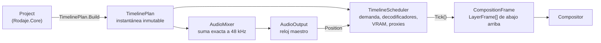

# Motor: `Rodaje.Engine`

Junta [Medios](medios.md), [Audio](audio.md) y [Reproducción](reproduccion.md) en sesiones que se pueden reproducir. `ClipPlayer` reproduce un archivo (fase 2) y `TimelineSession`, una secuencia con varias capas (fase 3). Es `net10.0-windows` e `IsAotCompatible`. Lo usa la app, que pasa cada `CompositionFrame` al [Render](render.md).

## Flujo

1. **El plan.** [`TimelinePlan`](../../src/Rodaje.Engine/Timeline/TimelinePlan.cs) convierte la secuencia en datos inmutables y se reconstruye en cada edición. Las capas están en [`VideoPlan`](../../src/Rodaje.Engine/Timeline/VideoPlan.cs) y el audio en [`AudioPlan`](../../src/Rodaje.Engine/Timeline/AudioPlan.cs).
   - Por capa: los clips con su correspondencia de cuadros (`VideoClipPlan`) y su [`EffectPlan`](../../src/Rodaje.Engine/Timeline/EffectPlan.cs).
   - Para el audio: los clips en muestras de 48 kHz con su `GainPlan` (`AudioPlan`).
   - Deja fuera las pistas mudas, los clips desactivados y los medios sin el flujo. Las pistas ocultas no se ven, pero siguen calientes.
2. **El reloj.** Es el de la salida de audio, que reproduce la mezcla o silencio; sin dispositivo, `SystemClock`.
3. **Cada `Tick`** calcula la demanda de cada capa, presenta lo más nuevo disponible sin esperar a nadie y devuelve un `CompositionFrame`, que desecha quien lo recibe.
4. **`Reload(Project)`** aplica ediciones sin parar ni mover la posición; la mezcla solo se rehace si el audio cambió (`AudioPlan.SoundsLike`). `Invalidate()` sirve cuando el proyecto cambió en el sitio por el `UndoStack`.

## Efectos y transiciones (fase 5)

- **`EffectPlan`.** Se compila por clip en cada `Reload`: la primera transformación activa, los efectos de imagen del registro (etapas por píxel y espaciales) en el orden de la pila y el primer modo de mezcla activo; lo desconocido, desactivado o diferido no entra. Sin nada de eso el plan es nulo y la capa va por el camino rápido (`IsPlain`).
- **Sin reservas por `Tick`.** Los keyframes se copian a arreglos ([`Curve`](../../src/Rodaje.Engine/Timeline/Curve.cs), búsqueda binaria y las mismas curvas que el núcleo) y los efectos evaluados van a listas que cada carril rota de a tres (`EffectListRing`): una composición vale mientras la app la dibuja y la desecha en el mismo refresco. Los valores siguen los huecos del registro; una opción de elección (la dirección del empuje) va como su índice en el hueco que sigue a los parámetros, y una LUT (`paquete@versión/elemento` o `file:<ruta>`) va como `Resource` solo si `IEffectContent.TryGetLut` ya la tiene; si no, la capa sale sin LUT.
- **Transiciones como carriles.** Centradas en el corte: el clip que sale sigue en su carril media duración más (material sobrante o, si no hay, su último cuadro congelado: `ToSource` acota al material) y el que entra se adelanta la otra media en el carril compañero `pista#t`, que tiene su propio estado, demanda y pre-roll. En el carril principal el que entra recién aparece al terminar la transición. `Tick` arma la capa del que sale con `LayerFrame.Transition` (código, avance de 0 a 1, valores e `Incoming`); si el que entra todavía no llegó, se ve solo el que sale. Cada mitad se acota a la mitad de su clip.
- **De paquete.** `IEffectContent.FindTransition` da las curvas al armar el plan: x e y se suman (escaladas a la secuencia), escala y opacidad se multiplican, el giro se suma; la mezcla usa los `MixParameters` y `MixOptions` del preajuste. Si falta, cae a fundido cruzado y se cuenta en `TimelineStats.MissingContent`.
- **Cifras.** `Tick` con 8 capas y 4 efectos cada una: 0,09 ms de mediana con dobles; reserva lo mismo con efectos que sin ellos (la evaluación sola, 0 B). Con 4 pistas HEVC 1080p y un fundido de 0,5 s en cada corte, 28 de 28 transiciones con su pre-roll a tiempo, 0 refrescos tarde y el pico de VRAM en 880 MB de 1485.

## `TimelineScheduler`

Las decisiones de diseño están en [D-017](../decisiones.md) (caché global por urgencia y pre-roll por pista) y D-019.

[`TimelineScheduler`](../../src/Rodaje.Engine/Timeline/TimelineScheduler.cs) es el corazón del motor. Es una clase parcial: el archivo principal tiene el transporte, `Tick` y las cifras, y cada parte va en su archivo (`.Presentation`, `.Layers` con el armado de cada capa, `.Demand`, `.Vram`, `.Proxies`, `.Decoding` y `.State`, con los tipos internos).

- **Demanda.** Cada capa pide el cuadro debido más `PrefetchFrames` (8). Si el próximo corte está a menos de `PreRoll` (500 ms), también pide los primeros `PreRollFrames` (6) del clip siguiente, para que el corte llegue a tiempo. Las ventanas cercanas del mismo medio se agrupan.
- **Varios decodificadores por medio.** Cada tramo de demanda va al decodificador más barato: el que ya está ahí, el que tiene que avanzar pocos cuadros o, si no, uno que haga seek. Se abren hasta `MaxDecodersPerMedia` (4); así el mismo archivo en cuatro pistas no salta de un lado a otro.
- **Presupuesto de VRAM** ([D-019](../decisiones.md)). Por omisión es 3/8 de la VRAM dedicada, entre 512 MB y 4 GB (1,5 GB sin dispositivo).
  - Cada decodificador reserva su pool D3D11VA entero. `SizePool` corre en el hilo del decodificador y lo dimensiona: referencias del nivel + 5 retenidas + 3 de margen + la caché útil (mínimo 4).
  - `MakeRoom` cierra primero los decodificadores sin demanda. El pre-roll y las pistas ocultas nunca pasan del presupuesto; una capa visible sin decodificador sí lo pasa, y queda contado en `VramOverruns`.
  - En 4K con cortes, la memoria de video bajó de 3,7 GB a 1,4 GB.
- **Ociosos.** `CollectIdle` cierra los decodificadores sin uso tras `DecoderIdleTimeout` (5 s), o antes si hay muchos abiertos.
- **Caché.** [`TimelineFrameCache`](../../src/Rodaje.Engine/Timeline/TimelineFrameCache.cs) es global, con clave (medio, índice) y un tope por decodificador. Expulsa primero lo que nadie quiere y luego lo menos urgente, y descarta el cuadro nuevo si es menos urgente que lo que tendría que expulsar.
- **Proxies.** Con [`PreviewProxies`](../../src/Rodaje.Engine/Timeline/PreviewProxies.cs) la vista previa decide por medio (`ProxyUsage`: `Auto`, `Always`, `Never`). Cuando un proxy queda listo, cambia a él sin cortes y lo coloca con el tamaño visible del original. La exportación nunca usa proxies.
- **Orden por pistas.** La demanda va de la pista de arriba hacia abajo: los proxies se resuelven y los decodificadores se bombean en el orden en que se apilan las pistas. Las aperturas van por urgencia (los cuadros debidos primero) y, a igual urgencia, primero los medios sin decodificador y después la pista de arriba: si la pista pasara por delante de la urgencia, en 4K con cortes se abrirían decodificadores de más (la VRAM del proceso llegó a 1825 MB con 1485 de presupuesto). Una capa bajo otra opaca de pantalla completa (sin transición, mezcla normal, opacidad 1, sin mover ni achicar y con la forma de la secuencia) queda al final.
- **Composición atómica tras un seek.** Al abrir o tras un seek, mientras alguna capa no tenga su cuadro exacto, `Tick` repite la última composición completa (o negro si no hubo ninguna) en lugar de mostrar unas capas sí y otras no. El tope es `PartialFrameTimeout` (400 ms, contado desde el primer seek de una racha); después se muestra lo que haya y se cuenta en `TimelineStats.PartialPresentations` (`HeldRefreshes` cuenta los refrescos repetidos). Reproduciendo, un cuadro tarde no espera a nadie: no se añade latencia.
- **Fallos.** Una capa cuyo medio no abre queda vacía (`LayerState.Failure`) en vez de congelar el cuadro anterior; `DecodeFailed` avisa con `FrameIndex = -1`.

**Hilos.** Transporte, `Tick`, `Reload` y `Dispose` se llaman desde un solo hilo: el de render de la app.
- Cada decodificador tiene su propio hilo (`IDecodeExecutor`) y en él se abre.
- Un ejecutor de servicio cierra decodificadores y resuelve proxies.
- Un único candado protege el estado y nunca se retiene mientras se abre, decodifica o cierra un archivo.
- **Cierre asíncrono.** `Close` solo marca el decodificador y encola `Reap`, que lo libera en su hilo y recién entonces descuenta su VRAM: el hilo de la ventana no espera. `Dispose` de la sesión sí cierra todo antes de volver, para poder liberar después el dispositivo.

## Audio de la línea de tiempo

- **[`AudioMixer`](../../src/Rodaje.Engine/Timeline/AudioMixer.cs)** es la `IAudioSampleSource` de la salida.
  - Suma los clips exactos a la muestra en float estéreo; los huecos son silencio.
  - Reutiliza un decodificador por medio si quedó justo donde empieza el clip y cierra los ociosos.
  - Aplica el volumen de cada clip antes del recorte suave y de los medidores (ver [Audio](audio.md#volumen-y-fundidos)).
  - Aplica un recorte suave (rodilla 0,9).
  - Al recargar conserva 50 ms ya mezclados. Un medio que falla suena como silencio.
- **[`BufferedAudioSource`](../../src/Rodaje.Engine/BufferedAudioSource.cs)** decodifica por delante (500 ms) en su propio hilo sobre un anillo. El hilo de audio solo copia; si falta audio da silencio y la posición sigue, así la sincronía no se pierde.

## Archivos

| Archivo | Qué hace |
|---|---|
| [`ClipPlayer.cs`](../../src/Rodaje.Engine/ClipPlayer.cs) | Un archivo: `PlaybackScheduler` + `FrameCache` (hasta 384 MB) + `DecodeThread`, con paso de cuadro y latencia de seek medida |
| [`ClipBackend.cs`](../../src/Rodaje.Engine/ClipBackend.cs) | `IClipBackend`: la frontera con el hardware (abrir video, audio, salida y ejecutor), que las pruebas cambian por dobles |
| [`Timeline/TimelineSession.cs`](../../src/Rodaje.Engine/Timeline/TimelineSession.cs) | API pública: `Open(project, sequenceId, gpu, options)`, transporte, `Tick`, `Reload`, `Stats` y eventos |
| [`Timeline/TimelineSessionOptions.cs`](../../src/Rodaje.Engine/Timeline/TimelineSessionOptions.cs) | Pre-roll, cachés, presupuesto de VRAM, decodificadores por medio, proxies y adelanto de audio, con `Validate()` |
| [`Timeline/TimelineStats.cs`](../../src/Rodaje.Engine/Timeline/TimelineStats.cs) | Por capa: mostrados, perdidos, tarde, cortes y aciertos del pre-roll. En total: VRAM comprometida y pico, decodificadores, expulsiones, seeks, medios fallidos, contenido que falta, pre-roll de transiciones y composiciones retenidas tras un seek |
| [`Presentation/Timecode.cs`](../../src/Rodaje.Engine/Presentation/Timecode.cs) | `m:ss.mmm` para la interfaz |

## Pruebas

- **Sin hardware.** [`tests/Rodaje.Engine.Tests`](../../tests/Rodaje.Engine.Tests) usa dobles (`FakeTimelineBackend`, payloads con contador de vivos) para la sesión, el plan, los efectos y transiciones (`TimelineEffectsTests`, con un `IEffectContent` falso), el volumen (`AudioGainTests`), la composición tras un seek, el mezclador, los proxies y los recursos. Algunos casos: varios decodificadores por medio, presupuesto en 4K, que `Tick` nunca espera a un decodificador que se cierra, medios rotos y ediciones que no rebobinan el audio.
- **Con hardware.** `[HardwareFact]` corre `ClipPlayerHardwareTests` y `TimelineHardwareTests` en la suite normal. Con `RODAJE_PRUEBAS_LARGAS=1` se suman la carga (`TimelineLoadTests`: cuatro pistas HEVC 1080p y 4K con cortes cada 3 s dentro del presupuesto, también con un fundido en cada corte) y el cambio a proxy durante la reproducción (`TimelineProxyHardwareTests`).
