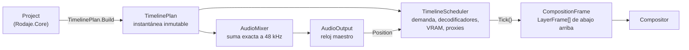

# Motor: `Rodaje.Engine`

Junta [Medios](medios.md), [Audio](audio.md) y [Reproducción](reproduccion.md) en sesiones que se pueden reproducir. `ClipPlayer` reproduce un archivo y `TimelineSession`, una secuencia con varias capas. Es `net10.0-windows` e `IsAotCompatible`. Lo usa la app, que pasa cada `CompositionFrame` al [Render](render.md).

## Flujo

1. **El plan.** [`TimelinePlan`](../../src/Rodaje.Engine/Timeline/TimelinePlan.cs) convierte la secuencia en datos inmutables y se reconstruye en cada edición. Las capas están en [`VideoPlan`](../../src/Rodaje.Engine/Timeline/VideoPlan.cs) y el audio en [`AudioPlan`](../../src/Rodaje.Engine/Timeline/AudioPlan.cs).
   - Por capa: los clips con su correspondencia de cuadros (`VideoClipPlan`) y su [`EffectPlan`](../../src/Rodaje.Engine/Timeline/EffectPlan.cs).
   - Para el audio: los clips en muestras de 48 kHz con su `GainPlan` (`AudioPlan`).
   - Deja fuera las pistas mudas, los clips desactivados y los medios sin el flujo. Las pistas ocultas no se ven, pero siguen calientes.
   - Antes de nada despliega con `CompoundOps.Flatten` los clips compuestos sin efectos ni transiciones propios: el resto del plan solo ve clips sueltos, sin coste extra. Probado cuadro a cuadro (y el audio muestra a muestra) contra los mismos clips sin componer, también recortado y movido.
   - Un compuesto con efectos de video o una transición queda como grupo (`GroupClipPlan` en `VideoLayerPlan.Groups`, y en `IncomingGroups` el que entra en una transición). Sus tramos se reparten en grupos que no se pisan por pista y cada grupo tiene sus carriles (`IsNested`), con lo de dentro recortado y llevado a la línea de tiempo; van en `Layers` detrás de su pista, se decodifican como los demás y se componen dentro de su grupo. `TimelineScheduler` y `OfflineTimeline` arman con ellos una capa compuesta (`LayerFrame.Nested`) con la transformación, los efectos y la transición del compuesto; recursivo hasta 16 niveles. `Expanded` es la secuencia con las pistas de los grupos, para buscar LUT y transiciones de paquete.
   - En audio, un compuesto con volumen, fundidos, ecualizador o compresor, transición o efectos en las pistas de su secuencia lleva esas pistas en `AudioClipPlan.Bus`: `MixRenderer` las mezcla (cada una con sus efectos), aplica los del compuesto y lo suma con su volumen y fundidos.
   - Pruebas ([`OfflineCompoundEffectsTests`](../../tests/Rodaje.Engine.Tests/Offline/OfflineCompoundEffectsTests.cs)): con color y opacidad 0,5 la capa compuesta tiene exactamente las capas de los clips sueltos; vista previa igual a exportación; transición en los dos sentidos igual a la del clip suelto; volumen del compuesto y de una pista anidada igual que en los clips (≤1e-5); un `Tick` reserva 560 B más (1 904 frente a 1 344 B con dos capas).
2. **El reloj.** Es el de la salida de audio, que reproduce la mezcla o silencio; sin dispositivo, `SystemClock`.
3. **Cada `Tick`** calcula la demanda de cada capa, presenta lo más nuevo disponible sin esperar a nadie y devuelve un `CompositionFrame`, que desecha quien lo recibe.
4. **`Reload(Project)`** aplica ediciones sin parar ni mover la posición; la mezcla solo se rehace si el audio cambió (`AudioPlan.SoundsLike`). `Invalidate()` sirve cuando el proyecto cambió en el sitio por el `UndoStack`.

## Efectos y transiciones

- **`EffectPlan`.** Se compila por clip en cada `Reload`: la primera transformación activa, los efectos de imagen del registro (etapas por píxel y espaciales) en el orden de la pila y el primer modo de mezcla activo; lo desconocido, desactivado o diferido no entra. Sin nada de eso el plan es nulo y la capa va por el camino rápido (`LayerFrame.IsPlain`).
- **Transformación.** `EffectPlan.Transform` evalúa la posición con `Curve.Position` (sobre la trayectoria de X e Y cuando el tramo tiene tangentes, como `MotionPath`) y arma `LayerTransform.Shape` solo si algún parámetro de forma o el volteo no está de fábrica. `Curve` usa las fórmulas de `KeyframeMath` del núcleo (mismos números que `Parameter.Evaluate`, probado con 5000 casos al azar de todas las curvas y tangentes) y acota lo que un suavizado que se pasa (elástico, Bézier) dé fuera del rango; `Max` mide esos tramos en 64 puntos (la escala de rasterizado de los títulos).
- **Desenfoque de movimiento.** Con `shutterAngle` > 0, `MotionSampler` llena `LayerFrame.MotionSamples` con la transformación en `n` instantes del obturador (`MotionBlur.OffsetTicks`: el centro de cada tramo de un cuadro × ángulo/360, corrido por la fase) en la misma lista que rota con los efectos de la capa (sin reservas por `Tick`). Lo arman igual `TimelineScheduler` y `OfflineTimeline` (clip, compuesto y título, con estabilizar, transición y la animación del estilo de cada instante); una capa que no se mueve en todo el obturador no lleva muestras y sigue por el camino rápido. `OfflineTimelineTests` lo compara cuadro a cuadro con la vista previa asentada (trayectoria Bézier, ancla, inclinación, volteo y obturador a 180°).
- **Estabilizar.** El primer `rodaje.stabilize` activo con su clave `analysis` pide las correcciones a `IEffectContent.FindStabilization` al armar el plan; `Tick` y `OfflineTimeline` ponen en `LayerTransform.Stabilization` la del índice del cuadro que se muestra (fuera del tramo analizado, la del borde). Solo, no saca la capa del camino rápido; sí la saca de las capas que tapan a otras.
- **Máscaras.** Cada `rodaje.mask` activo entra como efecto de imagen: sus 10 parámetros, la forma, invertir y el modo en los huecos 10 a 12, en el 13 los segundos del origen menos `matteStart` (el cuadro del video gris o el instante de la forma animada) y en el 14 su destino (`MaskGeometry.TargetSlot`: 0 la capa, `k + 1` el efecto `k` de la lista de la capa, −1 si su efecto está apagado o no existe). El contorno (`MaskGeometry.ShapeText`: los keyframes de forma si hay, si no los vértices o el trazo de antes) o el video viajan como `Resource` sin pasar por las LUT. Una máscara con destino no deja ver lo de abajo (`MayRevealBelow` solo cuenta las de la capa). `MaskGeometry` y `MaskPath` son la referencia de la CPU.
- **Recorte, croma, ruedas y curvas.** El primer `rodaje.crop` activo no es un efecto de imagen: sus cuatro curvas van aparte y `EffectPlan.Transform` pone el recorte (`CropGeometry.Sanitize`) en `LayerTransform.Crop`. Croma y ruedas entran como efectos de imagen con sus valores; las curvas viajan como `Resource` con la clave `general|rojo|verde|azul` (`ToneCurve.Key`), sin pasar por las LUT, y sin recurso si las cuatro son la identidad. Un recorte, una máscara o un croma (`EffectPlan.MayRevealBelow`) sacan la capa de las que tapan a otras, así lo de abajo se sigue decodificando.
- **Sin reservas por `Tick`.** Los keyframes se copian a arreglos ([`Curve`](../../src/Rodaje.Engine/Timeline/Curve.cs), búsqueda binaria y las mismas curvas que el núcleo) y los efectos evaluados van a listas que cada carril rota de a tres (`EffectListRing`): una composición vale mientras la app la dibuja y la desecha en el mismo refresco. Los valores siguen los huecos del registro; una opción de elección (la dirección del empuje) va como su índice en el hueco que sigue a los parámetros, y una LUT (`paquete@versión/elemento` o `file:<ruta>`) va como `Resource` solo si `IEffectContent.TryGetLut` ya la tiene; si no, la capa sale sin LUT.
- **Transiciones como carriles.** Centradas en el corte: el clip que sale sigue en su carril media duración más (material sobrante o, si no hay, su último cuadro congelado: `ToSource` acota al material) y el que entra se adelanta la otra media en el carril compañero `pista#t`, que tiene su propio estado, demanda y pre-roll. En el carril principal el que entra recién aparece al terminar la transición. `Tick` arma la capa del que sale con `LayerFrame.Transition` (código, avance de 0 a 1, valores e `Incoming`); si el que entra todavía no llegó, se ve solo el que sale. Cada mitad se acota a la mitad de su clip.
- **De paquete.** `IEffectContent.FindTransition` da las curvas al armar el plan: x e y se suman (escaladas a la secuencia), escala y opacidad se multiplican, el giro se suma; la mezcla usa los `MixParameters` y `MixOptions` del preajuste. Si falta, cae a fundido cruzado y se cuenta en `TimelineStats.MissingContent`.
- **Cifras.** `Tick` con 8 capas y 4 efectos cada una: 0,09 ms de mediana con dobles; reserva lo mismo con efectos que sin ellos (la evaluación sola, 0 B). Con 4 pistas HEVC 1080p y un fundido de 0,5 s en cada corte, 28 de 28 transiciones con su pre-roll a tiempo, 0 refrescos tarde y el pico de VRAM en 880 MB de 1485.

## Velocidad

- **El plan usa el mapeo.** Cada `VideoClipPlan` lleva el `ClipTimeMap` del clip y el tramo que se ve. `ToSource` es `ExtendedSource` acotado al material: en una transición el material sigue a la velocidad del borde y, donde se acaba, se congela el cuadro del borde. `FirstFrame` y `LastFrame` son el primer y el último cuadro *mostrados*, y `ShownAt` (con `TimelineOf`), `NextShown`, `IsShown` y `ShownBetween` cuentan solo lo que la rejilla de la secuencia llega a ver. Los efectos se evalúan con `EffectTime` (en un congelado, un tiempo virtual que avanza). A 1× el resultado es el mismo que sin velocidad.
- **Demanda en tiempo de la secuencia.** La ventana adelantada es lo que se mostrará en los próximos `PrefetchFrames` cuadros de la secuencia, y el pre-roll lo que el clip siguiente mostrará en sus primeros `PreRollFrames`: a 0,25× son 2 cuadros del origen, a 4× uno de cada cuatro. El decodificador decodifica todo, pero solo se le piden y la caché solo guarda los cuadros que se verán (urgencia nula al resto). Esto también vale para un origen de 60 fps en una secuencia de 30.
- **De 16× a 100×, reproduciendo,** la capa muestra el keyframe anterior al cuadro debido (sin salir del clip) y solo se piden esos keyframes; se cuenta en `TimelineStats.Approximated` y no cuenta como pérdida. En pausa y tras un seek el cuadro es siempre el exacto. Los keyframes llegan por `IKeyframeSource`/`IKeyframeIndex` desde el decodificador; sin ellos, todo es exacto.
- **Ediciones mientras suena.** `Reload` marca los carriles cuyo clip bajo el cursor cambió (otro clip, o el mismo con otros tiempos, como al cambiar la velocidad): su cuadro arranca en el debido y no cuenta como corte. Si no, un clip que la edición trae bajo el cursor a mitad de camino tomaba de la caché un cuadro de otra capa del mismo medio y contaba como perdido todo lo de en medio.
- **Curvas.** Todo lo anterior vale con una curva: cada cuadro mostrado sale del mapeo, así que la ventana adelantada y el pre-roll piden justo lo que se verá aunque la velocidad cambie dentro del tramo. `VideoClipPlan.MaxRate` es el pico real del tramo visible (`ClipTimeMap.RateRange`, en los nudos de la curva), y es lo que se le cuenta a la política de proxies: una curva 1×→8×→1× cuenta como 8×. El keyframe cercano se usa solo si la velocidad instantánea no baja de 16× en todo el tramo de la ventana (una curva llega a 10×, así que con curvas siempre es exacto). `AVDISCARD_NONREF` no se pide: con 1080p a 4× y curvas hasta 10× con la política de proxies no hizo falta, y entregaría cuadros anteriores al pedido.
- **Cifras.** 2000 seeks exactos por caso (0,25×, 0,5×, 1,37×, 2×, 4×, 1001/1000×, 100× y congelado) con dobles y, con `RODAJE_PRUEBAS_LARGAS=1`, leyendo el número dibujado en la imagen; 1080p H.264 a 2× y 4× sin proxy con 0 cuadros perdidos y 0 refrescos tarde; `Tick` con 8 capas con velocidad en 0,12 ms de mediana, con los mismos bytes en pausa que a 1×. Con curvas (`TimelineCurveTests`): los cinco preajustes cuadro a cuadro frente a una referencia `BigInteger` propia en cuatro tasas de origen, 2000 seeks exactos con «Bala» y «Montaje» reproducida con 0 cuadros perdidos, 0 refrescos tarde y solo los cuadros que se ven pedidos.

## Reversa

- **El plan cuenta hacia abajo.** En reversa los cuadros mostrados bajan con el tiempo: `FirstFrame` es el más alto y `LastFrame` el más bajo (`LowestFrame`/`HighestFrame` dan los extremos en los dos sentidos). `NextShown` y `PreviousShown` van por los índices; `ShownAt` es el primer instante en que se ve ese cuadro o uno menor, `ShownBetween` cuenta por índices (el cuadro nuevo primero) y `ShownFrom` cuenta hacia abajo. Comprobado contra la fuerza bruta en seis velocidades, cuatro tasas de origen y con un fundido entre clips en reversa.
- **Presentación por el límite superior.** La capa guarda `Bound`: el menor cuadro aceptable hacia adelante y el mayor en reversa; en reversa se muestra el cuadro guardado más bajo que no pasa del debido (`TimelineFrameCache.TryGetEarliest`) y las pérdidas se cuentan con `ShownBetween(nuevo, anterior)`.
- **Un decodificador propio por clip en reversa** (`DecoderState.ReverseClip`): sus ventanas forman su propio tramo y no comparten decodificador con lo que va hacia adelante, ni con el mismo medio en otra pista. Su ventana llega hasta el keyframe del GOP de abajo (dos GOP) y su caché es lo que admite el pool de D3D11VA (64 superficies menos referencias y retenidas) dentro de su parte del presupuesto de VRAM (D-019); sin pool, hasta 128 cuadros y la mitad de la caché.
- **Por GOP, como `ReverseFrameReader`.** Lo más urgente es lo más alto que falta; se pide primero lo más bajo del tramo (desde el keyframe, o desde donde empieza la ventana) y se sube sin buscar. Un tramo empezado se termina antes de alargarlo hacia abajo (si se alargara con cada cuadro mostrado, buscaría el keyframe cada vez: 126 seeks en 9,5 s antes de esta regla, 12 después). Un tramo que obliga a buscar solo empieza si entra el GOP entero (una pasada) o, si el GOP no cabe, media caché (dos pasadas), salvo que lo de arriba se deba mostrar en menos de `PrefetchFrames`; sin keyframes conocidos lo que no urge espera a leerlos (`ReadKeyframes`), y al conocerlos se rehace la demanda antes de pedir nada.
- **Pre-roll.** Un clip en reversa empieza por el final de su material: el pre-roll pide su último GOP entero, desde el keyframe.
- **Proxy obligatorio.** Por encima de 1080p la política exige proxy en reversa (`ProxyRecommendation.IsRequired`): `MediaSourceResolver.Assess` lo encola aunque no se generen solos los recomendados, y en Auto la vista previa pasa a él en cuanto está listo. Mientras tanto el original se lee por pasadas.
- **Cifras.** Con dobles (pool simulado, 49 cuadros de caché): 0 perdidos y 0 tarde a 0,5×, 1×, 2× y 4×; 1,00 decodificaciones por cuadro recorrido con GOP 30 y 1,61 con GOP 60 (dos pasadas); un seek por GOP; 2000 seeks exactos a 0,5×, 1×, 1,37× y 2×; el `Tick` en pausa reserva lo mismo en reversa que hacia adelante. Con FFmpeg y D3D11VA ([`TimelineReverseHardwareTests`](../../tests/Rodaje.Engine.Tests/Timeline/TimelineReverseHardwareTests.cs)): 1080p H.264 GOP 60 hacia atrás a 1× y 2× sin proxy con 0 perdidos y 0 tarde, 12 seeks en 9,5 s y VRAM pico 200 de 1485 MB; 4K HEVC hacia atrás con el proxy obligatorio (generado en 6,2 s con la generación automática apagada): 0 perdidos, 0 tarde, cada cuadro con su número y VRAM pico 731 de 1485 MB, sin desbordes; 400 seeks exactos a 1,5× en reversa.

## Exportación: el motor fuera de línea

[`Offline/`](../../src/Rodaje.Engine/Offline) da la secuencia exacta y sin reloj para exportar ([D-028](../decisiones.md)). Recibe una copia del proyecto y se usa desde el hilo de la exportación.

- **[`OfflineTimeline`](../../src/Rodaje.Engine/Offline/OfflineTimeline.cs).** `Render(frame)` arma las capas del instante `FromFrames(frame)` igual que la vista previa ya asentada tras un seek: el mismo `TimelinePlan`, los efectos en `EffectTimeAt`, la transición con el carril compañero y la mezcla. No hay reloj: espera a que cada capa tenga su cuadro exacto (hasta `FrameTimeout`) y nunca usa proxies, keyframes cercanos ni `SkipNonReference`. `RenderAt(time)` sirve a la conversión de tasa y aprende el paso de los dos últimos instantes; para mezclar dos cuadros conviene `Render` de los dos de la secuencia.
- **Decodificadores propios** ([`OfflineReaders`](../../src/Rodaje.Engine/Offline/OfflineReaders.cs)), en el `GpuDevice` de la exportación: hasta `MaxDecodersPerMedia` por medio, cada uno en su hilo. Un cuadro va al decodificador que lo alcanza avanzando menos (hasta 64 cuadros), luego al que tiene que volver menos, luego a uno nuevo y, si no quedan, al usado hace más tiempo. Se piden por delante `LookaheadFrames` (8) cuadros de la secuencia, y cada decodificador guarda como mucho los que le caben: al crear su pool de D3D11VA se reservan las referencias, 5 retenidas, 3 de margen y la lectura por delante que entre en el presupuesto (el de la vista previa por omisión, 3/8 de la VRAM); si no entra nada, 2 cuadros y se cuenta en `VramOverruns`. Un cuadro se suelta cuando pasa el último instante que lo usa; un decodificador sin trabajo durante 2 s de secuencia se cierra en su hilo, sin que espere la exportación. Un salto hacia atrás suelta lo pedido y sigue exacto. **Final del video:** la duración del medio es la del contenedor, que sigue al flujo más largo (un AAC de teléfono puede durar medio cuadro más), así que un clip entero puede pedir uno o dos cuadros más allá del último; el lector pide el último (`FrameCount` del flujo, o hasta 2 antes si el conteo era estimado) y lo congela, hacia adelante y en reversa. Si un cuadro no se decodifica, `ExportException` lleva `MediaFrame` (cuadro del medio) además de `Frame` (de la salida).
- **Antes del primer cuadro,** `Prepare(start, end)` (o `Render`, con toda la secuencia): un medio que no existe es `MediaMissing`; las LUT se esperan hasta que carguen (`IAwaitableEffectContent`, o mirando `Changed` hasta `ContentTimeout`) y, con las transiciones de paquete que cayeron a fundido, forman `MissingContentItems`. Con `MissingContentPolicy.Fail` eso es `ContentMissing` con la lista; con `ContinueWithout` se exporta sin ellas, como se ve en la vista previa. Un archivo que no abre al decodificar es `MediaMissing` y un cuadro que no llega, `DecodeFailed`, los dos con el cuadro y el medio.
- **Reversa.** Un clip invertido tiene su lector propio en `OfflineReaders`, que pide los tramos a `ReverseFrameReader` (un seek por tramo, no por cuadro). `M` sale de `IClipVideo.SpareSurfaces` del pool (que nace con el primer cuadro, exacto) menos 5 del decodificador, 3 de margen, 1 guardado y los cuadros pedidos; en 4K HEVC, `M` = 41. Un instante fuera de la rejilla sale exacto con un seek y desde entonces el lector entrega todos los cuadros. 10 s invertidos sin codificar ([`OfflineHardwareTests`](../../tests/Rodaje.Engine.Tests/Offline/OfflineHardwareTests.cs), compuestos, con carga en la máquina): 4K HEVC GOP 30 de 16,9 a 129,5 fps (VRAM pico 765 MB); 1080p H.264 GOP 60 de 18,1 a 163 fps; cada cuadro con su número dibujado. Con dobles y GOP 15: 21 seeks y 314 cuadros decodificados para 300.
- **[`OfflineAudio`](../../src/Rodaje.Engine/Offline/OfflineAudio.cs).** El `MixRenderer` de la vista previa (con WSOLA y cinta) leído de corrido. `WriteWave` escribe `[start, end)` exacto a la muestra: a la frecuencia `R` son `end.ToSamples(R) − start.ToSamples(R)` muestras, así que con los bordes en cuadros la suma de las partes es el todo y no hay deriva ni a las 3 h. A otra frecuencia que 48 kHz, la muestra `n` es el instante `n/R` de la mezcla con [`RateConverter`](../../src/Rodaje.Engine/Offline/RateConverter.cs) (sinc Kaiser de fases exactas, el diseño de `VarispeedResampler`). Mono promedia, 5.1 pone el estéreo en L/R; float o PCM 16/24/32 en un WAV extensible atómico ([`WaveWriter`](../../src/Rodaje.Engine/Offline/WaveWriter.cs): temporal `.rodaje-tmp` y renombrar; RF64 si pasa de 4 GB). Un medio que no abre es `MediaMissing` antes de escribir; disco lleno y destino no escribible tienen su código. `MeasureLoudness` ([`LoudnessMeter`](../../src/Rodaje.Engine/Offline/LoudnessMeter.cs)) sigue BS.1770-4 / EBU R128: integrada con puertas, LRA (Tech 3342) y pico verdadero ×4.
- **Cifras** (RTX 3050 Laptop). Igual a la vista previa asentada cuadro a cuadro, con dobles, en 7 tasas (24 a 60) con 2×, 0,5×, 1001/1000×, «Bala», congelado, reversa y 4 transiciones; en la GPU, en otro dispositivo y con el compositor estricto, 180 cuadros 1080p con diferencia máxima 0 y 497 de 497 capas con el número de cuadro que dibuja el medio. Exacto a 3 h en las 7 tasas. Sin reservas propias por cuadro: 568 B, lo mismo que las clases del contrato. 1080p30 con dos pistas (H.264 y HEVC en PiP con color), compuesto y convertido a NV12 con el anillo de `Staging`: 441–454 fps sin codificar, 0,2–0,3 ms por cuadro esperando al motor. Audio: el seno EBU a −23 y −33 dBFS mide −22,99 y −32,99 LUFS, el caso 1 de Tech 3342 da 10,00 LU y normalizar a −14 da −14,00; el remuestreo queda 98, 86 y 85 dB bajo la señal a 44,1, 32 y 96 kHz.

## Títulos: el carril generado

- **Plan.** Un clip con `generator` no entra en `VideoLayerPlan.Clips` (sin decodificador, demanda, audio ni transiciones: una transición contra un título se ve como corte); va en `VideoLayerPlan.Generated` como [`GeneratedClipPlan`](../../src/Rodaje.Engine/Timeline/GeneratedPlan.cs). El descriptor `GeneratedContent` (`Rodaje.Playback.Composition`: texto, copia del estilo, caja en píxeles de la secuencia, escala de rasterizado y `Key`) se arma una vez por clip en `TimelinePlan.Build`; dos planes con el mismo contenido dan descriptores iguales. Un tipo desconocido o un clip desactivado no se dibuja.
- **Animación.** `TitleAnimation`: `in` desde el borde izquierdo y `out` hasta el derecho, cada una solo si su `edges` está activo; si no caben se encogen por igual y suman la duración del clip. Su delta (x/y en unidades del estilo × `min(ancho/refAncho, alto/refAlto)`) se compone antes de la transformación del clip: gira y escala con él. La escala de rasterizado es el pico de la animación × el de la transformación (0,25–4). Una animación por unidades (`StyleAnimation.PerUnit`, D-039) no da delta: `GeneratedClipPlan.MotionAt` pone en la capa `TextMotion` (fase, avance de 0 a 1 ya encogido, y en karaoke la palabra que suena con lo dicho de ella) y la escala de rasterizado suma el pico de las unidades. Un título así (`GeneratedContent.UsesUnits`) no arma variantes por palabra: el barrido se dibuja cuadro a cuadro. Los tramos, el alto de la caja y las palabras dichas van al descriptor en `TextExtras` y a su `Key`.
- **Vista previa.** `Tick` emite `new LayerFrame(pista, clip, contenido, transformación)` (sin textura; `Frame.Index` cambia con el contenido). Con `TimelineSessionOptions.Titles` (`IGeneratedContentCache`, el rasterizador de la app) pide los títulos de los próximos `TitleLookahead` (2 s); tras un seek la composición espera al título visible como a un cuadro y, reproduciendo, uno que no está cuenta en `TimelineStats.LateTitles`. `TimelineSession.GeneratedContents()` da los de la secuencia para la pasada de fuentes.
- **Exportación.** `OfflineTimeline` emite las mismas capas (igualdad cuadro a cuadro con la vista previa asentada, probada), pide por delante a `OfflineTimelineOptions.Titles` y expone `GeneratedContents(inicio, fin)`; las fuentes que faltan las cuenta `Rodaje.Export` con `TitleRasterizer.FindMissingFonts` y aplica `MissingContentPolicy`.
- **Cifras.** Un `Tick` con un título animado y efectos reserva 1016 B frente a 1104 B de una capa de video equivalente; uno por letra con karaoke, lo mismo que uno por bloque (`TimelineUnitTitleTests`).

## `TimelineScheduler`

Las decisiones de diseño están en [D-017](../decisiones.md) (caché global por urgencia y pre-roll por pista) y D-019.

[`TimelineScheduler`](../../src/Rodaje.Engine/Timeline/TimelineScheduler.cs) es el corazón del motor. Es una clase parcial: el archivo principal tiene el transporte, `Tick` y las cifras, y cada parte va en su archivo (`.Presentation`, `.Layers` con el armado de cada capa, `.Demand`, `.Vram`, `.Proxies`, `.Decoding` y `.State`, con los tipos internos).

- **Demanda.** Cada capa pide el cuadro debido y lo que mostrará en los próximos `PrefetchFrames` (8) cuadros de la secuencia. Si el próximo corte está a menos de `PreRoll` (500 ms), también pide lo que el clip siguiente mostrará en sus primeros `PreRollFrames` (6), para que el corte llegue a tiempo. Las ventanas cercanas del mismo medio se agrupan.
- **Varios decodificadores por medio.** Cada tramo de demanda va al decodificador más barato: el que ya está ahí, el que tiene que avanzar pocos cuadros o, si no, uno que haga seek. Se abren hasta `MaxDecodersPerMedia` (4); así el mismo archivo en cuatro pistas no salta de un lado a otro.
- **Presupuesto de VRAM** ([D-019](../decisiones.md)). Por omisión es 3/8 de la VRAM dedicada, entre 512 MB y 4 GB (1,5 GB sin dispositivo).
  - Cada decodificador reserva su pool D3D11VA entero. `SizePool` corre en el hilo del decodificador y lo dimensiona: referencias del nivel + 5 retenidas + 3 de margen + la caché útil (mínimo 4).
  - `MakeRoom` cierra primero los decodificadores sin demanda. El pre-roll y las pistas ocultas nunca pasan del presupuesto; una capa visible sin decodificador sí lo pasa, y queda contado en `VramOverruns`.
  - En 4K con cortes, la memoria de video bajó de 3,7 GB a 1,4 GB.
- **Ociosos.** `CollectIdle` cierra los decodificadores sin uso tras `DecoderIdleTimeout` (5 s), o antes si hay muchos abiertos. Reproduciendo, uno ocioso se guarda si su medio vuelve en un corte de los próximos 30 s (`KeptForCut`): ver [Pausas en los cortes](#pausas-en-los-cortes).
- **Caché.** [`TimelineFrameCache`](../../src/Rodaje.Engine/Timeline/TimelineFrameCache.cs) es global, con clave (medio, índice) y un tope por decodificador. Expulsa primero lo que nadie quiere y luego lo menos urgente, y descarta el cuadro nuevo si es menos urgente que lo que tendría que expulsar.
- **Proxies.** Con [`PreviewProxies`](../../src/Rodaje.Engine/Timeline/PreviewProxies.cs) la vista previa decide por medio (`ProxyUsage`: `Auto`, `Always`, `Never`). Cuando un proxy queda listo, cambia a él sin cortes y lo coloca con el tamaño visible del original. La exportación nunca usa proxies.
- **Orden por pistas.** La demanda va de la pista de arriba hacia abajo: los proxies se resuelven y los decodificadores se bombean en el orden en que se apilan las pistas. Las aperturas van por urgencia (los cuadros debidos primero) y, a igual urgencia, primero los medios sin decodificador y después la pista de arriba: si la pista pasara por delante de la urgencia, en 4K con cortes se abrirían decodificadores de más (la VRAM del proceso llegó a 1825 MB con 1485 de presupuesto). Una capa bajo otra opaca de pantalla completa (sin transición, mezcla normal, opacidad 1, sin mover ni achicar y con la forma de la secuencia) queda al final.
- **Composición atómica tras un seek.** Al abrir o tras un seek, mientras alguna capa no tenga su cuadro exacto, `Tick` repite la última composición completa (o negro si no hubo ninguna) en lugar de mostrar unas capas sí y otras no. El tope es `PartialFrameTimeout` (400 ms, contado desde el primer seek de una racha); después se muestra lo que haya y se cuenta en `TimelineStats.PartialPresentations` (`HeldRefreshes` cuenta los refrescos repetidos). Reproduciendo, un cuadro tarde no espera a nadie: no se añade latencia.
- **Fallos.** Una capa cuyo medio no abre queda vacía (`LayerState.Failure`) en vez de congelar el cuadro anterior; `DecodeFailed` avisa con `FrameIndex = -1`.

**Hilos.** Transporte, `Tick`, `Reload` y `Dispose` se llaman desde un solo hilo: el de render de la app.
- Cada decodificador tiene su propio hilo (`IDecodeExecutor`) y en él se abre.
- Un ejecutor de servicio cierra decodificadores y resuelve proxies.
- Un único candado protege el estado y nunca se retiene mientras se abre, decodifica o cierra un archivo.
- **Cierre asíncrono.** `Close` solo marca el decodificador y encola `Reap`, que lo libera en su hilo y recién entonces descuenta su VRAM: el hilo de la ventana no espera. `Dispose` de la sesión sí cierra todo antes de volver, para poder liberar después el dispositivo.

### Pausas en los cortes

La prueba de aceptación de la exportación midió refrescos de 59–370 ms también sin exportar, siempre en los cortes y transiciones de la vista previa (entrada al clip a 2× en 10 s, PiP en 20 y 24,5 s). `Tick` no espera a nadie (ni a un decodificador que abre o se cierra: lo prueba `Tick_never_waits_for_a_decoder_that_is_closing`): lo que coincide con esos cortes es **abrir un decodificador mientras suena**, y es la causa probable. FFmpeg crea el decodificador de D3D11VA (`ID3D11VideoDevice::CreateVideoDecoder` y sus vistas de salida, en `ff_dxva2_decode_init`) con el candado del contexto inmediato tomado, que es el mismo `GpuDevice.LockContext` que toma el compositor en cada refresco: el hilo que compone se queda esperando lo que tarde el controlador. Cerrar uno (liberar su pool) también puede pesar. Lo comprueba la prueba con hardware de abajo. Con dobles, la escena de aceptación abría 18 decodificadores en dos minutos de reproducción, uno cada 6,7 s.

- **Cortes sin salto en el material** (`Continuing`). El pre-roll de un corte o de una transición del mismo medio donde el material sigue (la principal de la escena: 1×, 2×, 0,5× y 1001/1000× seguidos) ya no abre otro decodificador: el que avanza con el clip que sale llega solo. Si el clip pasa por el primer cuadro del tramo antes de que se deba mostrar, el tramo espera sin decodificador hasta quedar en el mismo tramo; si empieza justo después de lo que muestra el clip, se le asigna cuando la ventana del clip llega a su último cuadro (pedirlo antes lo haría volver atrás); si el que entra va por delante y el que sale lo alcanza antes de salir y va al menos tan rápido (un 2× hacia un 0,5×), el decodificador se adelanta una vez y vuelve con un seek (`CatchesUp`, hasta 2 s de solapamiento).
- **El que sale queda detrás** (`Leaving`). Al final de una transición hacia un clip más rápido del mismo medio (1001/1000× hacia «Bala») las ventanas se separan: si al tramo visible le quedan menos de `PreRollFrames` cuadros y hay un decodificador a menos de 64, lo sirve ese con un paso atrás. En el reparto lo que se ve elige decodificador antes que un pre-roll.
- **Ociosos guardados para el próximo corte** (`KeptForCut`). Un PiP que vuelve al principio de su material en cada corte necesita un segundo decodificador para el pre-roll. Reproduciendo, ese decodificador se guarda mientras el medio sea el siguiente clip de algún carril en los próximos 30 s, y el pre-roll lo reutiliza con un seek. No pasa del presupuesto (`MakeRoom` cierra primero los ociosos); en pausa, con muchos abiertos o si su archivo ya no es el del medio, se cierra a su tiempo.
- **Cifras con dobles** ([`TimelineCutPauseTests`](../../tests/Rodaje.Engine.Tests/Timeline/TimelineCutPauseTests.cs)). La principal de la escena, dos bloques: de 4 aperturas reproduciendo (pre-roll de 0,5 s) y 11 (2 s, lo que da un arranque lento de los decodificadores) a ninguna, con 0 refrescos tarde y los mismos seeks. La escena entera en dos minutos: de 18 aperturas a 2 (el primer corte de cada PiP, que sí necesita otro decodificador), 0 refrescos tarde, 52 seeks frente a 54. `TimelineStats.DecodersOpenedWhilePlaying` las cuenta.
- **Pendiente.** La primera apertura de cada PiP sigue siendo una pausa probable. Medirla con [`TimelineCutPauseHardwareTests`](../../tests/Rodaje.Engine.Tests/Timeline/TimelineCutPauseHardwareTests.cs) (`TiempoReal`, con GPU: `Tick` más la composición a 60 Hz en cortes con velocidad y transiciones; exige ≤50 ms fuera de esa apertura y la informa como `MEDIDA pausa_apertura_pip`) y con la aceptación (`RODAJE_PRUEBAS_LARGAS=1`, «Bloqueos >50 ms» de `ExportResponsivenessAcceptanceTests`). Si se confirma, el siguiente paso es abrir esos decodificadores antes de reproducir (al asentarse un seek en pausa) o fuera del candado del contexto, lo que toca `Rodaje.Media`.

## Audio de la línea de tiempo

- **[`AudioMixer`](../../src/Rodaje.Engine/Timeline/AudioMixer.cs)** es la `IAudioSampleSource` de la salida.
  - Suma los clips exactos a la muestra en float estéreo; los huecos son silencio.
  - Reutiliza un decodificador por medio si quedó justo donde empieza el clip y cierra los ociosos.
  - Aplica el volumen de cada clip antes del recorte suave y de los medidores (ver [Audio](audio.md#volumen-y-fundidos)).
  - Aplica un recorte suave (rodilla 0,9).
  - Al recargar conserva 30 ms ya mezclados. Un medio que falla suena como silencio.
  - Un clip con velocidad (`AudioClipPlan.Retime`) pasa por `RetimedReader`: WSOLA al mantener el tono, cinta si no (ver [Audio](audio.md#velocidad-timelineretime)).
- **`TimelineSession.MeasureAudio`** da los niveles de la mezcla a los medidores (ver [Audio](audio.md#medidores-de-nivel-metering)).
- **[`BufferedAudioSource`](../../src/Rodaje.Engine/BufferedAudioSource.cs)** decodifica por delante (500 ms) en su propio hilo sobre un anillo. El hilo de audio solo copia; si falta audio da silencio y la posición sigue, así la sincronía no se pierde.

## Archivos

| Archivo | Qué hace |
|---|---|
| [`ClipPlayer.cs`](../../src/Rodaje.Engine/ClipPlayer.cs) | Un archivo: `PlaybackScheduler` + `FrameCache` (hasta 384 MB) + `DecodeThread`, con paso de cuadro y latencia de seek medida |
| [`ClipBackend.cs`](../../src/Rodaje.Engine/ClipBackend.cs) | `IClipBackend`: la frontera con el hardware (abrir video, audio, salida y ejecutor), que las pruebas cambian por dobles |
| [`Timeline/TimelineSession.cs`](../../src/Rodaje.Engine/Timeline/TimelineSession.cs) | API pública: `Open(project, sequenceId, gpu, options)`, transporte, `Tick`, `Reload`, `Stats` y eventos |
| [`Timeline/TimelineSessionOptions.cs`](../../src/Rodaje.Engine/Timeline/TimelineSessionOptions.cs) | Pre-roll, cachés, presupuesto de VRAM, decodificadores por medio, proxies y adelanto de audio, con `Validate()` |
| [`Timeline/TimelineStats.cs`](../../src/Rodaje.Engine/Timeline/TimelineStats.cs) | Por capa: mostrados, perdidos, tarde, cortes, aciertos del pre-roll y refrescos aproximados (keyframe cercano). En total: VRAM comprometida y pico, decodificadores, expulsiones, seeks, medios fallidos, contenido que falta, pre-roll de transiciones y composiciones retenidas tras un seek |
| [`Timeline/IKeyframeIndex.cs`](../../src/Rodaje.Engine/Timeline/IKeyframeIndex.cs) | Keyframes de un archivo (`IKeyframeIndex`, `SortedKeyframes`) y el `IClipVideo` que los conoce (`IKeyframeSource`) |
| [`Presentation/Timecode.cs`](../../src/Rodaje.Engine/Presentation/Timecode.cs) | `m:ss.mmm` para la interfaz |

## Pruebas

- **Sin hardware.** [`tests/Rodaje.Engine.Tests`](../../tests/Rodaje.Engine.Tests) usa dobles (`FakeTimelineBackend`, payloads con contador de vivos) para la sesión, el plan, los efectos y transiciones (`TimelineEffectsTests`, con un `IEffectContent` falso), el volumen (`AudioGainTests`), la composición tras un seek, el mezclador, los proxies y los recursos. Algunos casos: varios decodificadores por medio, presupuesto en 4K, que `Tick` nunca espera a un decodificador que se cierra, medios rotos y ediciones que no rebobinan el audio.
- **Exportación.** [`Offline/`](../../tests/Rodaje.Engine.Tests/Offline): `OfflineTimelineTests` y `OfflineAudioTests` con dobles; `OfflineHardwareTests` (`[HardwareFact]`, el proyecto referencia `Rodaje.Render`) compara con la vista previa píxel a píxel y mide los fps sin codificar.
- **Con hardware.** `[HardwareFact]` corre `ClipPlayerHardwareTests` y `TimelineHardwareTests` en la suite normal; `TimelineCutPauseHardwareTests` es `TiempoReal`. Con `RODAJE_PRUEBAS_LARGAS=1` se suman la carga (`TimelineLoadTests`: cuatro pistas HEVC 1080p y 4K con cortes cada 3 s dentro del presupuesto, también con un fundido en cada corte) y el cambio a proxy durante la reproducción (`TimelineProxyHardwareTests`).
- **Picos del `Tick` con la CPU saturada (11-oct).** Con la máquina al 100 % compilando, `Four_hevc_4k_tracks…` llegó a `Tick` de 51–83 ms; en la máquina libre el máximo es 3,7–5,5 ms, con mediana 0,09 ms y p99 0,4–2 ms. No es regresión: el `Tick` lento no gasta CPU (0 ms de su hilo) ni hay GC; espera el candado del programador, que nadie retiene más de 8–18 ms, mientras Windows reparte la CPU saturada. Por eso la prueba es `TiempoReal` (corre sola, después).
