# Núcleo: `Rodaje.Core`

La capa de dominio del editor: tiempo exacto, el modelo del proyecto, las operaciones de edición, deshacer y rehacer, y el formato `.rodaje`. No tiene ventana, FFmpeg ni código nativo; solo usa la biblioteca base de .NET. Es `net10.0` e `IsAotCompatible`. La referencian directamente `Rodaje.Playback` y `Rodaje.Media`, y por ellas todas las demás capas.

```mermaid
flowchart TB
    Timing["Timing<br/>Time (ticks), Rational (fps),<br/>ClipTimeMap, RetimeMath"]
    Model["Model<br/>Project, MediaRef, Sequence, Track, Clip,<br/>velocidad, efectos y keyframes, ModelValidator"]
    Editing["Editing<br/>TimelineEdits: cortar, recortar, ripple,<br/>roll, slip, slide, mover, velocidad;<br/>EffectEdits, TransitionEdits"]
    Commands["Commands<br/>Edits, SequenceEditCommand,<br/>SequenceSnapshot, UndoStack"]
    Serialization["Serialization<br/>.rodaje JSON, migraciones,<br/>guardado atómico, esquema"]
    Model --> Timing
    Editing --> Model
    Commands --> Editing
    Serialization --> Model
```



## Tiempo exacto (`Timing/`)

[`Time`](../../src/Rodaje.Core/Timing/Time.cs) es un `long` de ticks y un segundo tiene **705 600 000 ticks**. Ese número es divisible entre la duración de un cuadro a 24, 25, 30, 50, 60 fps y sus variantes NTSC (29,97 fps = 23 543 520 ticks por cuadro) y entre la de una muestra a 44,1 kHz (16 000 ticks) y 48 kHz (14 700 ticks), así que sumar y restar posiciones es aritmética entera sin deriva; un `long` alcanza para más de 400 años.

- Los operadores usan `checked`: se lanza `OverflowException` en vez de desbordarse en silencio.
- `FromFrames` redondea hacia arriba y `ToFrames` hacia abajo, con cuentas intermedias en `Int128`, de modo que `FromFrames(n).ToFrames() == n` también con cadencias exóticas. Además hay `SnapToFrame`, `FromSamples`/`ToSamples` y `FromSeconds`, este solo para entradas humanas.
- [`Rational`](../../src/Rodaje.Core/Timing/Rational.cs) es una fracción positiva y reducida para las tasas (`Ntsc30` = 30000/1001, `Fps25`...), nunca un decimal.

## Modelo (`Model/`)

`Project` → `Sequence` → `Track` → `Clip` → `EffectInstance` → `Parameter` → `Keyframe`. La edición es no destructiva: un clip es una referencia a un medio (`MediaId`) más tres tiempos y, si la tiene, su velocidad. Un título no tiene medio: lleva un `ClipGenerator` (texto, copia del estilo y bordes animados) y un origen virtual sin límites, así que su `SourceIn` puede ser negativo; dividirlo apaga los bordes internos y el slip y la velocidad no se le aplican (formato 5).

| Tipo | Qué guarda |
|---|---|
| [`Project`](../../src/Rodaje.Core/Model/Project.cs) | `SchemaVersion` (hoy 13), la biblioteca de medios y las secuencias |
| [`MediaRef`](../../src/Rodaje.Core/Model/MediaRef.cs) | Ruta (relativa al proyecto si se puede), duración, si tiene video o audio, fps, tamaño y Hz; `ResolvePath` también resuelve casos raros de Windows como `\Videos\a.mp4` |
| [`Sequence`](../../src/Rodaje.Core/Model/Sequence.cs) | fps, tamaño, Hz, `VideoTracks` (el índice 0 es el fondo), `AudioTracks`, `Markers` (`Time`, `Name`, `Color` y `Note` opcionales) y `Regions` (`[Start, End)`, `Name`, `Color`, `Note`); `FindClip` y `GetLinkGroup` |
| [`Track`](../../src/Rodaje.Core/Model/Track.cs) | `Height` (formato 11, solo vista: vale aunque esté bloqueada), `Muted`, `Hidden`, `Locked`, los clips ordenados por `Start` y sin solaparse (los huecos no son objetos), `Effects` de la pista (por ejemplo su volumen) y `Transitions` |
| [`Clip`](../../src/Rodaje.Core/Model/Clip.cs) | `SourceIn` (incluido), `SourceOut` (excluido), `Start`, `LinkId`, `GroupId` y `Color` (formato 11), `Enabled`, `Speed` (nula a 1×) y efectos; sin velocidad `ToSourceTime(t) = SourceIn + (t − Start)` y `Duration = SourceOut − SourceIn`; con ella la duración se guarda y los tiempos pasan por `TimeMap` |
| [`ClipSpeed`](../../src/Rodaje.Core/Model/ClipSpeed.cs) | Velocidad constante (`Rate`, de 1/10× a 100×) o con curva (`Curve`), `Reverse`, `Freeze` (cuadro congelado), `PreservePitch` y `FrameSampling`; [`ClipTimeMap`](../../src/Rodaje.Core/Timing/ClipTimeMap.cs) y [`RetimeMath`](../../src/Rodaje.Core/Timing/RetimeMath.cs) convierten entre línea de tiempo y origen con aritmética entera |
| [`Effects`](../../src/Rodaje.Core/Model/Effects.cs) | Parámetros animables con keyframes en tiempo del origen (al recortar, la animación sigue pegada al material; los de `Track.Effects` van en tiempo de la secuencia) e interpolación `Hold`, `Linear`, `EaseIn`, `EaseOut`, `EaseInOut`, `Bezier` (con `Keyframe.Ease`), `Bounce` o `Elastic`, y tangentes de trayectoria (`SpatialIn`, `SpatialOut`). Las fórmulas viven en [`KeyframeMath`](../../src/Rodaje.Core/Model/KeyframeMath.cs) (curvas de tiempo y tramos) y [`MotionPath`](../../src/Rodaje.Core/Model/MotionPath.cs) (la posición sobre la curva de X e Y a velocidad constante): el motor, la interfaz y un futuro seguidor de movimiento las usan sin copiarlas, y para escribir keyframes basta `EffectEdits.ReplaceKeyframes`, `SetKeyframeEase` y `SetSpatialTangents`. [`MotionPresets`](../../src/Rodaje.Core/Effects/MotionPresets.cs) da las animaciones de fábrica (Ken Burns, zoom lento, deslizar entrada y salida, sacudida, latido, giro y zoom de impacto) como keyframes en segundos. [`BuiltInEffects`](../../src/Rodaje.Core/Model/BuiltInEffects.cs) fija los códigos de los efectos propios: `Transform` (x, y, scale, rotation, opacity, ancla, escala por eje, inclinación, volteo y desenfoque de movimiento), color, viñeta, desenfoque, nitidez, mezcla y audio (ganancia y fundidos) |
| [`EffectRegistry`](../../src/Rodaje.Core/Effects/EffectRegistry.cs) | Tipos de efecto y de transición (las seis primeras, las nueve de calidad de D-042, `Preset`, que lee una transición de paquete, y los tres cruces de audio) con código estable, destino, etapa, parámetros con rango y opciones, y los 13 modos de mezcla; un tipo desconocido se conserva sin aplicarse |
| [`TransitionInstance`](../../src/Rodaje.Core/Model/TransitionInstance.cs) | Transición (`From`, `To`, `Duration`, `Alignment`, `Curve`) en `Track.Transitions`, en el corte entre dos clips contiguos, centrada o a un lado; `MaxDuration(pista, transición)` da su tope sin pisar a la vecina y [`TransitionOps.Reconcile`](../../src/Rodaje.Core/Editing/TransitionOps.cs) la mantiene pegada al corte tras cada edición |

Los clips con el mismo `LinkId` (por ejemplo, el video y el audio de una toma) se editan juntos y con el mismo desplazamiento; un grupo no puede tener dos clips en la misma pista. [`ModelValidator`](../../src/Rodaje.Core/Model/ModelValidator.cs) reúne todas las reglas (ids únicos en todo el archivo, clips dentro de su medio, sin solapes, keyframes en orden, un clip por pista en cada enlace) con mensajes en español; también rechaza los parámetros (y sus keyframes) fuera de su rango, los ids con caracteres de control y revisa la velocidad, los generadores (texto, estilo y sus topes) y los roles de pista. [`IdGenerator`](../../src/Rodaje.Core/Model/IdGenerator.cs) da ids GUID al programa e ids secuenciales (`clip-1`) a las pruebas.

**Clips compuestos (formato 6).** Un clip con `SequenceId` muestra el tramo `[SourceIn, SourceOut)` de otra secuencia del proyecto. `TimelineEdits.CreateCompound` lleva los clips elegidos (con sus enlazados, transiciones entre ellos y pistas relativas) a una secuencia nueva y deja un compuesto en la pista de video más baja y otro, enlazado, en la de audio; `DecomposeCompound` lo deshace (si la secuencia ya no la usa nadie, se borra y los clips recuperan sus ids: crear y descomponer es la identidad, probado con 400 proyectos al azar). [`CompoundOps.Flatten`](../../src/Rodaje.Core/Editing/CompoundOps.cs) despliega los compuestos en clips sueltos (recursivo, ids `compuesto/interno`, pistas extra `pista/k`), salvo los que el motor compone aparte por sus efectos o transiciones; el validador rechaza los ciclos y más de 16 niveles. `SequenceEditCommand` guarda además la lista de secuencias si la operación agrega o quita alguna, así crear y descomponer son un paso del historial. Un compuesto no admite velocidad ni reemplazar medio, y recortarlo está acotado por la duración de su secuencia.

**Tres y cuatro puntos.** [`TimelineEdits.PlanThreePoint`](../../src/Rodaje.Core/Editing/TimelineEdits.ThreePoint.cs) aplica las reglas clásicas: con tres marcas la cuarta se calcula (sin entrada del origen, su inicio; sin salida, su final; sin entrada de la secuencia, el cursor; con solo la salida de la secuencia el clip termina ahí) y con cuatro de distinta duración `FourPointFit` decide ajustar la velocidad (`ApproximateRate`, duración exacta si hay material) o recortar. `ThreePointEdit` inserta (con el alcance del ripple) o sobrescribe en las pistas destino de video y audio, enlazadas.

**Tres puntos, el resto (D-041).** `ThreePointEdit(ctx, request, ThreePointAction)` suma reemplazar (el tramo del clip bajo el cursor o de las marcas de la secuencia, con el cursor del origen o su entrada alineado), ajustar a rellenar (cambia la velocidad para llenar ese tramo) y superponer (la imagen en la primera pista de video libre encima de la destino, o en una nueva). Insertar con el alcance de la pista corre también los enlazados de lo que se corre (`TrackOps.InsertSpaceLinked`).

**Organización, huecos y sincronía (D-041).** `TimelineEdits.Organize`: `SetClipColor`, `GroupClips`/`UngroupClips` (un grupo se elige y se mueve junto, también en una misma pista; no es un enlace), `ExpandWithGroups`, `MoveClips` (empujón sin pisar nada, con enlazados y grupos) y `SetTrackHeight`. `TimelineEdits.Gaps`: `FindGaps`, `NextGap` y `CloseAllGaps`, que cierra del último al primero y deja (y cuenta) los huecos que no se pueden cerrar o que desincronizarían. [`LinkSync`](../../src/Rodaje.Core/Editing/LinkSync.cs) mide el desfase de cada clip con su primer enlazado del mismo medio (exacto con la misma velocidad constante) y `Resync` lo mueve o lo desliza a su lugar. El ripple corre la pista de un enlazado desde el inicio de ese enlazado (`EditContext.RippleEach`), así una pareja más larga o en J no se queda atrás; un borrado ripple que aun así desincronizaría se rechaza (`LinkSync.EnsureNoNewDesync`). [`MulticamEdits.SwitchAngle`](../../src/Rodaje.Core/Editing/MulticamEdits.cs) corta en un instante y pone en la parte derecha otro ángulo en el mismo punto del reloj común (los desfases salen de la sincronía por forma de onda de `Rodaje.Analysis.Sync`).

**Texto (`Text/`).** Lo que comparten el motor, el render y la interfaz para los títulos profesionales (D-039): [`TextAnimator`](../../src/Rodaje.Core/Text/TextAnimator.cs) evalúa la pose de cada unidad (desfase, orden fijo, las interpolaciones de `KeyframeMath`) sin reservar memoria; [`TextAnimationPresets`](../../src/Rodaje.Core/Text/TextAnimationPresets.cs) son las diez animaciones de fábrica (la salida es la entrada al revés) y `Match` reconoce una; [`TextSpans`](../../src/Rodaje.Core/Text/TextSpans.cs) aplica formato a un trozo, normaliza y mueve los tramos con el texto (`Remap`); [`TextCasing`](../../src/Rodaje.Core/Text/TextCasing.cs) pone mayúsculas sin cambiar el largo. `TitleEdits.SetText` mueve los tramos y `FormatText` (comando `Edits.FormatTitleText`) da formato a un trozo.

## Operaciones de edición (`Editing/`)

`TimelineEdits` (repartida en `.Trimming`, `.Placement`, `.Tracks`, `.Markers` y `.Speed`) modifica la secuencia en el sitio, respeta los enlaces, rechaza tocar pistas bloqueadas y termina siempre con `EditContext.EnsureValid()`. Si no puede hacer algo, lanza [`EditException`](../../src/Rodaje.Core/Editing/EditException.cs) con un mensaje listo para mostrar. Un `delta` positivo mueve a la derecha.

En los diagramas cada carácter es un segundo, con A de 0 a 4 s, B de 4 a 10 s, C de 10 a 14 s y un clip nuevo X de 3 s:

| Operación | Antes | Después |
|---|---|---|
| `Split` B en 7 s (la mitad derecha recibe id nuevo y efectos copiados) | `AAAABBBBBBCCCC` | `AAAABBBbbbCCCC` |
| `Trim` final de B, −2 s (abre hueco) | `AAAABBBBBBCCCC` | `AAAABBBB··CCCC` |
| `RippleTrim` final de B, −2 s (corre lo de después) | `AAAABBBBBBCCCC` | `AAAABBBBCCCC` |
| `Roll` corte B/C, +2 s | `AAAABBBBBBCCCC` | `AAAABBBBBBBBCC` |
| `Slip` B, +2 s (otra parte del archivo) | B muestra 0-6 s | B muestra 2-8 s |
| `Slide` B, +2 s | `AAAABBBBBBCCCC` | `AAAAAABBBBBBCC` |
| `Move` B a 8 s, modo `Overwrite` | `AAAABBBBBBCCCC` | `AAAA····BBBBBB` |
| `Insert` X en 6 s | `AAAABBBBBBCCCC` | `AAAABBXXXBBBBCCCC` |
| `Overwrite` X en 6 s | `AAAABBBBBBCCCC` | `AAAABBXXXBCCCC` |
| `Lift` B / `RippleDelete` B | `AAAABBBBBBCCCC` | `AAAA······CCCC` / `AAAACCCC` |

`Move` tiene tres modos (`PlacementMode`: `Strict`, `Overwrite`, `Insert`); también existen `AppendMedia` y `CloseGap`. El ripple tiene alcance (`RippleScope`): `Track` corre las pistas del grupo editado y las de los enlazados de lo que se corre, para no desincronizarlos (si una no puede cerrar el tramo, la edición se rechaza), `AllTracks` corre todas las no bloqueadas y `AllTracksAndMarkers` además corre marcadores y regiones (lo que cae dentro de un tramo cerrado queda en su inicio y una región que queda vacía se borra). `ReorderOnMainTrack` lleva un clip a otra posición de su pista y la deja sin huecos, con sus enlazados; es el arrastre de la pista principal magnética. Los marcadores y regiones tienen `AddMarker`, `RemoveMarker`, `MoveMarker`, `RenameMarker`, `EditMarker` (nombre, color y nota), `AddRegion`, `EditRegion` y `RemoveRegion`. A eso se suman las operaciones de pistas y estado: `AddTrack`, `RemoveTrack`, `MoveTrack`, `SetTrackState`, `SetClipEnabled`, `LinkClips` y `UnlinkClips`. Desde las cabeceras se usan `DeleteTrack`, `ReorderTrack` y `StepTrack`, que dejan fija la principal (la primera de video): no se elimina ni se mueve y ninguna pasa debajo de ella; `DeleteTrack` además suelta los compresores que se disparaban con la pista. Un video que se suelta o se mueve a otra pista lleva su sonido a `LinkedAudioTrack`: la primera pista de audio libre en ese tramo o, si no hay, una nueva al final del audio (`Move` con `relocateLinkedAudio`, `InsertMediaWithLinkedAudio`). Las piezas comunes están en [`TrackOps`](../../src/Rodaje.Core/Editing/TrackOps.cs) y [`TrimmingSupport`](../../src/Rodaje.Core/Editing/TrimmingSupport.cs).

Aparte, `EffectEdits` (añadir, quitar, mover y activar efectos, parámetros y keyframes, en un clip o en una pista), `TransitionEdits` (añadir, quitar y cambiar duración, tipo, parámetros y opciones) y `TimelineEdits.Speed` (`SetSpeed`, `SetCurve`, `SetReverse`, `SetPreservePitch`, `RateStretch` y `FreezeFrame`) siguen las mismas reglas. El cambio de velocidad mantiene siempre el magnetismo (D-026), en cualquier pista y respetando el `RippleScope` de la sesión: al acortarse el clip, el siguiente se une y la transición se queda; al crecer respeta los huecos y solo empuja lo que pisa; [`TrackKeyframes`](../../src/Rodaje.Core/Editing/TrackKeyframes.cs) mueve los keyframes de pista con los clips y `TransitionOps.Reconcile` reajusta las transiciones tras cada edición.

## Velocidad

La velocidad es `Clip.Speed` ([`ClipSpeed`](../../src/Rodaje.Core/Model/ClipSpeed.cs)) y todo tiempo pasa por [`ClipTimeMap`](../../src/Rodaje.Core/Timing/ClipTimeMap.cs), exacto en `Int128` con [`RetimeMath`](../../src/Rodaje.Core/Timing/RetimeMath.cs); el contrato y el formato están en [D-026](../decisiones.md) y [formato-proyecto.md](../formato-proyecto.md). Además del origen de cada instante, `ClipTimeMap` da `RateRange` (menor y mayor velocidad de un tramo; en una curva, en sus nudos), `SameCourse` (dos mapeos muestran el mismo origen donde coinciden, como las mitades de un clip dividido) y `Join` (une dos mitades).

Ediciones (en `TimelineEdits.Speed`, fábricas en `Edits.Speed`): `SetSpeed`, `SetCurve`, `ApplySpeedPreset`, `RateStretch` (Alt + borde), `FreezeFrame`, `SetReverse` y `SetPreservePitch`. Si el clip se acorta, lo que sigue se une; si crece, solo empuja lo que pisa; respetan el `RippleScope` de la sesión. `RateStretch` sobre una curva escala `Span` y `Offset` por `D′/D` y divide cada punto por lo mismo (velocidad media nueva), redondeado a centésimas y acotado para que ningún punto salga de 0,1×–10×; el material no cambia.

**Preajustes propios** ([`SpeedPresets`](../../src/Rodaje.Core/Model/SpeedPresets.cs)): datos, no código. `ApplySpeedPreset` es `SetCurve` con la forma, así que la duración sale de la velocidad media y el clip conserva su material. Puntos en diezmilésimas del clip y velocidad en centésimas:

| Preajuste | Forma | Media |
|---|---|---|
| Montaje | 2,5× hasta 20 %, baja a 0,5× (28–38 %), 2,5× (46–60 %), 0,5× (68–78 %), 2,5× desde 86 % | 1,78× |
| Héroe | 1× hasta 35 %, cámara lenta a 0,2× (43–57 %), 1× desde 65 % | 0,82× |
| Bala | 3× hasta 25 %, 0,12× (33–67 %), 3× desde 75 % | 1,79× |
| Entrada rápida | 4× hasta 15 %, frena a 1× en el 40 % y sigue a 1× | 1,83× |
| Salida rápida | 1× hasta 60 %, acelera a 4× en el 85 % y sigue a 4× | 1,83× |

## Deshacer y rehacer (`Commands/`)

Nada fuera del núcleo cambia el modelo directamente. La interfaz pide un comando a [`Edits`](../../src/Rodaje.Core/Commands/Edits.cs) (unas 50 fábricas, repartidas en archivos parciales de la clase `Edits`: `Edits.Split`, `Edits.Move`, `Edits.SetSpeed`...) y lo pasa por [`UndoStack.Execute`](../../src/Rodaje.Core/Commands/UndoStack.cs). La IA hace lo mismo.

```mermaid
sequenceDiagram
    participant UI as Interfaz
    participant U as UndoStack
    participant C as SequenceEditCommand
    participant T as TimelineEdits
    UI->>U: Execute(Edits.Split(seq, clip, 7 s))
    U->>C: Apply(proyecto)
    C->>C: SequenceSnapshot.Capture → foto de antes
    C->>T: Split(EditContext, ...) y EnsureValid()
    C->>C: pistas bloqueadas intactas; foto de después
    U->>U: vacía rehacer, intenta fundir, guarda
    U-->>UI: evento Changed
```

- **Instantáneas, no inversas.** [`SequenceEditCommand`](../../src/Rodaje.Core/Commands/SequenceEditCommand.cs) fotografía la secuencia antes y después ([`SequenceSnapshot`](../../src/Rodaje.Core/Commands/SequenceSnapshot.cs)). Deshacer restaura la foto de antes; rehacer restaura la de después sin repetir la operación, así que los ids creados (`CreatedIds`) no cambian. Si la operación falla a mitad, se restaura la foto de antes: una edición fallida nunca deja el proyecto a medias. Las pistas vuelven a ser los mismos objetos, pero los clips son copias nuevas, así que fuera del núcleo un clip se refiere por su id.
- **Fusión.** Los arrastres llevan una clave (`trim:clip-3:out`, `move:clip-3`...); comandos seguidos con la misma clave se funden en un paso, y `BreakMerge` al soltar el ratón corta la fusión. Dentro de un grupo (un gesto de la interfaz) también se funden, así un arrastre largo guarda un paso y no uno por cada movimiento del ratón.
- **Grupos.** `BeginGroup`/`EndGroup` dejan varios comandos como un único [`CompositeCommand`](../../src/Rodaje.Core/Commands/CompositeCommand.cs), que se aplica todo o nada; `CancelGroup` revierte lo hecho.
- **Punto limpio.** `MarkClean`/`IsClean` dicen si el proyecto está como en el último guardado; nunca se funde un comando sobre ese punto.
- El historial guarda 500 pasos por omisión. [`ProjectCommands`](../../src/Rodaje.Core/Commands/ProjectCommands.cs) cubre medios y secuencias (no deja quitar un medio en uso).

## Formato `.rodaje` (`Serialization/`)

JSON UTF-8 legible, con tiempos en ticks y tasas como `{"num":30000,"den":1001}`; la especificación está en [`docs/formato-proyecto.md`](../formato-proyecto.md) y el esquema en [`schema/`](../../schema/rodaje-proyecto.v13.schema.json).

- **Abrir** ([`ProjectSerializer.Load`](../../src/Rodaje.Core/Serialization/ProjectSerializer.cs)) sigue cinco pasos:
  1. Lee UTF-8 estricto.
  2. Analiza el árbol JSON sin admitir campos repetidos.
  3. [`ProjectMigrator`](../../src/Rodaje.Core/Serialization/ProjectMigrator.cs) aplica en cadena las migraciones N → N+1 sobre el árbol y rechaza versiones futuras.
  4. Convierte con el generador de código de System.Text.Json ([`ProjectJsonContext`](../../src/Rodaje.Core/Serialization/ProjectJsonContext.cs), sin reflexión, apto para AOT).
  5. Busca nulos dentro de las listas y valida todo.
  Cualquier problema produce un `ProjectFormatException` con la lista completa en español.
- **Guardar** es atómico: escribe `.tmp` con `WriteThrough`, lo pone en su lugar con `File.Replace` (la versión anterior queda como `.bak`) y reintenta ante bloqueos pasajeros. Guardar nunca valida: nunca rechaza el trabajo de quien edita.
- **Versión** `schemaVersion` es un entero (comparar versiones como texto falla). [`ProjectSchema.Export`](../../src/Rodaje.Core/Serialization/ProjectSchema.cs) genera el esquema desde los mismos metadatos que usa el lector, y una prueba exige que coincida con el archivo publicado (`RODAJE_REGENERAR_ESQUEMA=1` lo reescribe).

## Pruebas

- [`tests/Rodaje.Core.Tests`](../../tests/Rodaje.Core.Tests) tiene una carpeta por área (`Timing`, `Model`, `Editing/Trimming`, `Editing/Placement`, `Editing/Speed`, `Commands`, `Serialization`, `Fuzz`) con casos normales, bordes y mensajes de error.
- `Properties/EditPropertiesTests` (CsCheck) genera 10 000 proyectos aleatorios con hasta 40 operaciones (también de efectos, transiciones y velocidad), con deshacer y rehacer intercalados, y comprueba:
  - que un rechazo deja el proyecto idéntico byte a byte;
  - que el proyecto siempre es válido;
  - que las pistas bloqueadas no cambian;
  - que deshacer reproduce cada estado anterior;
  - que slip, roll, slide y cortar conservan lo que deben.
  - que las ediciones que mantienen el enlace (cortar, mover, insertar, sobrescribir, levantar, empujar, agrupar, cerrar huecos, las de tres puntos) no crean desfases entre enlazados del mismo medio (propiedad 11, con `LinkSync`). La misma propiedad sobre todas las ediciones (salvo enlazar a mano, desbloquear y las de velocidad) corre en 10 000 escenarios y con las semillas de los desfases que encontró (ripple con enlazados de otro largo, en una y en todas las pistas, y recortar la entrada a velocidad constante).
  Otros 5 000 escenarios comprueban que un arrastre se funde en un paso, y otros 10 000 tienen curvas o preajustes en casi todos los clips y cortan, recortan y estiran: dividir y recortar no cambian el origen de ningún instante.
- [`tests/Rodaje.AotSmoke`](../../tests/Rodaje.AotSmoke/Program.cs) es un programa que se publica con Native AOT (`Probar.bat aot`): recorre todas las familias de edición, deshace y rehace 16 pasos comparando cada estado, y guarda y abre en una carpeta con espacios y una ñ. El ejecutable pesa unos 3,4 MB.
- La cobertura de `Rodaje.Core` se mide con `Probar.bat cobertura` (mínimo 99 % de líneas).

## Pendiente

Dos cosas se deciden probando la interfaz: si en un ripple con clips enlazados de distinto largo cada pista se corre desde el final de su propio clip, y si los `LinkId` huérfanos se limpian siempre. Si el historial pesa demasiado con proyectos grandes, se fotografiarán solo las pistas tocadas ([D-009](../decisiones.md)).
