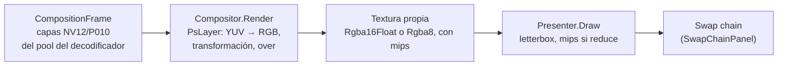

# Render: `Rodaje.Render`

Compone en Direct3D 11 las capas de un `CompositionFrame` y presenta el resultado en la cadena de intercambio de una ventana. Referencia [Medios](medios.md) (por `GpuDevice` y `D3D11TexturePayload`) y [Reproducción](reproduccion.md) (por los tipos de `Composition`), y usa TerraFX.Interop.Windows. No depende del motor: el contrato entre ambos es `Rodaje.Playback.Composition`. La vista previa y la futura exportación compartirán este mismo compositor, para que lo que se ve sea lo que se exporta.

## Cómo compone

- **Sin copias.** Los cuadros de D3D11VA son capas de un `Texture2DArray` del pool del decodificador, en el mismo dispositivo. [`PlaneViewCache`](../../src/Rodaje.Render/PlaneViewCache.cs) crea vistas de luma (R) y croma (RG) por textura y capa, y las suelta cuando su decodificador se cerró o tras 2 s sin uso (como mucho 512), porque una vista retiene el pool.
- **Color.** `PsLayer` aplica el rango y la matriz del cuadro:
  - [`YuvRange`](../../src/Rodaje.Render/YuvRange.cs) corrige que P010 leído como R16_UNORM devuelva código·64/65535;
  - `YuvToRgb` cubre BT.601, BT.709 y BT.2020.
- **Mezcla.** De abajo hacia arriba con "over" premultiplicado, sobre negro. Se mezcla en valores con gamma, no en luz lineal ([D-016](../decisiones.md)); el muestreo es bilineal.
- **Geometría.** [`LayerLayout.Place`](../../src/Rodaje.Render/LayerLayout.cs) encaja el tamaño visible en la secuencia ("contain"). Después escala sobre el centro, rota en sentido horario y desplaza en píxeles de secuencia. [`SourceGeometry`](../../src/Rodaje.Render/SourceGeometry.cs) aplica el aspecto de píxel y la rotación del archivo, y [`VideoLayout.Corners`](../../src/Rodaje.Render/VideoLayout.cs) recorta el relleno de la textura. El shader calcula la cobertura del borde en píxeles de destino, así los bordes rotados salen suavizados.
- **Tamaño.** El compositor puede ser más chico que la secuencia (por ejemplo, a la mitad en una vista previa pequeña): las posiciones siguen en píxeles de secuencia y se escalan.
- **Contexto compartido.** El compositor toma `GpuDevice.LockContext()`, porque FFmpeg usa el mismo contexto. Al terminar, `QuadPipeline.Unbind` suelta las superficies para que el decodificador pueda reutilizarlas.
- **Resultado.** Las capas que no son NV12/P010 de D3D11 o que ya se liberaron se saltan y se cuentan en `CompositeResult`; una capa de otro dispositivo es un error.

## Archivos

| Archivo | Qué hace |
|---|---|
| [`Compositor.cs`](../../src/Rodaje.Render/Compositor.cs) | `Render(frame) → CompositeResult`, `ReadbackRgba()` (pruebas y miniaturas), `TrimCachedViews()` en pausa |
| [`Presenter.cs`](../../src/Rodaje.Render/Presenter.cs) | `Draw(rtv, ancho, alto, compositor)`: letterbox con `VideoLayout.Fit`, mips y muestreo trilineal al reducir. Deja el destino libre para dibujar encima |
| [`QuadPipeline.cs`](../../src/Rodaje.Render/QuadPipeline.cs) | Estado compartido: cuatro vértices sin búfer, sampler lineal, mezcla premultiplicada y constantes del `cbuffer` |
| [`RenderShaders.cs`](../../src/Rodaje.Render/RenderShaders.cs) | HLSL en línea (`VsQuad`, `PsLayer`, `PsPresent`), compilado una vez por proceso |
| [`ShaderCompiler.cs`](../../src/Rodaje.Render/ShaderCompiler.cs) | Compila con el `d3dcompiler_47.dll` del sistema, con optimización O3 y las advertencias como errores ([D-015](../decisiones.md)) |
| [`LayerLayout.cs`](../../src/Rodaje.Render/LayerLayout.cs), [`VideoLayout.cs`](../../src/Rodaje.Render/VideoLayout.cs), [`SourceGeometry.cs`](../../src/Rodaje.Render/SourceGeometry.cs) | Matemática de colocación, letterbox y rotaciones, probada sin GPU |
| [`YuvRange.cs`](../../src/Rodaje.Render/YuvRange.cs) | Rangos y matrices de color |
| [`GpuTimer.cs`](../../src/Rodaje.Render/GpuTimer.cs) | Mide el tiempo de GPU con consultas de marca de tiempo |
| [`RenderException.cs`](../../src/Rodaje.Render/RenderException.cs) | Explica un HRESULT, incluidos dispositivo quitado o reiniciado |

## Pruebas

[`tests/Rodaje.Render.Tests`](../../tests/Rodaje.Render.Tests):

- **`CompositorTests`** (`[GpuFact]`, necesitan texturas NV12 y P010) compara cada píxel con `ReferenceColor`, que implementa las ecuaciones ITU por su cuenta, sin compartir código con los shaders. Usa imágenes NV12 y P010 de 8 y 10 bits y las presenta en un destino fuera de pantalla legible.
- **`LayerLayoutTests` y `VideoMathTests`** prueban la geometría sin GPU.
- **`DecoderCompositionTests`** (`[HardwareFact]`) compone superficies reales del decodificador y lee el número de cuadro de cada capa.
- **`CompositorPerformanceTests`** mide el tiempo de composición.
