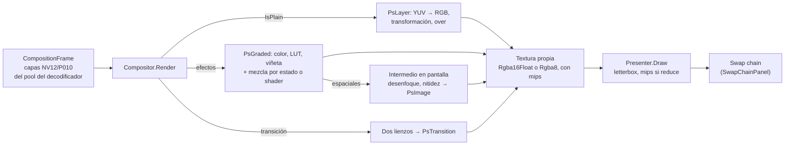

# Render: `Rodaje.Render`

Compone en Direct3D 11 las capas de un `CompositionFrame` y presenta el resultado en la cadena de intercambio de una ventana, o lo convierte para la exportación. Referencia [Medios](medios.md) (por `GpuDevice` y `D3D11TexturePayload`) y [Reproducción](reproduccion.md) (por los tipos de `Composition`), y usa TerraFX.Interop.Windows. No depende del motor: el contrato entre ambos es `Rodaje.Playback.Composition`. La vista previa y la exportación comparten este mismo compositor, para que lo que se ve sea lo que se exporta.

## Cómo compone

- **Sin copias.** Los cuadros de D3D11VA son capas de un `Texture2DArray` del pool del decodificador, en el mismo dispositivo. [`PlaneViewCache`](../../src/Rodaje.Render/PlaneViewCache.cs) crea vistas de luma (R) y croma (RG) por textura y capa, y las suelta cuando su decodificador se cerró o tras 2 s sin uso (como mucho 512), porque una vista retiene el pool.
- **Color.** `SampleRgb` aplica el rango y la matriz del cuadro:
  - [`YuvRange`](../../src/Rodaje.Render/YuvRange.cs) corrige que P010 leído como R16_UNORM devuelva código·64/65535;
  - `YuvToRgb` cubre BT.601, BT.709 y BT.2020.
- **Mezcla.** De abajo hacia arriba sobre negro, en valores con gamma, no en luz lineal ([D-016](../decisiones.md)); el muestreo es bilineal.
- **Geometría.** [`LayerLayout.Place`](../../src/Rodaje.Render/LayerLayout.cs) encaja el tamaño visible en la secuencia ("contain"). Después escala sobre el centro, rota en sentido horario y desplaza en píxeles de secuencia. [`SourceGeometry`](../../src/Rodaje.Render/SourceGeometry.cs) aplica el aspecto de píxel y la rotación del archivo, y [`VideoLayout.Corners`](../../src/Rodaje.Render/VideoLayout.cs) recorta el relleno de la textura. El shader calcula la cobertura del borde en píxeles de destino, así los bordes rotados salen suavizados.
- **Tamaño.** El compositor puede ser más chico que la secuencia (vista previa a media resolución): posiciones y radios siguen en píxeles de secuencia y se escalan.
- **Contexto compartido.** El compositor toma `GpuDevice.LockContext()`, porque FFmpeg usa el mismo contexto. Al terminar, `QuadPipeline.Unbind` suelta las superficies para que el decodificador pueda reutilizarlas.

## Efectos

[`LayerRenderer`](../../src/Rodaje.Render/LayerRenderer.cs) dibuja cada capa. Una capa con `IsPlain` (sin efectos, mezcla normal ni transición) va por el **camino rápido**: un cuadrilátero con `PsLayer`. El resto:

| Etapa | Cómo | Dónde |
|---|---|---|
| Color, LUT, viñeta | Fusionados en `PsGraded`, el shader que convierte YUV a RGB; una variante por combinación de banderas | [`EffectShaders`](../../src/Rodaje.Render/Effects/EffectShaders.cs) |
| Desenfoque, nitidez | Intermedio RGBA16F del tamaño de la capa en pantalla (sin pasar del lado mayor del destino), luego `PsImage` con la transformación | [`LayerRenderer.Effects`](../../src/Rodaje.Render/LayerRenderer.Effects.cs) |
| Mezcla | Normal, suma, multiplicar y trama por estado fijo; los otros 9 por shader, con una copia del fondo solo en el rectángulo de la capa | `EffectPipeline` |
| Transición | Cada lado (con sus efectos) en un lienzo transparente del tamaño del destino; `PsTransition` los mezcla y aplica la mezcla de la capa | `LayerRenderer.Effects` |

**Fórmulas** (en gamma, de 0 a 1; las pruebas tienen su propia referencia en la CPU, [`EffectReference`](../../tests/Rodaje.Render.Tests/Support/EffectReference.cs)):

- **Color**, en este orden: exposición `c·2^e`; contraste `(c − 0,5)·(1 + k) + 0,5`; saturación `L + (c − L)·(1 + s)` con L de BT.709; temperatura y tinte como ganancias `R·(1 + 0,2t)`, `G·(1 − 0,2m)`, `B·(1 − 0,2t)`; altas y sombras suman `0,25·(h·smoothstep(0,5; 1; L) + s·(1 − smoothstep(0; 0,5; L)))`; recorte a 0–1.
- **LUT 3D**: `Texture3D` RGBA16F con filtro trilineal del hardware y `lerp(c, LUT(c), intensidad)`. Una LUT de menos de 17³ se subdivide al subirla (sin cambiar el resultado), porque el filtro pondera con unos 8 bits de fracción. Se pide con `IEffectResources.TryGetLut`, que nunca espera: si no está, la capa sale sin LUT y se cuenta.
- **Viñeta**: `d = |2·(uv − 0,5)|/√2` en el espacio de la capa; `t = saturate((d − tamaño)/suavidad)`; ganancia `1 − cantidad·smoothstep(t)`.
- **Desenfoque**: gaussiano con sigma = radio/3. Mientras sigma pase de 2 px se reduce a la mitad (promedio de 2×2, pirámide ½, ¼…), y en ese nivel van dos pasadas separables de ⌈3σ⌉ muestras por lado.
- **Nitidez**: máscara de enfoque `saturate(c + cantidad·(c − gauss(c, σ = radio)))`.
- **Mezcla**: con fuente premultiplicada y fondo opaco, `Cb·(1 − a) + a·B(Cb, Cs)` con las funciones B de W3C (*Compositing and Blending Level 1*). La suma es `Cb + a·Cs` y en RGBA16F no se recorta hasta la salida.
- **Transiciones** (`p` de 0 a 1, exactas en los extremos): fundido `A·(1 − p) + B·p`; a color en dos mitades a través del color; barrido con borde lineal de ancho `suavidad` en la dirección del ángulo (0 = de izquierda a derecha); empujar, con el saliente corrido `p` cuadros; zoom y desenfoque con un peso `4p(1 − p)` que vale 0 en los extremos. Un `rodaje.preset` que llega sin resolver (falta el paquete) cae a fundido cruzado y cuenta como contenido que falta.

**Imagen y color.** Croma, ruedas y curvas van en `PsGraded` con la bandera `ADVANCED` (64 variantes) y cada uno se enciende con una rama uniforme (`extra`), así no se multiplican las variantes. Orden: croma (sobre la imagen original) → color → ruedas → curvas → LUT → viñeta; el alfa del croma se multiplica con el de las máscaras.

- **Croma** en Y'CbCr BT.709: `Cb = (B − Y)/1,8556`, `Cr = (R − Y)/1,5748`; alfa = `smoothstep(tol, tol + suavidad, 2·|CbCr − clave|)`, recortado a `0,45·limpieza` por abajo y por arriba; el derrame quita del croma su componente positiva en la dirección de la clave (`·derrame`) y la luma queda igual.
- **Ruedas**, por canal con el general sumado: `c + lift·(1 − c)`, luego `·(1 + gain)`, luego `^(2^−gamma)`.
- **Curvas**: cúbica de Hermite con pendientes de Fritsch–Carlson (no se pasa de los puntos), canal y luego general, en una tabla RGBA16F de 1024 × 1 en `t10` (`CurveTextures`, se sube solo si cambia).
- **Recorte** (`LayerTransform.Crop`): `LayerLayout.Place` ajusta el tamaño que queda y `VideoLayout.Crop` lleva las esquinas de la textura a esa parte; vale por los dos caminos y por el intermedio.
- **Capas compuestas** (`LayerFrame.Nested`, un clip compuesto con efectos propios): sus capas se componen en un intermedio RGBA16F transparente del pool, del tamaño del destino (recursivo), y ese intermedio se dibuja como una capa más con color, máscaras, mezcla y transición: `PsGraded` lo lee de `t5` con `extra.w = 1` en lugar de los planos Y'CbCr. Sin memoria en el pool se salta y se cuenta. Contra la referencia de componer a mano ([`CompoundLayerTests`](../../tests/Rodaje.Render.Tests/CompoundLayerTests.cs)): color y opacidad sobre el compuesto igual que sobre su clip (≤1/255), opacidad 0,5 la mitad de la composición, anidado ×0,25, fundido y barrido en los dos sentidos ≤1/255. Coste: dos capas 1080p pasan de 0,120 a 0,168 ms (+0,05 ms, 15 MB de pool).
- **Antes/después y cuentagotas** (`Compositor.CompareSplit`, `Compositor.Bypass`, solo vista previa): con la cortina se compone otra vez sin color en un intermedio del pool y se copia su parte izquierda sobre la salida; `PreviewBypass` deja fuera el color, el croma o el recorte en todo el cuadro. `RenderStrict` no los mira.
- **Pruebas** (`ImageColorTests`, contra `EffectReference` y `ToneCurve` en la CPU, ≤2/255): ruedas (6 casos), curvas, pantalla verde con derrame, pantalla azul con limpieza, croma con máscara y sin croma en vista previa, antes/después y exportación sin cortina, recorte (3 casos). En la GPU de verdad localmente y en el adaptador básico (WARP) en la CI.
- **Cifras** (RTX 3050 Laptop, Release, mediana de 300 cuadros): una capa 1080p con recorte, croma, color, LUT, ruedas y curvas, **0,16 ms**; con antes/después, **0,30 ms** (15 MB de pool). La capa 4K con color y LUT sigue en 0,33 ms.

**Estabilizar.** No es una etapa propia: la corrección del cuadro llega en `LayerTransform.Stabilization` (similitud sobre el centro de la imagen ajustada, en altos de esa imagen) y `LayerLayout.Place` la compone antes de la transformación (`S·s`, `u + θ`, desplazamiento `S·R(u)·h·t`), así la capa sigue siendo un cuadrilátero por cualquiera de los caminos.

**Unidades.** Los radios están en píxeles de la secuencia: el intermedio mide en píxeles de pantalla y los radios se multiplican por esa escala, así la vista previa a media resolución se ve como la exportación. Medida: 0,64/255 de diferencia media entre mitad y completa reducida.

**Dirección del empuje.** `rodaje.push` no tiene parámetros numéricos y su dirección es una opción de texto: el motor manda su índice en `EffectRegistry.PushDirections` (0 izquierda, 1 derecha, 2 arriba, 3 abajo) en el primer valor de `LayerTransition.Values`.

**Lo que no se aplica se cuenta, nunca se espera.** `CompositeResult` trae `EffectsApplied`, `EffectsSkipped` (shader sin compilar, pool lleno, código desconocido, un segundo color o viñeta en la misma capa), `MissingContent` (LUT que carga o falta, preset sin resolver) y `PoolBytes`.

### Shaders y memoria

- **[`ShaderCache`](../../src/Rodaje.Render/Shaders/ShaderCache.cs)**: bytecode en memoria y en `%LOCALAPPDATA%\Rodaje\cache\shaders\<sha256>.cso` (o `RODAJE_DATOS\cache\shaders`). La clave incluye fuente, variante, perfil y opciones del compilador. `EffectPipeline` crea las 72 variantes en segundo plano al abrir el compositor (`ShadersReady`); hasta entonces la capa sale por el camino rápido. Los shaders base (`VsQuad`, `PsLayer`, `PsPresent`) se compilan al arrancar ([D-015](../decisiones.md)).
- **[`RenderTargetPool`](../../src/Rodaje.Render/RenderTargetPool.cs)**: intermedios reutilizados, con tamaños redondeados a 64 px y un tope del 7,5 % de la VRAM entre 96 y 300 MB (300 MB con 4 GB), fuera del presupuesto de los decodificadores. Si una textura no cabe, el efecto se salta. Las libres se sueltan tras 240 cuadros sin uso o con `TrimCachedViews`.
- **[`GpuEffectRegistry`](../../src/Rodaje.Render/Effects/GpuEffectRegistry.cs)**: tabla explícita código → implementación, sin reflexión; una prueba exige que coincida con `EffectRegistry`.

## Exportación

[`ExportFrameConverter`](../../src/Rodaje.Render/Export/ExportFrameConverter.cs) lleva la composición R'G'B' (premultiplicada, con mips) al cuadro que recibe el sink ([D-028](../decisiones.md)). Todo va en compute shaders ([`ExportShaders`](../../src/Rodaje.Render/Export/ExportShaders.cs)):

1. **Escala y forma** ([`ExportGeometry`](../../src/Rodaje.Render/Export/ExportGeometry.cs)). La composición cae en un rectángulo de la salida: barras (por defecto; borde en posición y tamaño pares si el croma está submuestreado), recorte centrado o estirado. Con un recorte por región (`ExportSourceRegion`, de `VideoExportSettings.Crop`) solo esa parte de la composición se escala a la salida; lee un nivel de mip mientras la región caiga en texels enteros de él. Con `Auto`, una reducción a la mitad exacta (o un cuarto…) lee el nivel de mip, que es el promedio 2×2; si además llena el cuadro, la conversión lee ese nivel directamente, sin pasada de escala. Lo demás va con Catmull-Rom, ensanchado 1/escala al reducir (4K → 720p: mip 1 y núcleo ×1,5). `Lanczos` (3 lóbulos) y `Bilinear` leen el nivel 0. `SubmitBlend` mezcla dos composiciones en esta misma pasada.
2. **Y'CbCr por planos** a un búfer lineal ([`ExportLayout`](../../src/Rodaje.Render/Export/ExportLayout.cs)): un hilo escribe una palabra de 4 bytes, y el pitch se redondea a esa unidad (1080p NV12 sale sin relleno). Matriz BT.709 o BT.601, rango limitado o completo; croma «left» con [1 2 1]/4 en horizontal y promedio de las dos filas en vertical (4:2:0), solo horizontal (4:2:2) o ninguno (4:4:4). Tramado de Bayer 4×4 de ±0,5 LSB en 8 bits (`Dither`). P010 lleva el código en los 10 bits altos; los planares de 10 bits, en los bajos. Con alfa (YUVA, RGBA) el color se despremultiplica, el alfa es de rango completo y las barras son transparentes; el compositor compone sobre transparente con `TransparentBackground`.
3. **Anillo de `Staging`** (3 por omisión): `Submit` copia el búfer al `Staging` del cuadro y hace `Flush`; `TryRead` mapea el más antiguo con `DO_NOT_WAIT`, soltando el candado del contexto entre intentos, lo copia a un búfer propio reservado una vez, desmapea y se lo presta al sink. `ReadWait` acumula lo que se esperó a la GPU. Cada 500 ms se baja además una miniatura BGRA de 320 px (`LatestThumbnail`).

**Modo estricto.** `Compositor.RenderStrict` espera a los shaders de efectos y, si un efecto se salta, vacía el pool y compone otra vez; si sigue, lanza `ExportException` con `EffectFailed`. `MissingContent` lo decide quien llama.

**Pruebas** ([`tests/…/Export`](../../tests/Rodaje.Render.Tests/Export)): una referencia propia en la CPU ([`ExportReference`](../../tests/Rodaje.Render.Tests/Export/ExportReference.cs), doble precisión, ecuaciones de la norma y el mismo Bayer) contra la GPU, en **WARP** (corre en la CI) y en la GPU de verdad: los 13 formatos de píxel, matrices y rangos, filas con relleno, escalas 2× y arbitrarias con cada filtro, barras, recorte y estirado, alfa, mezcla, anillo y miniaturas. Todas a ≤1 código salvo la bilineal (≤3 en 10 bits). Barras BT.709 al 100 %: los códigos publicados ±1 con tramado; al 100 % y al 75 % vuelven a R'G'B' ±1.

**Cifras** (RTX 3050 Laptop, Release, 300 cuadros; «anillo» es encolar n y leer n − 2 copiando a la CPU y empaquetando como la tubería; [`ExportPerformanceTests`](../../tests/Rodaje.Render.Tests/Export/ExportPerformanceTests.cs)):

| Caso | GPU por cuadro (mediana) | Anillo |
|---|---|---|
| 1080p → 1080p NV12 | 0,42–0,47 ms | 1915–2003 fps (0,5 ms) |
| 1080p → 1080p P010 | 0,66–0,71 ms | 1020–1065 fps |
| 1080p → 720p NV12 (Catmull-Rom ×1,5) | 0,72 ms | ~1280 fps |
| 1080p → 1080×1920 NV12 (barras) | 1,2 ms | ~765 fps |
| 4K → 1080p NV12 (mip 1) | 0,62 ms | ~1495 fps |
| 4K → 4K NV12 | 2,4 ms | ~460 fps |
| 4K → 4K P010 | 3,2 ms | 248–271 fps |

Con `Map` síncrono, bajar un NV12 1080p cuesta 3,2–3,3 ms; con el anillo son 0,5 ms, así que la bajada no es el cuello de botella frente a los ≥150 fps sin codificar.

## Títulos

[`Text/TitleRasterizer`](../../src/Rodaje.Render/Text/TitleRasterizer.cs), uno por `GpuDevice`, rasteriza un `GeneratedContent` con DirectWrite y Direct2D sobre el dispositivo D3D11 (con `LockContext` y `ClearState` al terminar, porque el contexto es compartido):

- **Imagen.** Textura BGRA premultiplicada centrada en la caja del texto, a la secuencia × la escala máxima, con margen para borde y sombra. Tope en bytes: el 25 % del pool por título (si no cabe se baja la escala, `Downscaled`) y 16384 px por lado. Caché propia por `Key` (por omisión el tope del pool), fuera del soltado del pool: lo más viejo se saca, nunca lo de este cuadro o el anterior, y se suelta al empezar el cuadro siguiente del compositor.
- **Dibujo.** Fondo redondeado; borde con el contorno de los glifos (`GlyphOutlines`: un `IDWriteTextRenderer` propio con tabla COM y `UnmanagedCallersOnly`, apto para AOT) trazado al doble de ancho bajo el relleno; relleno con `DrawTextLayout` (emoji de color, sin ajuste a píxel, antialias gris); sombra con el efecto de sombra de Direct2D sobre la capa de borde y relleno (sigma = desenfoque / 2). Alineación, ajuste en la caja, interlineado uniforme, espaciado de letras y bidi de DirectWrite.
- **Fuentes.** `RegisterFonts` arma una colección privada (`CreateFontSetBuilder`/`AddFontFile`, hasta 20 MB por archivo; lo que DirectWrite rechaza vuelve en la lista) que se busca antes que la del sistema; si falta la familia se usa el primer respaldo y si no Segoe UI. `FindMissingFonts` es la pasada que solo resuelve.
- **Hilos.** `Prepare` (la interfaz `IGeneratedContentCache` del motor) encola y lo rasteriza un hilo propio (`Changed` avisa); `TryGet` nunca espera; `Rasterize` lo hace en el acto.
- **Composición.** `Compositor.Titles` conecta el rasterizador. La capa va por `PsImage` con `LayerLayout.PlaceNative` (tamaño nativo, centrada; `scale` 1 = tamaño del texto), opacidad y mezcla; desenfoque y nitidez pasan por un intermedio con margen de tres sigmas; color, LUT y viñeta no se aplican a los títulos (`EffectsSkipped`). Un título sin rasterizar sale sin él y cuenta en `CompositeResult.TitlesPending`; uno con fuente de respaldo, en `MissingContent`. `RenderStrict` rasteriza antes de componer: vista previa y exportación dan los mismos bytes (probado, también con desenfoque).
- **Cifras** (RTX 3050 Laptop, Release, `TitleRasterizerTests`): rasterizar un título 1080p de una línea 0,36 ms de mediana; dos líneas con borde de 6 px y sombra desenfocada 1,36 ms (p90 1,68); componerlo ya rasterizado 0,01 ms de GPU por cuadro. Publicado con Native AOT sin advertencias y probado (borde, sombra, fondo y hebreo).

## Archivos

| Archivo | Qué hace |
|---|---|
| [`Compositor.cs`](../../src/Rodaje.Render/Compositor.cs) | `Render(frame) → CompositeResult`, `RenderStrict` para exportar, `TransparentBackground`, `Resources` (LUT), `ShadersReady`, `ReadbackRgba()`, `TrimCachedViews()` en pausa |
| [`Export/`](../../src/Rodaje.Render/Export) | `ExportFrameConverter`, sus shaders, la geometría de escala y forma y la disposición de los planos |
| [`LayerRenderer.cs`](../../src/Rodaje.Render/LayerRenderer.cs), [`LayerRenderer.Effects.cs`](../../src/Rodaje.Render/LayerRenderer.Effects.cs) | Camino rápido, efectos por píxel, intermedios, mezclas y transiciones |
| [`Effects/`](../../src/Rodaje.Render/Effects) | HLSL de los efectos, `EffectPipeline` (constantes, estados de mezcla, shaders), `LutTextures`, `GpuEffectRegistry` |
| [`RenderTargetPool.cs`](../../src/Rodaje.Render/RenderTargetPool.cs) | Intermedios con tope |
| [`Shaders/ShaderCache.cs`](../../src/Rodaje.Render/Shaders/ShaderCache.cs) | Caché de bytecode en memoria y disco |
| [`Presenter.cs`](../../src/Rodaje.Render/Presenter.cs) | `Draw(rtv, ancho, alto, compositor)`: letterbox con `VideoLayout.Fit`, mips y muestreo trilineal al reducir; la sobrecarga con `placement` dibuja en un rectángulo dado (puede salirse del destino, para el zoom) |
| [`QuadPipeline.cs`](../../src/Rodaje.Render/QuadPipeline.cs) | Estado compartido: cuatro vértices sin búfer, sampler lineal, mezcla premultiplicada y constantes del `cbuffer` |
| [`RenderShaders.cs`](../../src/Rodaje.Render/RenderShaders.cs) | HLSL base (`Prelude` común, `VsQuad`, `PsLayer`, `PsPresent`) |
| [`ShaderCompiler.cs`](../../src/Rodaje.Render/ShaderCompiler.cs) | Compila con el `d3dcompiler_47.dll` del sistema, con O3 y las advertencias como errores ([D-015](../decisiones.md)) |
| [`LayerLayout.cs`](../../src/Rodaje.Render/LayerLayout.cs), [`VideoLayout.cs`](../../src/Rodaje.Render/VideoLayout.cs), [`SourceGeometry.cs`](../../src/Rodaje.Render/SourceGeometry.cs) | Matemática de colocación, letterbox y rotaciones, probada sin GPU |
| [`YuvRange.cs`](../../src/Rodaje.Render/YuvRange.cs) | Rangos y matrices de color |
| [`GpuTimer.cs`](../../src/Rodaje.Render/GpuTimer.cs) | Mide el tiempo de GPU con consultas de marca de tiempo |
| [`RenderException.cs`](../../src/Rodaje.Render/RenderException.cs) | Explica un HRESULT, incluidos dispositivo quitado o reiniciado |

## Pruebas

[`tests/Rodaje.Render.Tests`](../../tests/Rodaje.Render.Tests):

- **`CompositorTests`** (`[GpuFact]`) compara cada píxel con `ReferenceColor`, que implementa las ecuaciones ITU por su cuenta, en NV12 y P010 de 8 y 10 bits.
- **`EffectFidelityTests`**: cada control de color, LUT (identidad ≤1/255 en 2³, 17³, 33³ y 65³; una curva ≤2/255), viñeta, desenfoque, nitidez y los 13 modos de mezcla ≤2/255 frente a la CPU; media resolución frente a completa ≤3/255 de media.
- **`TransitionTests`**: en 0 y en 1 cada transición es byte a byte el clip que sale o el que entra; el fundido a 0,5 es el promedio ±1.
- **`DecoderCompositionTests`** (`[HardwareFact]`): compone superficies reales del decodificador D3D11VA y lee el código de cuadro de cada capa.
- **`EffectPipelineTests`**: la tabla de la GPU coincide con el registro; un cuadro no espera a un shader; el pool lleno salta efectos sin fallar.
- **`ShaderCompileTests`**: todas las variantes compilan con las advertencias como errores; la caché en disco se lee en otra sesión.
- **`EffectPerformanceTests`** y **`CompositorPerformanceTests`** miden con `GpuTimer`; los objetivos se exigen con `RODAJE_PRUEBAS_LARGAS=1`.

**Cifras** (RTX 3050 Laptop, mediana de 300 cuadros):

| Escenario | Objetivo | Medido |
|---|---|---|
| 8 capas 1080p sin efectos | ≤0,6 ms | 0,53 ms (p95 0,86) |
| Una capa 4K con color y LUT | ≤1,0 ms | 0,33 ms |
| 3 capas 4K con color, LUT, desenfoque y superponer | ≤6 ms, p95 ≤8 | 1,8–3,4 ms, p95 2,7–6,9 |
| Transición 4K con color y LUT (fundido, barrido, zoom) | ≤5 ms | 0,98–0,99 ms |
| Ídem con desenfoque | ≤5 ms | 1,2–1,5 ms |
| Media resolución | ≤40 % | 19–32 % |
| Pool en 4K | ≤300 MB | 92 MB (3 capas), 151 MB (transición con desenfoque) |

Los rangos son de dos corridas: la GPU de un portátil varía con el reloj.
