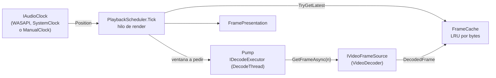

# Reproducción: `Rodaje.Playback`

Decide qué cuadro de video se muestra en cada refresco siguiendo al reloj del audio, y mantiene la decodificación un poco por delante. No depende de FFmpeg ni de dispositivos (`net10.0`, `IsAotCompatible`, solo referencia a `Rodaje.Core`), así que se prueba entera en tiempo virtual. La usan Medios (que implementa sus interfaces), Audio, Render, Motor y las ventanas.

## La regla

**El audio manda.** El video lee la posición de un reloj maestro ([`IAudioClock`](../../src/Rodaje.Playback/Clocks/IAudioClock.cs)) y nunca lo empuja. Si el equipo no alcanza, se repite o se salta un cuadro, nunca una muestra de audio, porque un salto de imagen se tolera mucho mejor que un chasquido. Nada en el camino de render espera al decodificador.

## Archivos

| Archivo | Qué hace |
|---|---|
| [`Clocks/IAudioClock.cs`](../../src/Rodaje.Playback/Clocks/IAudioClock.cs) | `Position`, `IsRunning`, `Start`, `Pause` y `Seek`. Es seguro entre hilos, la posición no retrocede mientras corre (salvo por un seek) y la latencia de salida la descuenta cada implementación |
| [`Clocks/ManualClock.cs`](../../src/Rodaje.Playback/Clocks/ManualClock.cs) | Reloj determinista para pruebas: `Advance(delta)` |
| [`Clocks/SystemClock.cs`](../../src/Rodaje.Playback/Clocks/SystemClock.cs) | Reloj de pared (`TimeProvider` inyectable) para medios sin audio o sin dispositivo |
| [`Clocks/SampleCountingClock.cs`](../../src/Rodaje.Playback/Clocks/SampleCountingClock.cs) | Base de los relojes de dispositivo: destino del último seek + muestras oídas desde entonces |
| [`Frames/DecodedFrame.cs`](../../src/Rodaje.Playback/Frames/DecodedFrame.cs) | Cuadro con conteo de referencias: `Index`, `Pts`, `Duration`, un `Payload` opaco (textura o memoria) y `SizeBytes`. `TryRetain` falla si ya se liberó y el último `Dispose` libera el payload |
| [`Frames/FrameCache.cs`](../../src/Rodaje.Playback/Frames/FrameCache.cs) | LRU por índice acotada por la suma de `SizeBytes`; entrega cuadros retenidos y nunca expulsa el recién agregado; `TryGetLatest(min, max)` da el mayor índice disponible del rango |
| [`Frames/IVideoFrameSource.cs`](../../src/Rodaje.Playback/Frames/IVideoFrameSource.cs) | `GetFrameAsync(n)`. El cuadro n tiene `Pts = Time.FromFrames(n, tasa)`; la implementación resuelve el seek al keyframe. Las llamadas nunca se solapan |
| [`Scheduling/ClipTiming.cs`](../../src/Rodaje.Playback/Scheduling/ClipTiming.cs) | Convierte entre línea de tiempo y cuadros del origen (`FrameAt`, `TimelineStartOf`, `Clamp`, `FromClip`) |
| [`Scheduling/DecodeThread.cs`](../../src/Rodaje.Playback/Scheduling/DecodeThread.cs) | El `IDecodeExecutor` de producción: un hilo dedicado que ejecuta en orden |
| [`Scheduling/PlaybackTypes.cs`](../../src/Rodaje.Playback/Scheduling/PlaybackTypes.cs) | `PlaybackOptions.PrefetchFrames` (8), `FramePresentation`, `PlaybackStats` y los eventos |
| [`Scheduling/PlaybackScheduler.cs`](../../src/Rodaje.Playback/Scheduling/PlaybackScheduler.cs) | El programador de un clip (ver abajo) |
| [`Composition/CompositionTypes.cs`](../../src/Rodaje.Playback/Composition/CompositionTypes.cs) | Lo que el motor entrega al compositor: `CompositionFrame` (instante, tamaño y capas de abajo hacia arriba; vacía = negro) con `LayerFrame` (pista, clip, cuadro retenido, `LayerTransform` x/y/escala/rotación/opacidad, aspecto de píxel, rotación del archivo y si es proxy) |

## `PlaybackScheduler`

Se construye con `(ClipTiming, IAudioClock, IVideoFrameSource, FrameCache, IDecodeExecutor, PlaybackOptions?)`. Expone `Play`, `Pause`, `Seek`, `SeekToFrame`, `Tick` y `Stats`, y los eventos `ExactFrameReady`, `EndReached` y `DecodeFailed`.

1. **`Tick`** (hilo de render) lee `clock.Position`, la lleva al tiempo del origen y calcula el cuadro debido. Muestra el más reciente disponible hasta ese índice (o repite el último), sin bloquear. Cuenta aciertos, fallos, cuadros saltados, refrescos tarde y el desfase máximo entre audio y video. Al reproducir, borra de la caché lo que ya pasó para que el LRU no expulse lo adelantado.
2. **Ventana de decodificación:** `[debido, debido + PrefetchFrames)`, recalculada en cada `Tick` y antes de cada pedido. Hay un solo pedido en vuelo, un cuadro adelantado se pide una vez por ventana y los cuadros que fallan se marcan no disponibles hasta el siguiente seek.
3. **Seek por épocas:** cada seek cancela el token de la época anterior. Lo que llegue de una época vieja se guarda en caché pero no cuenta. Si el decodificador devuelve un índice distinto del pedido, se descarta y cuenta como error: el seek es exacto al cuadro o no es.
4. **Hilos:** un solo candado (`_gate`) que nunca se retiene mientras se decodifica; los eventos y los `Dispose` de cuadros se hacen fuera de él. Si un `ValueTask` termina en otro hilo, el resultado se guarda allí y solo el bucle vuelve al ejecutor.

## Pruebas

[`tests/Rodaje.Playback.Tests`](../../tests/Rodaje.Playback.Tests) corre en tiempo virtual con dobles:

- **Dobles:** `PlaybackHarness` (refresco de 60 Hz exacto en ticks), `SimulatedSource` (latencia e inyección de fallos) y `PayloadTracker`, que detecta cuadros filtrados.
- **Unitarias:** relojes, conteo de referencias concurrente, caché, `ClipTiming` y `DecodeThread` con hilo real.
- **Programador:** unos 22 escenarios (seek lento, cancelación, fin de clip, picos de latencia, caché chica, errores).
- **Propiedades con CsCheck:** el seek muestra el cuadro exacto, el instante muestra el cuadro que lo contiene y ninguna secuencia aleatoria filtra cuadros.
- **Sincronía:** `AvSyncTests` reproduce 10 minutos a 23,976, 25, 29,97 y 59,94 fps con el reloj ±0,1 % desviado, y el cuadro mostrado nunca se aleja un cuadro del reloj.

La aceptación de la fase 2 con decodificador y dispositivo reales está en [Audio](audio.md#aceptación-de-la-fase-2).
