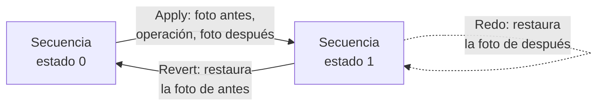
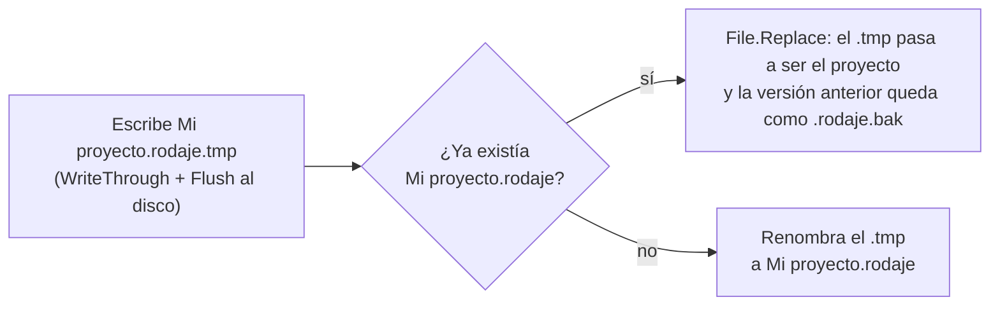
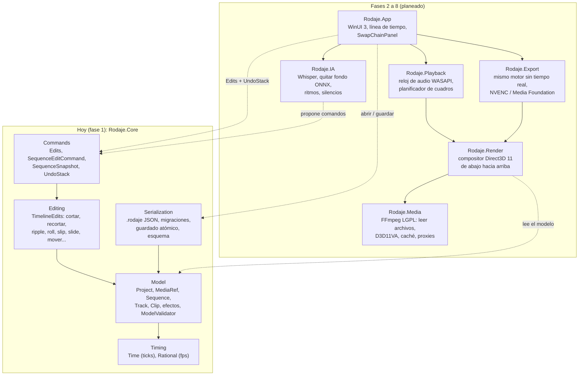
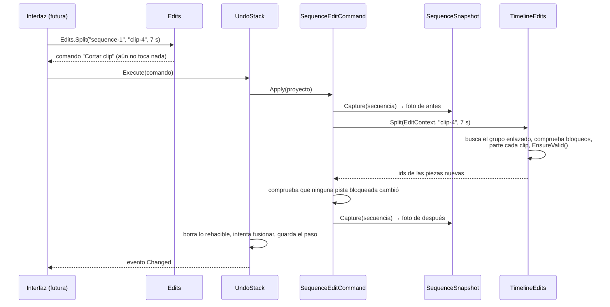
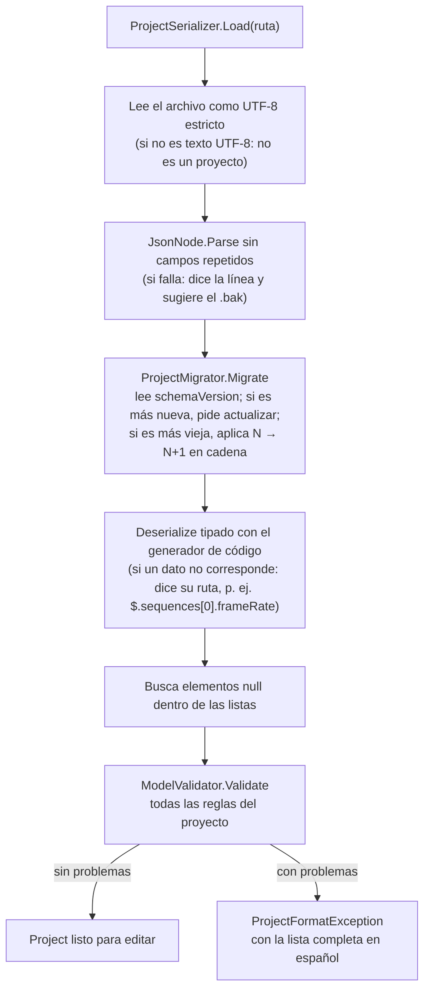

# Rodaje

Rodaje es un editor de video nativo para Windows que Daniel ([Dathinel](https://github.com/Dathinel)), estudiante de Ingeniería Mecatrónica, construye desde cero. La experiencia de uso que persigue es la de los editores rápidos al estilo de CapCut: arrastrar material a una línea de tiempo, cortar, recortar, poner capas encima, subtítulos automáticos y exportar sin pelear con el programa. De esos programas solo se toman ideas de producto. Todo el código es propio, ningún recurso suyo se usa y ninguna de sus marcas aparece en Rodaje. La lógica de fondo se estudió en editores de código abierto (Kdenlive con MLT, Shotcut, OpenShot, Olive y LosslessCut), siempre a nivel de diseño y sin copiar una línea, como se explica en [Licencias y fondo legal](#licencias-y-fondo-legal).

El programa está escrito en C# sobre .NET 10 y la interfaz será WinUI 3. Se entregará como un ejecutable compilado de antemano a código nativo (Native AOT), autocontenido y sin instalador. El repositorio `Dathinel/rodaje` es privado por ahora y el código está bajo la licencia [MIT](../LICENSE).

**En qué punto está.** De las ocho fases del plan, la **fase 1 está terminada**. Es el núcleo lógico del editor, una biblioteca sin ventana con su batería de pruebas: el modelo de la línea de tiempo con tiempo exacto, todas las operaciones de edición (cortar, recortar, ripple, roll, slip, slide, mover, insertar, sobrescribir, añadir al final, levantar, borrar con ripple y cerrar huecos), deshacer y rehacer con comandos, y el formato de proyecto `.rodaje` en JSON con versión y migraciones. Todavía no hay ventana ni se reproduce video. Lo que hoy se puede ejecutar son más de 600 pruebas automáticas y un pequeño programa nativo que recorre el núcleo de punta a punta. Empezar por el núcleo sin interfaz no fue un atajo. Es la regla de trabajo de todos los programas de Daniel: primero la lógica, probada a fondo, y después la interfaz encima de algo que ya se sabe que funciona.

## ¿Quiere probarlo? Aquí está

Doble clic en **[`ABRIR.bat`](../ABRIR.bat)**. Se abre una consola que explica qué se va a probar y corre todas las pruebas del núcleo. Al final dice en español cuántas pasaron, cuáles fallaron (con qué esperaban, qué obtuvieron y en qué archivo y línea) y cuánto tardó.

La primera vez descarga el SDK de .NET 10.0.401 fijado por el proyecto, unos 280 MB, **dentro de la carpeta `.entorno\`** del propio proyecto, y comprueba su huella SHA-512 antes de descomprimirlo. No instala nada en Windows, no toca ningún .NET global y no necesita permisos de administrador. Las veces siguientes arranca enseguida y funciona sin internet.

El mismo `ABRIR.bat` acepta un argumento para las otras acciones (desde una consola en la carpeta del proyecto):

| Comando | Qué hace | Cuánto tarda |
|---|---|---|
| `ABRIR.bat` | Restaura los paquetes, compila el núcleo y las pruebas, y corre todas las pruebas | 10-60 s (más la descarga la primera vez) |
| `ABRIR.bat cobertura` | Lo mismo y además mide qué porcentaje de las líneas y de las ramas de `Rodaje.Core` recorre alguna prueba | 15-90 s |
| `ABRIR.bat aot` | Compila con Native AOT un programa de consola que usa todo el núcleo, lo ejecuta sin .NET y dice cuánto pesa el `.exe` y cuánto tardó | 10-90 s |
| `ABRIR.bat preparar-entorno` | Borra y vuelve a descargar el SDK de `.entorno\` (solo si el entorno se dañó) | 2-10 min |
| `ABRIR.bat -Filtro Recorte` | Cualquier otro argumento pasa tal cual a `probar.ps1`; `-Filtro` corre solo las pruebas cuyo nombre contiene ese texto | segundos |

Así se ve una corrida normal (las cifras cambian según el equipo):

```
  Rodaje - pruebas automáticas del núcleo
    Proyecto: D:\Programas de uso libre\Rodaje

  Fase 1/3: restaurando paquetes NuGet (la primera vez los descarga; luego salen de la caché local)...
    Paquetes listos.

  Fase 2/3: compilando el núcleo y las pruebas...
    Compila sin errores ni advertencias.

  Fase 3/3: corriendo las pruebas...
    pruebas ejecutadas: 600

  Resumen
    Pruebas: 6xx en total
    Pasaron:  6xx
    Fallaron: 0

    RESULTADO: todas las pruebas pasaron.

    Tiempo total: 24.3 s
    Registros completos y resultados en: D:\Programas de uso libre\Rodaje\TestResults\20261009-160200
```

Y así termina la prueba nativa (`ABRIR.bat aot`), que recorre el núcleo como lo haría la interfaz:

```
  Rodaje - prueba de humo del núcleo compilado con Native AOT
    Modo: Native AOT
    [ 1] Proyecto creado con la secuencia «Secuencia 1» a 30 fps.
    [ 2] Dos medios importados con AddMediaCommand.
    [ 3] InsertMedia y AppendMedia con audio enlazado: 3 clips en V1 y 3 en A1.
    ...
    [ 8] Deshacer todo (16 pasos) y rehacer todo: cada estado coincide texto a texto.
    [ 9] Guardar (dos veces) y abrir en «...\Rodaje prueba AOT ñ»: 4905 bytes, idéntico.
    ...
    [13] Tiempo exacto en cuadros NTSC sin error de redondeo.

    RESULTADO: todo bien. El núcleo funciona compilado con Native AOT (13 ms).
```

**Requisitos.**

- Windows 10 u 11 de 64 bits, con Windows PowerShell 5.1, que viene con el sistema. Si una versión recortada de Windows lo deshabilitó (pasa a veces en AtlasOS), `ABRIR.bat` lo detecta y explica cómo comprobarlo.
- Internet solo la primera vez, para el SDK de .NET y los paquetes NuGet de las pruebas.
- Solo para `ABRIR.bat aot`: **Visual Studio Build Tools 2022 con la carga de trabajo "Desarrollo para el escritorio con C++"**, porque Native AOT usa el enlazador `link.exe` de Microsoft. Las pruebas normales no lo necesitan. Se instala con
  `winget install Microsoft.VisualStudio.2022.BuildTools --override "--quiet --wait --add Microsoft.VisualStudio.Workload.VCTools --includeRecommended"`.
- La carpeta puede estar en cualquier ruta, aunque tenga espacios y tildes (este repositorio vive en `D:\Programas de uso libre\Rodaje`).

## Paso a paso

### Cómo se probó, de cero a verde

1. **Clonar o copiar la carpeta** y hacer doble clic en `ABRIR.bat`. La consola muestra el encabezado de Rodaje y, como `.entorno\dotnet\dotnet.exe` no existe, avisa que va a descargar el SDK y llama a [`herramientas/preparar-entorno.ps1`](../herramientas/preparar-entorno.ps1).
2. **El script descarga el zip oficial de Microsoft** a `.entorno\dotnet-sdk-10.0.401-win-x64.zip.part`, lo renombra solo si la descarga terminó, calcula su SHA-512 y lo compara con el valor fijado en el script. Si no coincide, se detiene. Si coincide, lo descomprime en `.entorno\dotnet` y deja una marca `.sdk-10.0.401` para no repetir el trabajo.
3. **[`herramientas/probar.ps1`](../herramientas/probar.ps1) corre las tres fases** (restaurar, compilar, probar) con ese SDK. Fija `NUGET_PACKAGES` dentro de `.entorno\nuget`, apaga la telemetría y usa los archivos `packages.lock.json`, así que siempre se restauran exactamente las mismas versiones de paquetes. La salida completa de cada fase queda en `TestResults\<fecha-hora>\` (`1-restaurar.log`, `2-compilar.log`, `3-probar.log` y el `.trx` con el resultado de cada prueba). Se conservan las últimas diez corridas.
4. **El resumen se arma leyendo el `.trx`**, no la salida de `dotnet test`, para poder contar las pruebas que pasaron, fallaron o se omitieron y mostrar de cada fallo su mensaje y la primera línea de la pila que apunta a un archivo.
5. **Con `cobertura`** se activa el colector de coverlet, que viene como paquete del proyecto de pruebas, y el script suma las líneas y ramas del paquete `Rodaje.Core` del informe Cobertura. Una misma línea que aparece en dos clases (por clases parciales o lambdas) se cuenta una sola vez.
6. **Con `aot`**, [`herramientas/publicar-aot-prueba.ps1`](../herramientas/publicar-aot-prueba.ps1) publica [`tests/Rodaje.AotSmoke`](../tests/Rodaje.AotSmoke/Program.cs) con `PublishAot`, falla si el compilador deja cualquier advertencia de recorte o de AOT (con archivo, línea y código `IL2026`/`IL3050`), y ejecuta el `.exe` resultante **quitando `DOTNET_ROOT`** del entorno, para demostrar que no necesita ningún .NET instalado. El ejecutable queda en `dist\prueba-aot\` y pesa unos 3,4 MB.

### Sin `ABRIR.bat`

Para quien prefiere la consola, [`herramientas/dotnet-local.cmd`](../herramientas/dotnet-local.cmd) ejecuta el SDK del entorno propio con cualquier argumento de `dotnet`:

```
herramientas\dotnet-local.cmd test
herramientas\dotnet-local.cmd test --filter "FullyQualifiedName~Ripple"
```

Si el SDK no está, lo prepara primero. La variable `RODAJE_ENTORNO` permite apuntar a otro `.entorno` (por ejemplo, el de la copia principal desde un worktree de git) para no descargar el SDK dos veces. `RODAJE_SIN_PAUSA=1` evita que `ABRIR.bat` espere una tecla al final, útil para lanzarlo desde otro programa.

## ¿Quiere saber cómo funciona? Aquí está todo

1. [Las fases del proyecto](#las-fases-del-proyecto)
2. Conceptos: [edición no destructiva](#qué-es-la-edición-no-destructiva), [tiempo en ticks](#qué-es-el-tiempo-en-ticks-y-por-qué-1705-600-000-de-segundo), [pistas](#qué-son-las-pistas-y-por-qué-se-cuentan-de-abajo-hacia-arriba), [clips enlazados](#qué-son-los-clips-enlazados), [las operaciones de edición](#las-operaciones-de-edición-con-diagramas), [comandos e instantáneas](#qué-es-el-patrón-comando-y-por-qué-con-instantáneas), [fusión, grupos y punto limpio](#fusión-de-arrastres-grupos-y-punto-limpio), [el formato `.rodaje`](#qué-es-el-formato-rodaje) y [Native AOT](#qué-es-native-aot-y-por-qué-importa)
3. [La idea general](#la-idea-general): la arquitectura de hoy y la planeada
4. [Qué hace cada archivo](#qué-hace-cada-archivo)
5. [La lógica del código, paso a paso](#la-lógica-del-código-paso-a-paso): una edición de principio a fin y la apertura de un proyecto
6. [Cómo se prueba](#cómo-se-prueba)
7. [Licencias y fondo legal](#licencias-y-fondo-legal), [problemas de compatibilidad](#problemas-de-compatibilidad), [pendiente](#pendiente) y [créditos](#créditos)

## Las fases del proyecto

El plan completo tiene ocho fases. Cada una se da por terminada solo cuando cumple sus criterios y cuando un agente distinto al que la construyó revisa el código y corre las pruebas, para que el trabajo no se califique a sí mismo.

| Fase | Qué entrega | Criterio para darla por terminada | Estado |
|---|---|---|---|
| 1. Modelo de la línea de tiempo | La biblioteca `Rodaje.Core`: tiempo exacto, modelo, operaciones, comandos con deshacer y formato `.rodaje` | Todas las operaciones con pruebas, miles de escenarios aleatorios en los que deshacer deja el proyecto idéntico, invariantes siempre válidas, migraciones probadas, cobertura de al menos 90 %, revisión de otro agente | **Terminada** |
| 2. Reproducción de un clip | Decodificación con FFmpeg (DLL LGPL de BtbN, mediante FFmpeg.AutoGen) acelerada con D3D11VA en un hilo propio, caché de cuadros y audio por WASAPI (NAudio) como reloj maestro | Búsqueda exacta al cuadro en archivos H.264 y HEVC de prueba; desfase entre audio y video menor que un cuadro en 10 minutos | Siguiente |
| 3. Multipista y compositor | El modelo conectado al motor, varias capas compuestas en la GPU con Direct3D 11 de abajo hacia arriba, y proxies (copias ligeras del material) generados con NVENC | **Prueba humana:** Daniel comprueba con su propio material qué tan fluida es la reproducción con varias capas, siguiendo instrucciones exactas | Pendiente |
| 4. Interfaz de línea de tiempo | La ventana en WinUI 3, con la experiencia de edición rápida y la vista previa presentada sin copias mediante `SwapChainPanel` | Daniel valida que sea cómoda | Pendiente |
| 5. Efectos y keyframes | Transformaciones, opacidad, modos de mezcla y animación con suavizado, sobre el modelo de efectos que ya existe | Lo que se ve en la vista previa coincide con lo esperado en pruebas de imagen | Pendiente |
| 6. Exportación | El mismo motor de la vista previa, sin tiempo real, hacia NVENC con respaldo a Media Foundation | El archivo exportado es idéntico a la vista previa; progreso y cancelación | Pendiente |
| 7. IA local | Subtítulos con Whisper, quitar el fondo con un modelo ONNX, detección de ritmos para cortar al compás, detección de silencios y plantillas como proyectos con huecos | Todo corre en el equipo, sin enviar material a ningún servicio | Pendiente |
| 8. Integraciones | Órdenes en lenguaje natural ("corta los silencios del segundo clip") traducidas a comandos del historial con DeepSeek o un modelo local, y perillas físicas con un ESP32 por serial | Cada orden es un paso normal de deshacer | Pendiente |

## Qué es la edición no destructiva

Un editor de video nunca modifica el archivo original. Cuando se "corta" una toma en la línea de tiempo, el archivo `.mp4` del disco sigue intacto. Lo que cambia es una descripción de qué parte de ese archivo se muestra y en qué momento. Esa descripción es el **clip**, y en Rodaje se reduce a una referencia al medio más tres números:

- `SourceIn`: dónde empieza el fragmento dentro del archivo de origen (incluido).
- `SourceOut`: dónde termina dentro del archivo (excluido).
- `Start`: dónde se coloca el fragmento en la pista.

De ahí salen dos valores que no se guardan porque se calculan: la duración (`SourceOut − SourceIn`) y el final en la pista (`Start + duración`). Toda operación de edición, por complicada que parezca, es un cambio de estos tres números en uno o varios clips. Por eso un proyecto pesa unos pocos kilobytes y deshacer nunca pierde material.

```
archivo de origen "toma 01.mp4" (10 s)
0s        1s        2s        3s        4s        5s        6s        7s        8s        9s       10s
|---------|---------|=========|=========|=========|=========|---------|---------|---------|---------|
                    ^ SourceIn = 2 s                        ^ SourceOut = 6 s

línea de tiempo (pista Video 1)
0s        1s        2s        3s        4s        5s        6s        7s
|---------|---------|---------|---------|---------|---------|---------|
          [=======================================]
          ^ Start = 1 s                           ^ End = Start + (6 s − 2 s) = 5 s
```

Un instante de la línea de tiempo se convierte en el instante del archivo con `Clip.ToSourceTime`, que es simplemente `SourceIn + (t − Start)`. Con esa sola fórmula se calculan los cortes, los recortes y la posición de los keyframes.

## Qué es el tiempo en ticks y por qué 1/705 600 000 de segundo

Guardar el tiempo en segundos con decimales (`double`) parece natural, pero acumula error: 1/30 no se puede representar exacto en binario, y sumar cientos de cuadros de 0,0333… s termina dando un número que no cae justo en ningún cuadro. Tras horas de edición, eso se nota como clips que no se tocan del todo, cortes que caen medio cuadro antes o audio que se desfasa. Guardar el tiempo en cuadros tampoco sirve, porque ata el proyecto a una sola cadencia y el audio no se mide en cuadros.

Rodaje cuenta el tiempo como un entero de 64 bits de **ticks**, y un segundo tiene exactamente **705 600 000 ticks** (la misma idea que los "flicks"). El número se eligió porque es divisible exactamente entre la duración de un cuadro y de una muestra de audio en todas las cadencias habituales:

| Cadencia | Un cuadro o una muestra dura | ¿Entero? |
|---|---|---|
| 24 fps | 29 400 000 ticks | sí |
| 25 fps | 28 224 000 ticks | sí |
| 30 fps | 23 520 000 ticks | sí |
| 29,97 fps (30000/1001, NTSC) | 705 600 000 × 1001 / 30 000 = 23 543 520 ticks | sí |
| 23,976 fps (24000/1001) | 29 429 400 ticks | sí |
| 59,94 fps (60000/1001) | 11 771 760 ticks | sí |
| 44,1 kHz | 16 000 ticks por muestra | sí |
| 48 kHz | 14 700 ticks por muestra | sí |

Lo mismo vale para 48, 50, 60, 90, 100 y 120 fps y para 8, 16, 22,05, 24, 32, 88,2, 96 y 192 kHz. Como el inicio de cada cuadro y de cada muestra cae siempre en un tick entero, sumar y restar posiciones es aritmética entera exacta y no hay deriva, ni después de mil operaciones ni después de diez horas. Un `long` con esta unidad alcanza para más de 400 años.

En el código, el tiempo es el tipo [`Time`](../src/Rodaje.Core/Timing/Time.cs), una estructura inmutable con operadores que lanzan `OverflowException` en lugar de desbordarse en silencio. Las tasas de cuadros son [`Rational`](../src/Rodaje.Core/Timing/Rational.cs), fracciones normalizadas como `30000/1001`, nunca decimales. Las conversiones a cuadros y muestras (`FromFrames`, `ToFrames`, `FromSamples`, `ToSamples`, `SnapToFrame`) hacen las cuentas intermedias en `Int128`, para que multiplicar ticks por el numerador de la tasa no se desborde, y redondean de forma definida: `FromFrames` hacia arriba y `ToFrames` hacia abajo. Así `FromFrames(n).ToFrames() == n` se cumple también con una cadencia exótica cuyo cuadro no dure un número entero de ticks.

## Qué son las pistas y por qué se cuentan de abajo hacia arriba

Una secuencia (una línea de tiempo) tiene dos listas de pistas: `VideoTracks` y `AudioTracks`. En video, el orden decide qué tapa a qué. La pista 0 es la capa del fondo y cada pista siguiente se compone encima de la anterior, como hojas de acetato apiladas. En audio todas las pistas se mezclan y el orden solo importa para mostrarlas.

```
  lo que se ve en pantalla
          ▲
  Video 3 │   [ título ]                 ← arriba: tapa a las de abajo
  Video 2 │        [ foto encima ]
  Video 1 │ [ toma 01        ][ toma 02 ] ← índice 0: el fondo
  ────────┼──────────────────────────────── tiempo →
  Audio 1 │ [ sonido toma 01 ][ sonido 02]
  Audio 2 │ [ música                       ]
```

Dentro de una pista los clips van ordenados por `Start` y nunca se solapan. Los huecos no son objetos: son simplemente el espacio que queda entre un clip y el siguiente. Cada pista tiene además tres interruptores: `Muted` (no suena), `Hidden` (no se ve) y `Locked` (ninguna operación de edición puede cambiar su contenido).

## Qué son los clips enlazados

Cuando se coloca un video que trae sonido, se crean dos clips, uno en una pista de video y otro en una de audio, con el mismo tramo del archivo y el mismo `LinkId`. Los clips que comparten `LinkId` forman un grupo de enlace y todas las operaciones los editan juntos y con el mismo desplazamiento, para que la imagen y el sonido no se desincronicen. Un grupo nunca puede tener dos clips en la misma pista.

```
Video 1   [ toma 01 (clip-1, link-7) ]
Audio 1   [ toma 01 (clip-3, link-7) ]   ← mismo LinkId: se mueven, recortan y cortan juntos
```

Al cortar un clip enlazado, las dos mitades derechas (la del video y la del audio) reciben un enlace nuevo que comparten entre ellas ([`EditContext.DerivedLinkId`](../src/Rodaje.Core/Editing/EditContext.cs)), así que cada mitad sigue unida a su pareja. `LinkClips` y `UnlinkClips` enlazan o separan clips a mano, y al borrar una pista los clips de otras pistas que se quedan sin pareja pasan a ir sueltos.

## Las operaciones de edición, con diagramas

Todas las operaciones viven en [`TimelineEdits`](../src/Rodaje.Core/Editing/TimelineEdits.Trimming.cs), modifican la secuencia en el sitio y lanzan `EditException` con un mensaje en español cuando la edición no se puede hacer ("La pista «Video 1» está bloqueada. Desbloquéala para editarla.", "El punto de salida pasa el final de «toma 01»…"). Todas respetan los enlaces, todas rechazan tocar una pista bloqueada y todas terminan comprobando que la secuencia sigue siendo válida.

La convención de signos es una sola para todas: un borde, un corte o un clip se mueve `delta` en la línea de tiempo, y un `delta` positivo lo lleva a la derecha (más tarde).

En los diagramas cada carácter es un segundo, las letras son clips y `·` es hueco. La situación de partida es la misma en todos: tres clips pegados, A de 0 a 4 s, B de 4 a 10 s y C de 10 a 14 s, y un clip X nuevo de 3 s para las operaciones que colocan material.

```
             0    5    10   15   20
partida      AAAABBBBBBCCCC
```

### Cortes y recortes

| Operación | Qué hace | Antes | Después |
|---|---|---|---|
| **Cortar** (`Split`) B en 7 s | Parte el clip en dos. La mitad izquierda conserva el identificador; la derecha recibe uno nuevo y una copia de los efectos. Corta también los enlazados que pasen por ese instante | `AAAABBBBBBCCCC` | `AAAABBBbbbCCCC` (b = pieza nueva) |
| **Recortar** (`Trim`) final de B, −2 s | Mueve un solo borde sin correr nada; puede abrir un hueco, nunca montarse sobre el vecino | `AAAABBBBBBCCCC` | `AAAABBBB··CCCC` |
| **Recorte ripple** (`RippleTrim`) final de B, −2 s | Mueve el borde y corre lo que viene después para que no quede hueco | `AAAABBBBBBCCCC` | `AAAABBBBCCCC` |
| **Recorte ripple** inicio de B, +2 s | El clip sigue empezando en el mismo lugar; lo que cambia es qué parte del archivo muestra, y lo de después se corre | `AAAABBBBBBCCCC` | `AAAABBBBCCCC` (B empieza 2 s más adentro de su archivo) |
| **Roll** en el corte B/C, +2 s | Mueve el punto de unión: B se alarga lo que C se acorta; la duración total no cambia | `AAAABBBBBBCCCC` | `AAAABBBBBBBBCC` |
| **Slip** B, +2 s | Muestra otra parte del archivo sin mover el clip ni cambiar su duración | `AAAABBBBBBCCCC` (B muestra 0-6 s de su archivo) | `AAAABBBBBBCCCC` (B muestra 2-8 s) |
| **Slide** B, +2 s | Mueve el clip entre sus vecinos pegados: el anterior se alarga y el siguiente se acorta para seguir tocándolo; B conserva su contenido | `AAAABBBBBBCCCC` | `AAAAAABBBBBBCC` |

El ripple tiene un alcance (`RippleScope`). Con `Track` solo se corren las pistas de los clips editados y sus enlazados. Con `AllTracks` se corren todas las pistas no bloqueadas, para que una música o un título en otra capa sigan sincronizados con lo que se recortó.

```
RippleTrim final de B, −2 s, alcance AllTracks
             0    5    10   15
Video 1      AAAABBBBBBCCCC            →   AAAABBBBCCCC
Video 2      ··········TTTT            →   ········TTTT      (el título T se corre con C)
```

### Colocación y borrado

| Operación | Qué hace | Antes | Después |
|---|---|---|---|
| **Mover** (`Move`) B a 16 s, modo estricto | Mueve el clip (y sus enlazados) si el destino está libre; si no, falla con el nombre del clip que estorba | `AAAABBBBBBCCCC` | `AAAA······CCCC··BBBBBB` |
| **Mover** B a 8 s, modo sobrescribir | El clip tapa lo que encuentra: recorta, parte o quita lo que había debajo | `AAAABBBBBBCCCC` | `AAAA····BBBBBB` (C quedó cubierto entero) |
| **Mover** C a 2 s, modo insertar | Abre espacio en el destino: si un clip pasa por ese punto se parte, y todo lo de después se corre a la derecha | `AAAABBBBBBCCCC` | `AACCCCAABBBBBB` |
| **Insertar** (`Insert`) X en 6 s | Coloca material nuevo corriendo lo que había (parte a B en dos) | `AAAABBBBBBCCCC` | `AAAABBXXXBBBBCCCC` |
| **Sobrescribir** (`Overwrite`) X en 6 s | Coloca material nuevo tapando lo que había en ese tramo | `AAAABBBBBBCCCC` | `AAAABBXXXBCCCC` |
| **Añadir al final** (`AppendMedia`) X | Coloca el material justo después del último clip de la pista (o de la más larga de las dos si lleva su audio) | `AAAABBBBBBCCCC` | `AAAABBBBBBCCCCXXX` |
| **Levantar** (`Lift`) B | Quita el clip y deja el hueco | `AAAABBBBBBCCCC` | `AAAA······CCCC` |
| **Borrar con ripple** (`RippleDelete`) B | Quita el clip y cierra el hueco corriendo a la izquierda lo de después | `AAAABBBBBBCCCC` | `AAAACCCC` |
| **Cerrar hueco** (`CloseGap`) en 6 s | Corre a la izquierda todo lo que viene después del hueco que contiene ese instante | `AAAA······CCCC` | `AAAACCCC` |

En la fila de mover C en modo insertar, la parte que se corre de A es la que estaba a la derecha del punto de inserción. En el modo estricto, los clips del propio grupo que se mueve no cuentan como obstáculo, así que un clip puede moverse un poco sobre su propia posición anterior. Con alcance `AllTracks`, el borrado con ripple y el cierre de hueco se niegan a correr una pista donde un clip quedaría partido por el tramo que se cierra, en lugar de dañarlo.

Además están las operaciones de pistas y de estado: añadir, borrar y reordenar pistas (`AddTrack`, `RemoveTrack`, `MoveTrack`), cambiar sus interruptores (`SetTrackState`), activar o desactivar un clip con sus enlazados (`SetClipEnabled`) y enlazar o desenlazar clips (`LinkClips`, `UnlinkClips`).

## Qué es el patrón comando y por qué con instantáneas

Para que deshacer funcione, ninguna parte del programa cambia el proyecto directamente: toda modificación es un **comando**, un objeto con `Apply` (aplicar), `Revert` (revertir) y una descripción para el menú ("Cortar clip", "Recorte ripple"). La [`UndoStack`](../src/Rodaje.Core/Commands/UndoStack.cs) aplica cada comando y lo guarda; deshacer es llamar `Revert` del último y rehacer, `Apply` otra vez.

La parte difícil es escribir `Revert`. Kdenlive, Shotcut y OpenShot dedican mucho código a calcular la operación inversa de cada edición, y los errores típicos son deshaceres que dejan el proyecto *casi* como estaba. Rodaje no escribe inversas: el [`SequenceEditCommand`](../src/Rodaje.Core/Commands/SequenceEditCommand.cs) que envuelve cada edición toma una **instantánea** completa de la secuencia antes de ejecutarla (una copia profunda de todas sus pistas, clips, efectos y keyframes, en [`SequenceSnapshot`](../src/Rodaje.Core/Commands/SequenceSnapshot.cs)) y otra después. Deshacer restaura la de antes; rehacer restaura la de después, sin volver a correr la operación, así que los identificadores de los clips creados son los mismos en cada rehacer. Si la operación falla a mitad de camino, se restaura la instantánea de antes y el error sigue su camino: una edición fallida nunca deja el proyecto a medio cambiar.



El costo es memoria: cada paso guarda dos copias de la secuencia. Con cientos de clips son kilobytes por paso, y el historial tiene un límite (500 pasos por omisión) que descarta los más viejos. Si algún día pesa demasiado con proyectos grandes, el siguiente paso previsto es fotografiar solo las pistas que la operación tocó ([D-009 en el registro de decisiones](decisiones.md)).

Al restaurar, las pistas vuelven a ser los mismos objetos `Track` que había (la interfaz puede guardar referencias a ellas), pero los clips se restauran como copias nuevas. Por eso la interfaz siempre debe referirse a un clip por su identificador y buscarlo de nuevo con `Sequence.FindClip`, nunca guardar el objeto.

## Fusión de arrastres, grupos y punto limpio

**Fusión.** Arrastrar el borde de un clip con el ratón genera decenas de pequeños recortes por segundo, y nadie quiere pulsar Ctrl+Z cincuenta veces. Las operaciones de arrastre (mover, recortar, recorte ripple, roll, slip y slide) llevan una **clave de fusión** con el clip y el borde, como `trim:clip-3:out`. Si el comando nuevo tiene la misma clave que el anterior, ambos se funden en un solo paso: el primero conserva su instantánea de antes y adopta la de después del segundo. Cuando se suelta el ratón, la interfaz llama a `BreakMerge`, así dos arrastres seguidos del mismo clip son dos pasos distintos. Deshacer y rehacer también cortan la fusión.

```
arrastre del borde de B:  trim −1  trim −1  trim −1  │ suelta (BreakMerge) │ trim +2
historial:                [ "Recortar final" (−3) ]                        [ "Recortar final" (+2) ]
```

**Grupos.** Entre `BeginGroup("Aplicar plantilla")` y `EndGroup()` los comandos se aplican al momento, y al cerrar el grupo más externo quedan como un único [`CompositeCommand`](../src/Rodaje.Core/Commands/CompositeCommand.cs) en el historial. Los grupos se pueden anidar, `CancelGroup` revierte todo lo hecho dentro en orden inverso, y un compuesto es todo o nada: si una pieza falla al rehacerse, las anteriores se revierten. Esto es lo que usarán las plantillas y las órdenes en lenguaje natural, que hacen muchas ediciones con un solo clic.

**Punto limpio.** `MarkClean()` se llama al guardar y recuerda la posición del historial; `IsClean` dice si el proyecto está como en el último guardado, que es lo que decidirá si la ventana pregunta "¿guardar cambios?". Si se deshace hasta antes del guardado y se hace otra edición, ese punto ya no se puede alcanzar y el proyecto queda sucio hasta el próximo guardado. Nunca se funde un comando sobre el punto limpio, para que "guardado" siga significando exactamente el estado que se guardó.

## Qué es el formato `.rodaje`

Un proyecto se guarda como JSON legible en UTF-8, con extensión `.rodaje`. Se eligió texto y no un formato binario para que un proyecto dañado se pueda abrir y reparar con un editor de texto, y para que los otros programas de Daniel (un futuro editor de audio, herramientas en Python) puedan leer y escribir el mismo proyecto sin depender del código de Rodaje. El archivo nunca contiene video ni audio, solo rutas, tiempos en ticks y tasas como fracciones `{"num": 30000, "den": 1001}`. El formato completo, con un ejemplo comentado campo por campo y las reglas que el esquema no puede expresar, está en [`docs/formato-proyecto.md`](formato-proyecto.md), y el esquema JSON (draft 2020-12) en [`schema/rodaje-proyecto.v1.schema.json`](../schema/rodaje-proyecto.v1.schema.json). El esquema lo genera el código a partir de los mismos metadatos que usa el lector, y una prueba verifica que el archivo publicado coincide.

```
Proyecto (schemaVersion, id, name)
├── media[]       MediaRef: path relativa al .rodaje, duración, tiene video/audio, fps, tamaño, Hz
└── sequences[]   Sequence: fps, ancho × alto, Hz
    ├── videoTracks[]   Track (0 = fondo) → clips[] → effects[] → parameters{} → keyframes[]
    └── audioTracks[]   Track             → clips[] → ...
```

**Versión y migraciones.** El primer campo que se lee es `schemaVersion`, un entero que solo crece (hoy vale 1). Es un entero a propósito: OpenShot tuvo un error al comparar versiones como texto, donde "10.0.0" quedaba antes que "3.1.1". Si el archivo es de una versión anterior, el [`ProjectMigrator`](../src/Rodaje.Core/Serialization/ProjectMigrator.cs) aplica en cadena las migraciones de N a N+1 sobre el árbol JSON, antes de convertirlo en objetos, porque las clases del modelo solo saben describir la versión actual. Si es de una versión más nueva, se rechaza con un mensaje que pide actualizar Rodaje en lugar de abrirlo a medias. Hoy la cadena está vacía porque solo existe la versión 1, pero el mecanismo está probado con cadenas de prueba.

**Guardado atómico con `.bak`.** El portátil de desarrollo ha tenido apagados inesperados, y un apagado a mitad de una escritura deja un archivo cortado. Por eso [`ProjectSerializer.Save`](../src/Rodaje.Core/Serialization/ProjectSerializer.cs) nunca escribe sobre el proyecto:



Corte la luz cuando corte, en disco queda la versión anterior completa o la nueva completa, nunca una mezcla. Si un proyecto no abre, el `.bak` tiene el guardado anterior. Guardar no valida el proyecto: guardar nunca rechaza el trabajo de quien edita.

## Qué es Native AOT y por qué importa

Un programa normal de .NET se distribuye en un código intermedio que un compilador "justo a tiempo" (JIT) traduce a código de máquina mientras el programa arranca, y necesita el runtime de .NET instalado o empaquetado al lado. **Native AOT** (compilación de antemano) hace esa traducción al publicar: el resultado es un solo `.exe` con código de máquina, que arranca al instante, no necesita .NET en el equipo de destino y se puede copiar a otro PC tal cual. Es lo más cercano a un ejecutable nativo de C++ que ofrece .NET, y es la forma en que se entregará Rodaje, en una carpeta `dist\` sin instalador.

El precio es que no se puede usar reflexión libre, porque el compilador elimina el código que no ve usado. Por eso el núcleo se declara `IsAotCompatible` desde el primer día, y todo su JSON pasa por el generador de código de System.Text.Json ([`ProjectJsonContext`](../src/Rodaje.Core/Serialization/ProjectJsonContext.cs)) en lugar de por reflexión. Con las advertencias tratadas como errores, cualquier uso incompatible rompe la compilación de la prueba AOT en vez de aparecer como un fallo misterioso el día de entregar. La prueba de hoy produce un ejecutable de unos 3,4 MB que crea un proyecto, edita, deshace, guarda y abre en una carpeta con espacios y una ñ en unos milisegundos.

## La idea general

Hoy existe una sola biblioteca, `Rodaje.Core`, sin ventana y sin dependencias nativas, para poder probarla aislada y reutilizarla en otros programas. Por dentro tiene cinco capas, cada una apoyada en las de abajo. Las capas punteadas son las que traerán las fases siguientes.



La regla que sostiene esta forma es que **la interfaz no toca el modelo directamente**. Cuando exista la ventana, cada gesto del usuario se convertirá en una llamada a una fábrica de [`Edits`](../src/Rodaje.Core/Commands/Edits.cs) (`Edits.Split`, `Edits.Move`…) que devuelve un comando, y ese comando pasará por `UndoStack.Execute`. Lo mismo harán la IA y las órdenes en lenguaje natural de la fase 8: en lugar de un camino propio, producirán comandos normales, de modo que todo lo que hagan se pueda deshacer con Ctrl+Z.

La vista previa y la exportación compartirán el mismo motor de render, cambiando solo el destino (pantalla o archivo), para que lo que se ve sea lo que se exporta. Durante la reproducción mandará el reloj del audio: si el equipo no alcanza, se descartan cuadros de video, nunca muestras de audio, porque un salto en la imagen se tolera mucho mejor que un chasquido.

## Qué hace cada archivo

### Raíz del repositorio

| Archivo | Qué hace |
|---|---|
| [`ABRIR.bat`](../ABRIR.bat) | El doble clic. Prepara `.entorno\` la primera vez y lanza el script de la acción pedida, con mensajes de error en lenguaje sencillo |
| [`probar.json`](../probar.json) | Declara las acciones que se pueden probar (pruebas, cobertura, aot, preparar entorno), con su duración típica, qué hacer si fallan y qué puntos de la fase cubre cada una. Sigue el formato del lanzador de Sensores-Teoria, con un tipo de acción `powershell` propio de Rodaje |
| [`global.json`](../global.json) | Fija el SDK de .NET 10.0.401 (solo parches más nuevos de la misma versión) |
| [`Directory.Build.props`](../Directory.Build.props) | Opciones comunes a todos los proyectos: .NET 10, nulabilidad estricta, advertencias como errores, análisis de código recomendado, compilación determinista y restauración con archivos de bloqueo |
| [`Rodaje.slnx`](../Rodaje.slnx) | La solución: el núcleo y los dos proyectos de prueba |
| [`LICENSE`](../LICENSE) | Licencia MIT del código propio |
| [`LICENCIAS.md`](../LICENCIAS.md) | Cada dependencia actual y prevista, con su licencia verificada, su fuente y lo que implica |
| [`THIRD-PARTY-NOTICES.txt`](../THIRD-PARTY-NOTICES.txt) | Avisos de terceros que viajarán junto a `Rodaje.exe` |
| [`SECURITY.md`](../SECURITY.md), [`CONTRIBUTING.md`](../CONTRIBUTING.md) | Políticas de seguridad y de contribución, escritas para el día en que el repositorio se haga público |
| [`.env.example`](../.env.example) | Nombres de las variables secretas (la clave de DeepSeek de la fase 8), sin valores. El `.env` real nunca se sube |
| `.entorno\` | El SDK de .NET y la caché de NuGet del proyecto. No se sube: lo reconstruye `preparar-entorno.ps1` |
| `TestResults\`, `dist\` | Registros de las corridas de prueba y el ejecutable de la prueba AOT. No se suben |

### `herramientas/`

| Archivo | Qué hace |
|---|---|
| [`preparar-entorno.ps1`](../herramientas/preparar-entorno.ps1) | Descarga el SDK fijado en `.entorno\dotnet`, verifica su SHA-512 y lo descomprime. `-Forzar` lo rehace desde cero |
| [`probar.ps1`](../herramientas/probar.ps1) | Restaura, compila y prueba en tres fases con el SDK propio; explica el resultado, mide la cobertura con `-Cobertura` y filtra con `-Filtro` |
| [`publicar-aot-prueba.ps1`](../herramientas/publicar-aot-prueba.ps1) | Publica la prueba de humo con Native AOT, falla ante cualquier advertencia de recorte o AOT y ejecuta el `.exe` sin .NET |
| [`dotnet-local.cmd`](../herramientas/dotnet-local.cmd) | Ejecuta el SDK propio con cualquier argumento de `dotnet`, con la caché de NuGet y la telemetría configuradas |

### `docs/` y `schema/`

| Archivo | Qué hace |
|---|---|
| [`docs/archivo/investigacion.md`](archivo/investigacion.md) | Cómo resuelven MLT, Kdenlive, Shotcut, OpenShot, Olive y LosslessCut los problemas de un editor, y qué toma Rodaje de cada uno |
| [`docs/decisiones.md`](decisiones.md) | Registro de decisiones: el nombre, la licencia, el stack, Native AOT, el entorno propio, FFmpeg LGPL, los ticks, el modelo, el deshacer, el formato, el idioma y libmpv, cada una con su contexto, alternativas y consecuencias |
| [`docs/formato-proyecto.md`](formato-proyecto.md) | Especificación del formato `.rodaje` para quien quiera leerlo o escribirlo desde otro programa |
| [`docs/legal.md`](legal.md) | Situación legal, obligaciones de FFmpeg LGPL, patentes de códecs, modelos de IA, marcas y la lista de comprobación antes de publicar |
| [`schema/rodaje-proyecto.v1.schema.json`](../schema/rodaje-proyecto.v1.schema.json) | Esquema JSON de la versión 1 del formato. Una vez publicado no cambia nunca; una versión nueva tendrá su propio archivo |

### `src/Rodaje.Core/Timing/`

| Archivo | Qué hace |
|---|---|
| [`Time.cs`](../src/Rodaje.Core/Timing/Time.cs) | El tiempo exacto en ticks: operadores con comprobación de desbordamiento, conversión a cuadros y muestras con `Int128`, ajuste al cuadro más cercano y formato `hh:mm:ss.mmm` para los mensajes |
| [`Rational.cs`](../src/Rodaje.Core/Timing/Rational.cs) | Fracción positiva normalizada para las tasas de cuadros, con las cadencias comunes ya definidas (`Ntsc30`, `Fps25`…) |

### `src/Rodaje.Core/Model/`

| Archivo | Qué hace |
|---|---|
| [`Project.cs`](../src/Rodaje.Core/Model/Project.cs) | La raíz del documento: versión de formato, biblioteca de medios y secuencias |
| [`MediaRef.cs`](../src/Rodaje.Core/Model/MediaRef.cs) | Referencia a un archivo de origen y lo que se sabe de él; resuelve rutas relativas contra la carpeta del proyecto, incluidos los casos raros de Windows como `\Videos\a.mp4` |
| [`Sequence.cs`](../src/Rodaje.Core/Model/Sequence.cs) | Una línea de tiempo con sus pistas de video y audio; busca pistas, clips y el grupo de enlace de un clip |
| [`Track.cs`](../src/Rodaje.Core/Model/Track.cs) | Una pista con sus interruptores y su lista ordenada de clips; copia profunda para las instantáneas |
| [`Clip.cs`](../src/Rodaje.Core/Model/Clip.cs) | El clip: medio, `SourceIn`, `SourceOut`, `Start`, enlace, activado y efectos; calcula duración, final y la conversión al tiempo del origen |
| [`Effects.cs`](../src/Rodaje.Core/Model/Effects.cs) | Efectos con parámetros animables. Los keyframes están en tiempo del origen, así que al recortar el clip la animación sigue pegada al mismo cuadro del material; interpolaciones `Hold`, `Linear`, `EaseIn`, `EaseOut` y `EaseInOut` |
| [`ModelValidator.cs`](../src/Rodaje.Core/Model/ModelValidator.cs) | Todas las reglas de un proyecto válido (identificadores únicos, clips dentro de su medio, sin solapes, keyframes ordenados, un clip por pista en cada enlace…), con mensajes en español |
| [`ProjectFactory.cs`](../src/Rodaje.Core/Model/ProjectFactory.cs) | Crea un proyecto nuevo con «Secuencia 1» de 1920×1080 a 48 kHz y dos pistas de video y dos de audio |
| [`IdGenerator.cs`](../src/Rodaje.Core/Model/IdGenerator.cs) | Identificadores únicos (`clip-3f2a…`) para el programa y secuenciales (`clip-1`, `clip-2`) para las pruebas |

### `src/Rodaje.Core/Editing/`

| Archivo | Qué hace |
|---|---|
| [`TimelineEdits.Trimming.cs`](../src/Rodaje.Core/Editing/TimelineEdits.Trimming.cs) | Cortar, recortar, recorte ripple, roll, slip y slide |
| [`TimelineEdits.Placement.cs`](../src/Rodaje.Core/Editing/TimelineEdits.Placement.cs) | Mover (estricto, sobrescribir, insertar), colocar medios, añadir al final, levantar, borrar con ripple y cerrar hueco |
| [`TimelineEdits.Tracks.cs`](../src/Rodaje.Core/Editing/TimelineEdits.Tracks.cs) | Añadir, borrar y reordenar pistas, sus interruptores, activar clips y enlazar o desenlazar |
| [`EditContext.cs`](../src/Rodaje.Core/Editing/EditContext.cs) | Lo que recibe cada operación: el proyecto, la secuencia y la fuente de identificadores. También el corrimiento ripple, los enlaces derivados de un corte y la comprobación final `EnsureValid` |
| [`TrackOps.cs`](../src/Rodaje.Core/Editing/TrackOps.cs) | Piezas de la colocación: vaciar un tramo, abrir espacio, partir un clip, encontrar solapes y unir tramos |
| [`TrimmingSupport.cs`](../src/Rodaje.Core/Editing/TrimmingSupport.cs) | Piezas de los recortes: el "plan" de cada clip (cómo quedaría), la comprobación de límites del medio y de solapes antes de aplicar, y la limpieza de enlaces huérfanos |
| [`EditEnums.cs`](../src/Rodaje.Core/Editing/EditEnums.cs) | `TrimEdge` (inicio o final), `PlacementMode` (estricto, sobrescribir, insertar) y `RippleScope` (pista o todas) |
| [`EditException.cs`](../src/Rodaje.Core/Editing/EditException.cs) | El error de una edición que no se puede hacer, con un mensaje pensado para mostrarse tal cual |

### `src/Rodaje.Core/Commands/`

| Archivo | Qué hace |
|---|---|
| [`ICommand.cs`](../src/Rodaje.Core/Commands/ICommand.cs) | El contrato de un comando: `Apply`, `Revert`, `TryMerge` y la descripción |
| [`Edits.cs`](../src/Rodaje.Core/Commands/Edits.cs) | Las fábricas que usará la interfaz: un comando listo por cada operación, con su texto para el menú y su clave de fusión cuando es un arrastre |
| [`SequenceEditCommand.cs`](../src/Rodaje.Core/Commands/SequenceEditCommand.cs) | Envuelve cualquier edición con instantáneas de antes y después, restaura si falla y comprueba que ninguna pista bloqueada cambió |
| [`SequenceSnapshot.cs`](../src/Rodaje.Core/Commands/SequenceSnapshot.cs) | La foto completa de una secuencia y las comparaciones profundas de pistas, clips, efectos y parámetros |
| [`UndoStack.cs`](../src/Rodaje.Core/Commands/UndoStack.cs) | El historial: ejecutar, deshacer, rehacer, fusión, `BreakMerge`, grupos, punto limpio, límite y evento `Changed` para la interfaz |
| [`CompositeCommand.cs`](../src/Rodaje.Core/Commands/CompositeCommand.cs) | Varios comandos que se aplican y se deshacen como uno, todo o nada |
| [`ProjectCommands.cs`](../src/Rodaje.Core/Commands/ProjectCommands.cs) | Comandos sobre el proyecto: importar y quitar medios (no deja quitar uno que está en uso), añadir y quitar secuencias y renombrar |

### `src/Rodaje.Core/Serialization/`

| Archivo | Qué hace |
|---|---|
| [`ProjectSerializer.cs`](../src/Rodaje.Core/Serialization/ProjectSerializer.cs) | Convierte a y desde JSON, abre (`Load`) y guarda (`Save`) con el procedimiento atómico y la copia `.bak` |
| [`ProjectMigrator.cs`](../src/Rodaje.Core/Serialization/ProjectMigrator.cs) | Lee `schemaVersion`, rechaza versiones futuras y aplica en cadena las migraciones sobre el árbol JSON |
| [`ProjectJsonContext.cs`](../src/Rodaje.Core/Serialization/ProjectJsonContext.cs) | El contexto del generador de código de System.Text.Json: camelCase, LF, tildes legibles, campos desconocidos ignorados, sin reflexión |
| [`TimeJsonConverter.cs`](../src/Rodaje.Core/Serialization/TimeJsonConverter.cs), [`RationalJsonConverter.cs`](../src/Rodaje.Core/Serialization/RationalJsonConverter.cs) | Escriben el tiempo como entero de ticks y las tasas como `{"num","den"}`, y rechazan decimales, texto o valores no positivos |
| [`ProjectSchema.cs`](../src/Rodaje.Core/Serialization/ProjectSchema.cs) | Genera el esquema JSON a partir de los mismos metadatos que usa el lector, para que nunca se desincronice |
| [`ProjectFormatException.cs`](../src/Rodaje.Core/Serialization/ProjectFormatException.cs) | El error de un archivo que no se puede abrir, con el mensaje para el usuario y la lista de problemas encontrados |

### `tests/`

| Carpeta | Qué prueba |
|---|---|
| [`Rodaje.Core.Tests/Timing`](../tests/Rodaje.Core.Tests/Timing/TimeTests.cs) | Aritmética de ticks, conversiones a cuadros y muestras en todas las cadencias, desbordamientos y propiedades con valores aleatorios |
| [`Rodaje.Core.Tests/Model`](../tests/Rodaje.Core.Tests/Model/ModelValidatorTests.cs) | Cada regla del validador, búsqueda de clips y enlaces, resolución de rutas e interpolación de keyframes |
| [`Rodaje.Core.Tests/Editing/Trimming`](../tests/Rodaje.Core.Tests/Editing/Trimming/TrimTests.cs) | Cortar, recortar, ripple, roll, slip y slide, con enlaces, pistas bloqueadas y límites del medio |
| [`Rodaje.Core.Tests/Editing/Placement`](../tests/Rodaje.Core.Tests/Editing/Placement/MoveTests.cs) | Mover en los tres modos, insertar, sobrescribir, añadir, levantar, borrar con ripple y cerrar hueco |
| [`Rodaje.Core.Tests/Commands`](../tests/Rodaje.Core.Tests/Commands/UndoStackTests.cs) | Instantáneas, comandos de edición y de proyecto, compuestos, fábricas y la pila de deshacer con fusión, grupos y punto limpio |
| [`Rodaje.Core.Tests/Serialization`](../tests/Rodaje.Core.Tests/Serialization/ProjectSerializerTests.cs) | Ida y vuelta del JSON, archivos dañados o editados a mano, migraciones, guardado atómico con `.bak` y que el esquema publicado coincida con el generado |
| [`Rodaje.Core.Tests/Properties`](../tests/Rodaje.Core.Tests/Properties/EditPropertiesTests.cs) | Pruebas de propiedades con CsCheck sobre proyectos y secuencias de operaciones aleatorias |
| [`Rodaje.AotSmoke`](../tests/Rodaje.AotSmoke/Program.cs) | El programa de consola que se compila con Native AOT y recorre el núcleo en 13 pasos |

## La lógica del código, paso a paso

### Una edición de principio a fin: cortar un clip

Este es el camino que recorrerá un clic en "Cortar" cuando exista la interfaz. Hoy lo recorren las pruebas y la consola AOT exactamente igual.



1. **La interfaz pide un comando.** `Edits.Split(sequenceId, clipId, at)` no toca el proyecto: devuelve un `SequenceEditCommand` con la descripción "Cortar clip" y una función que, cuando se ejecute, llamará a `TimelineEdits.Split`. Cortar no lleva clave de fusión, porque no es un arrastre.
2. **`UndoStack.Execute(comando)`** llama a `comando.Apply(proyecto)`. Si `Apply` lanza una excepción, la pila no guarda nada y la excepción sigue hasta la interfaz, que mostrará su mensaje.
3. **`Apply` toma la foto de antes.** `SequenceSnapshot.Capture` copia en profundidad todas las pistas de la secuencia y recuerda qué objetos `Track` había y en qué orden.
4. **Arma el contexto.** Un `EditContext` nuevo junta el proyecto (para consultar los medios), la secuencia que se edita y la fuente de identificadores. El contexto también recuerda los enlaces derivados, para que todas las piezas derechas de un mismo enlace compartan uno nuevo.
5. **`TimelineEdits.Split` hace el corte.** Resuelve el grupo enlazado del clip (el clip pedido va primero) y comprueba que el instante caiga estrictamente dentro de él; en un borde no hay nada que cortar y lanza `EditException`. Toma de ese grupo los clips que también pasan por el instante y verifica que ninguna de sus pistas esté bloqueada. Para cada uno calcula el punto de corte en el archivo con `ToSourceTime`, crea la pieza derecha (identificador nuevo, mismo medio, desde ese punto hasta el `SourceOut` original, enlace derivado y efectos copiados con identificadores nuevos; los keyframes no se tocan porque están en tiempo del origen), acorta la pieza izquierda y coloca la derecha justo después.
6. **`EnsureValid` es la red de seguridad.** Al final de toda operación, el `ModelValidator` revisa la secuencia completa. Si una combinación rara dejara un solape o un clip fuera de su medio, se lanza `EditException` con el primer problema en vez de dejar un proyecto inválido.
7. **El comando vigila las pistas bloqueadas.** Además de los chequeos de cada operación, `SequenceEditCommand` compara el contenido de cada pista que estaba bloqueada en la foto de antes con su estado actual. Si alguna cambió o desapareció, lanza el mismo error que vería el usuario. Es una segunda línea de defensa independiente de cada operación.
8. **Si algo falló en los pasos 5 a 7**, el comando restaura la foto de antes y relanza la excepción: el proyecto queda exactamente como estaba.
9. **Si todo salió bien**, toma la foto de después y guarda los identificadores creados en `CreatedIds` (la interfaz los usa, por ejemplo, para seleccionar la pieza nueva).
10. **La pila registra el paso.** Vacía la lista de rehacer (y, si el punto limpio estaba ahí, lo da por perdido), intenta fundir el comando con el anterior y, si no puede, lo añade al historial, descartando el más viejo si se pasa del límite. Al final dispara `Changed` para que la interfaz se redibuje.
11. **Deshacer** (`Undo`) llama a `Revert`, que restaura la foto de antes en la misma secuencia: vacía y vuelve a llenar las listas de pistas con los mismos objetos `Track` y clips recién copiados. **Rehacer** (`Redo`) llama a `Apply` de nuevo, que al ver que ya tiene foto de después la restaura sin volver a cortar nada. Ambos ponen una barrera para que el próximo comando no se funda con este.

### Abrir un proyecto



1. **Leer.** `Load` lee el archivo como UTF-8 que rechaza bytes inválidos; un archivo binario se reconoce como "no es un proyecto de Rodaje" en lugar de producir basura.
2. **Analizar.** El texto se convierte en un árbol JSON sin tipos, rechazando campos repetidos en un mismo objeto (no habría forma de saber cuál vale). Si el JSON está cortado, el mensaje dice cerca de qué línea y recuerda la copia `.bak`.
3. **Migrar.** El migrador lee `schemaVersion` del árbol. Si falta o no es un entero positivo, el archivo no es un proyecto. Si es mayor que la versión que conoce el programa, se rechaza pidiendo actualizar. Si es menor, aplica cada migración en orden y comprueba que cada una dejó la versión siguiente.
4. **Convertir.** El árbol ya migrado se convierte en objetos `Project` con los metadatos del generador de código, sin reflexión. Los campos que faltan toman su valor por defecto y los desconocidos se ignoran. Un tiempo con decimales, una tasa con denominador cero o un tipo de pista inventado producen un error con la ruta exacta del dato.
5. **Revisar nulos.** El lector respeta la nulabilidad de las propiedades pero no la de los elementos de una lista, así que `"clips": [null]` se detecta aparte.
6. **Validar.** El `ModelValidator` comprueba todas las reglas que el esquema no puede expresar: identificadores únicos en todo el archivo, clips dentro de la duración de su medio, sin solapes, pistas en la lista de su tipo, keyframes en orden, un solo clip por pista en cada enlace. Si hay problemas, se lanza `ProjectFormatException` con todos ellos, y `Load` antepone el nombre del archivo al mensaje.

## Cómo se prueba

Las pruebas están en dos proyectos y en tres niveles.

**Pruebas unitarias, por área.** Cada parte del núcleo tiene su carpeta en [`tests/Rodaje.Core.Tests`](../tests/Rodaje.Core.Tests/Rodaje.Core.Tests.csproj) (ver la tabla de [Qué hace cada archivo](#tests)). Prueban cada operación en su caso normal, en sus bordes (cortar justo en el borde, recortar hasta el final del archivo, mover a una pista del otro tipo) y en sus errores, comprobando también que el mensaje de error es el que verá el usuario. Usan xUnit e identificadores secuenciales (`clip-1`, `clip-2`) para que los resultados sean predecibles.

**Pruebas de propiedades con CsCheck.** En lugar de casos escritos a mano, [`EditPropertiesTests`](../tests/Rodaje.Core.Tests/Properties/EditPropertiesTests.cs) genera **10 000 escenarios aleatorios**: un proyecto al azar (medios de video con audio, solo video o solo audio, varias pistas, algunas bloqueadas, clips colocados con distintas fábricas) y una lista de hasta 40 operaciones al azar entre las 21 que existen, con deshacer y rehacer intercalados. Después de cada paso comprueba reglas que deben cumplirse siempre:

1. Una operación rechazada deja el proyecto idéntico, carácter por carácter, a como estaba.
2. Después de cada operación aceptada el proyecto sigue siendo válido.
3. Las pistas bloqueadas conservan sus clips pase lo que pase.
4. Deshacer lleva exactamente al estado de cada paso anterior, y deshacer todo vuelve al principio y rehacer todo al final alcanzado.
5. Un arrastre de muchos comandos con la misma clave queda como un solo paso, y deshacerlo vuelve al inicio (otros 5 000 escenarios).
6. Conservación: slip, roll, slide y cortar no tocan ninguna pista fuera del grupo editado; slip no mueve el clip ni cambia lo que ocupa la pista; roll con un vecino pegado conserva el inicio del clip y el final de la pista; slide conserva el contenido del clip y lo mueve exactamente lo pedido; y después de un corte, en cada instante se ve u oye el mismo medio en el mismo punto del origen que antes.

Si una propiedad falla, CsCheck achica el caso al más simple que la rompe y el mensaje trae la semilla para reproducirlo exacto, la lista de operaciones ejecutadas y el estado del proyecto. [`TimePropertyTests`](../tests/Rodaje.Core.Tests/Timing/TimePropertyTests.cs) hace lo mismo con la aritmética del tiempo.

**Prueba de humo con Native AOT.** [`tests/Rodaje.AotSmoke`](../tests/Rodaje.AotSmoke/Program.cs) no es un proyecto de pruebas sino un programa que se compila de antemano y se ejecuta sin .NET: crea un proyecto, importa medios, hace todas las familias de edición, agrupa un efecto con keyframes y un renombre en un paso, deshace los 16 pasos y los rehace comparando cada estado, guarda y abre en una carpeta con espacios y una ñ, rechaza un archivo inválido, exporta el esquema y evalúa un parámetro animado. Comprueba a la vez que el núcleo no usa nada incompatible con AOT y que funciona igual compilado así.

En total son **más de 600 pruebas**, que corren en pocos segundos. La cobertura se mide con `ABRIR.bat cobertura`, que muestra el porcentaje de líneas y de ramas de `Rodaje.Core` recorridas y deja el informe completo en formato Cobertura en `TestResults\`. El criterio de la fase 1 es al menos 90 %.

## Licencias y fondo legal

El código de Rodaje es MIT. Aunque el repositorio es privado, todo el fondo legal se mantiene como si fuera a publicarse mañana:

- [`LICENCIAS.md`](../LICENCIAS.md) lista cada dependencia con su licencia verificada y su fuente. Hoy solo se redistribuye el runtime de .NET (MIT), embebido en el ejecutable AOT. xUnit, CsCheck, coverlet y el SDK de test solo se usan para probar y nunca salen del equipo. También están revisadas las dependencias previstas: FFmpeg LGPL de BtbN, FFmpeg.AutoGen, Vortice, Windows App SDK, NAudio, Whisper.net, ONNX Runtime y los modelos de quitar fondo.
- [`docs/legal.md`](legal.md) explica cómo se cumplirá la LGPL de FFmpeg (DLL separadas y sin renombrar, cargadas dinámicamente, código fuente exacto, línea de configuración y crédito), por qué el FFmpeg GPL de gyan.dev instalado en el equipo nunca se copia a `dist\`, la nota sobre patentes de H.264 y HEVC (se delegan en NVENC o en Media Foundation), qué modelos de IA se aceptan (solo los que permiten redistribución y uso comercial; RMBG de BRIA queda excluido) y la lista de comprobación completa antes de publicar, que incluye la búsqueda de marca del nombre y el escaneo de secretos del historial con gitleaks.
- [`THIRD-PARTY-NOTICES.txt`](../THIRD-PARTY-NOTICES.txt) es el archivo de avisos que viajará siempre junto a `Rodaje.exe`.

**Sala limpia.** Los editores de código abierto se estudiaron solo a nivel de arquitectura y comportamiento: Kdenlive y Shotcut sobre MLT, OpenShot, Olive y LosslessCut. Lo aprendido, con la licencia verificada de cada proyecto y lo que Rodaje toma de cada uno, está en [`docs/archivo/investigacion.md`](archivo/investigacion.md). No se copió, tradujo ni adaptó código de ninguno; varios son GPL, y tomar un fragmento literal obligaría a cambiar la licencia MIT, así que si alguna vez se plantea, el trabajo se detiene y se consulta. De CapCut y de los demás programas comerciales solo se toman ideas de experiencia de uso: nunca se descompilan ni se analizan sus binarios, nunca se extraen sus efectos, plantillas, fuentes, música o íconos y sus marcas no aparecen en ninguna parte visible del programa. El nombre Rodaje se eligió para alejarse de "PhotoShot" y de Photoshop ([D-001](decisiones.md)).

## Problemas de compatibilidad

Estas son las trabas más probables al repetir esto en otro Windows:

- **Windows PowerShell deshabilitado.** Algunas versiones recortadas de Windows, como AtlasOS, pueden quitar o bloquear `powershell.exe`. `ABRIR.bat` lo comprueba antes de nada y explica cómo verificarlo. Los scripts se ejecutan con `-ExecutionPolicy Bypass` solo para ese proceso, sin cambiar la directiva del sistema.
- **La primera descarga se corta.** El SDK pesa unos 280 MB. La descarga se escribe primero como `.part` y solo se acepta completa y con la huella correcta, así que basta con volver a hacer doble clic. Si dice que la huella no coincide, Microsoft cambió el archivo publicado y hay que actualizar a la vez la versión y el hash en `preparar-entorno.ps1` y en `global.json`.
- **`ABRIR.bat aot` dice que falta el enlazador.** Native AOT necesita `link.exe` de Visual Studio Build Tools 2022 con la carga de trabajo de C++. Las pruebas normales funcionan sin él. La primera vez también descarga el compilador AOT de NuGet (unos 50 MB).
- **Un paquete no coincide con el archivo de bloqueo.** Las versiones de NuGet están fijadas en los `packages.lock.json`. Si alguien cambia un paquete sin actualizarlos, la restauración falla a propósito y `probar.ps1` explica cómo regenerarlos.
- **Un SDK más nuevo trae advertencias nuevas.** El proyecto trata las advertencias como errores, así que un analizador nuevo podría romper la compilación. Por eso `global.json` solo acepta parches de la misma versión del SDK (`latestPatch`).
- **Choques de espacios de nombres en las pruebas.** Las pruebas viven en espacios como `Rodaje.Core.Tests.Timing`, que tapan a `Rodaje.Core.Timing` cuando se escribe `Timing.Time`. En las pruebas, los tipos del núcleo se escriben con su nombre completo o con `using`.
- **Rutas con espacios y tildes.** Todos los scripts citan sus rutas y la prueba AOT guarda y abre un proyecto en una carpeta con espacios y una ñ precisamente para comprobarlo.
- **Guardar en una unidad de red o en una carpeta sincronizada.** El guardado atómico depende de que el temporal y el proyecto estén en la misma carpeta, y de `File.Replace`. En carpetas sincronizadas como OneDrive, el servicio de sincronización puede tener el archivo abierto en el momento del reemplazo; si eso pasa, el guardado falla con un error y el proyecto anterior queda intacto.

## Pendiente

- **Fase 2: reproducción de un clip.** Las DLL de FFmpeg `lgpl-shared` de BtbN irán en `.entorno\ffmpeg` con URL y hash fijados en `preparar-entorno.ps1`, usadas mediante FFmpeg.AutoGen. La decodificación con D3D11VA correrá en un hilo propio con una caché de cuadros, y el audio irá por WASAPI con NAudio como reloj maestro. Estará terminada cuando la búsqueda sea exacta al cuadro en archivos H.264 y HEVC de prueba y el desfase entre audio y video quede por debajo de un cuadro en 10 minutos.
- **Ripple con clips enlazados de distinto largo.** Pasa, por ejemplo, después de sobrescribir solo el audio de una toma. Hoy, en un recorte ripple con alcance de pista, todas las pistas del grupo se corren desde el final original del clip principal; la alternativa es que cada pista se corra desde el final de su propio clip. Conviene que Daniel lo decida probando la interfaz en la fase 4.
- **Enlaces huérfanos.** Sobrescribir o cortar parcialmente puede dejar un `LinkId` que ya no comparte ningún otro clip. No rompe nada (al borrar una pista sí se limpian); falta decidir si se limpia siempre de forma automática.
- **Código compartido entre programas.** Cuando exista el segundo programa de Daniel habrá que decidir cómo compartir el formato de proyecto y el lanzador: un paquete NuGet desde su propio repositorio, un submódulo de git u otra opción.
- **Capturas y video.** Cuando haya ventana (fase 4), este README tendrá capturas y un video corto de la edición en marcha.

## Créditos

Rodaje es un proyecto de Daniel ([Dathinel](https://github.com/Dathinel)), estudiante de Ingeniería Mecatrónica de la UMNG, construido con Claude Code como herramienta de trabajo.

La forma de trabajar y de documentar viene de su repositorio [Sensores-Teoria](https://github.com/Dathinel/Sensores-Teoria), y el doble clic en `ABRIR.bat` con `probar.json` sigue la idea de su `_lanzador`. El diseño del núcleo le debe sus ideas, nunca su código, a los equipos de [MLT](https://github.com/mltframework/mlt), [Kdenlive](https://github.com/KDE/kdenlive), [Shotcut](https://github.com/mltframework/shotcut), [OpenShot](https://github.com/OpenShot), [Olive](https://github.com/olive-editor/olive) y [LosslessCut](https://github.com/mifi/lossless-cut), cuyas decisiones y lecciones están reseñadas en [`docs/archivo/investigacion.md`](archivo/investigacion.md). La unidad de tiempo sigue la idea de los "flicks". Las pruebas usan [xUnit](https://github.com/xunit/xunit), [CsCheck](https://github.com/AnthonyLloyd/CsCheck) y [coverlet](https://github.com/coverlet-coverage/coverlet).
