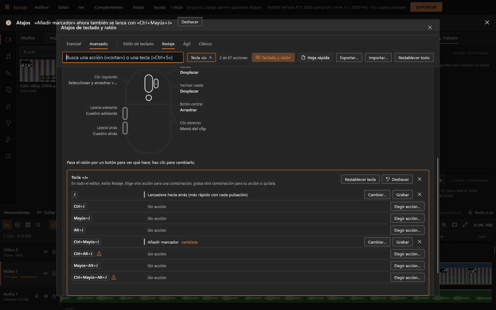

# Atajos de teclado y ratón

Rodaje trae tres estilos de teclado y todo se puede cambiar. El estilo se elige en el menú **Atajos** (Estilo Rodaje, Ágil o Clásico) y el panel se abre con **Atajos › Atajos de teclado...** o **Ctrl+Alt+K**.

- **Rodaje**: el de fábrica. Letras sueltas para lo frecuente (S corta, Q y W recortan, M marcador, N ajuste).
- **Ágil**: cercano a los editores rápidos de escritorio (Ctrl+B corta, A herramienta normal, Ctrl+G compuesto).
- **Clásico**: cercano a los editores profesionales (S corta, Ctrl+M exporta, flechas con Alt para cuadros, ↑ y ↓ hacen zoom).

En las tablas, «=» significa «igual que Rodaje».

## Reproducción

| Acción | Rodaje | Ágil | Clásico |
|---|---|---|---|
| Reproducir o pausar | Espacio | = | = |
| Lanzadera hacia atrás (más rápido con cada pulsación) | J | = | = |
| Lanzadera: detener | K | = | = |
| Lanzadera hacia adelante (hasta ×8) | L | = | = |
| Cuadro anterior / siguiente | ← / → | = | Alt+← / Alt+→ |
| Ir al inicio / al final | Inicio / Fin | = | = |
| Reproductor en pantalla completa | F (o doble clic en el visor; Esc sale) | = | = |
| Visor de origen o de programa | Mayús+2 | = | = |

## Edición

| Acción | Rodaje | Ágil | Clásico |
|---|---|---|---|
| Cortar en el cursor | S, Ctrl+B | Ctrl+B | S |
| Cortar en todas las pistas | Ctrl+Mayús+B | = | Ctrl+Mayús+K |
| Borrar | Supr, Retroceso | = | Supr |
| Borrar a la izquierda / derecha del cursor (recortar hasta el cursor) | Q / W | = | Alt+[ / Alt+] |
| Seleccionar todo | Ctrl+A | = | = |
| Deshacer | Ctrl+Z | = | = |
| Rehacer | Ctrl+Mayús+Z, Ctrl+Y | Ctrl+Mayús+Z | Ctrl+Y, Ctrl+Mayús+Z |
| Añadir texto | T | = | = |
| Transición por defecto en el corte | Ctrl+T | = | = |
| Velocidad del clip… | Ctrl+R | = | = |
| Congelar cuadro | Mayús+R | = | = |
| Más rápido / Más lento | Ctrl+Alt+. / Ctrl+Alt+, | = | = |
| Marcar entrada / salida | I / O | = | = |
| Quitar entrada y salida | Alt+X | = | Ctrl+Mayús+X |
| Insertar desde el origen (con un borde elegido: recortarlo un cuadro a la izquierda) | , | = | = |
| Sobrescribir desde el origen (con un borde elegido: recortarlo un cuadro a la derecha) | . | = | = |
| Reemplazar desde el origen | Mayús+. | = | = |
| Ajustar a rellenar desde el origen | Ctrl+Mayús+. | = | = |
| Superponer desde el origen | Mayús+, | = | = |
| Agrupar / Desagrupar | Ctrl+G / Ctrl+Mayús+G | (sin tecla) | = |
| Mover clip un cuadro a la izquierda / derecha | Alt+← / Alt+→ | = | Ctrl+Alt+← / Ctrl+Alt+→ |
| Ángulo 1 a 9 de la multicámara | 1 … 9 | = | = |
| Crear clip compuesto | Alt+G | Ctrl+G | Alt+G |
| Descomponer clip compuesto | Alt+Mayús+G | Ctrl+Mayús+G | Alt+Mayús+G |

Sin tecla de fábrica (se asignan en el panel): Cerrar todos los huecos, Ir al hueco siguiente o anterior, Invertir, Formato del proyecto, Añadir pista de video, Añadir pista de audio, Añadir pista de subtítulos, Pista principal magnética, Fundido cruzado automático, Bloquear envolventes, Ignorar grupos, Salir del clip compuesto.

## Línea de tiempo y herramientas

| Acción | Rodaje | Ágil | Clásico |
|---|---|---|---|
| Añadir marcador | M | = | = |
| Añadir región | R | (sin tecla) | R |
| Ajuste (imán a bordes, cursor y marcadores) | N | = | F8 |
| Ripple automático | Ctrl+L | (sin tecla) | Ctrl+L |
| Herramienta normal | V | A | Ctrl+D |
| Herramienta de envolvente | E | (sin tecla) | E |
| Herramienta de zoom | Z | (sin tecla) | Z |
| Herramienta de roll | Y | Mayús+Y | N |
| Herramienta de slide | U | Mayús+U | U |
| Herramienta cuchilla | C | B | C |
| Herramienta de ripple | B | (sin tecla) | B |
| Herramienta de slip | D | (sin tecla) | Y |
| Herramienta de rango | G | (sin tecla) | G |
| Acercar | Ctrl++ (también en el numérico) | = | ↑ |
| Alejar | Ctrl+- | = | ↓ |
| Ajustar a la ventana | Mayús+Z | = | = |
| Zoom a la selección | Ctrl+Alt+Z | = | = |

## Archivo y vista

| Acción | Rodaje | Ágil | Clásico |
|---|---|---|---|
| Proyecto nuevo / Abrir proyecto | Ctrl+N / Ctrl+O | = | = |
| Guardar / Guardar como | Ctrl+S / Ctrl+Mayús+S | = | = |
| Importar medios | Ctrl+I | = | = |
| Preferencias de la aplicación | Ctrl+, | = | = |
| Historial del proyecto | Ctrl+H | = | = |
| Exportar | Ctrl+E, Ctrl+M | Ctrl+E | Ctrl+M |
| Exportar fotograma | Ctrl+Mayús+E | = | = |
| Atajos de teclado | Ctrl+Alt+K | = | = |
| Esc | Sale de pantalla completa; si no, cierra la página abierta (Exportar, Atajos, Complementos, Preferencias); si no, cancela el arrastre en curso | = | = |

## Ratón

Clic izquierdo y derecho son fijos: seleccionar y arrastrar (Ctrl suma a la selección, Alt arrastra sin ajuste) y menú contextual. El resto se cambia por zona.

**Línea de tiempo**

| Parte | Rodaje | Ágil | Clásico |
|---|---|---|---|
| Rueda | Desplazar en el tiempo | = | Zoom |
| Ctrl+rueda | Zoom alrededor del puntero | = | Desplazar en el tiempo |
| Mayús+rueda | Desplazar las pistas | = | = |
| Alt+rueda | Recorrer cuadros | Desplazar las pistas | Recorrer cuadros |
| Inclinar rueda | Desplazar en el tiempo | = | = |
| Botón central | Arrastrar la vista | = | = |
| Laterales atrás / adelante | Cuadro anterior / siguiente | Deshacer / Rehacer | Cuadro anterior / siguiente |

**Visor**: la rueda recorre cuadros; Ctrl+rueda pasa entre Ajustar, 50 % y 100 %; clic y arrastre mueve un título, sus esquinas lo escalan. **Biblioteca**: la rueda desplaza la lista; los laterales como en la línea de tiempo.

## Cambiar un atajo

1. Abre **Atajos › Atajos de teclado...** y pasa a la pestaña **Avanzado** («Esencial» solo muestra los 18 más usados).
2. Busca la acción o la tecla («cortar», «Ctrl+S», «ñ»), pulsa **Cambiar…** y la combinación nueva. O activa **Teclado y ratón**, haz clic en una tecla del dibujo y rellena sus ocho combinaciones (sola, Ctrl, Mayús, Alt y mezclas).
3. Si la combinación ya era de otra acción, elige **Intercambiar** o **Quitársela**. Todo se deshace desde la barra de avisos o con Ctrl+Z.
4. Cada estilo guarda sus propios cambios (en `atajos.json`). **Restablecer** va por acción, por tecla, por botón del ratón o por estilo entero («Restablecer todo»).

Se rechazan las teclas reservadas por Windows (tecla Windows, Alt+F4, Alt+Tab, Tab, Impr Pant…). Ctrl+Alt con una letra se acepta con aviso: en los teclados español y latinoamericano es AltGr.

**Exportar… / Importar…** guardan y leen un JSON con los tres estilos, para pasarlos a otro equipo.

## Hoja rápida

En el panel, **Hoja rápida** junta los 15 atajos más útiles del estilo actual y los guarda en Documentos como «Atajos de Rodaje.html» (imprimible) o «Atajos de Rodaje.png».
