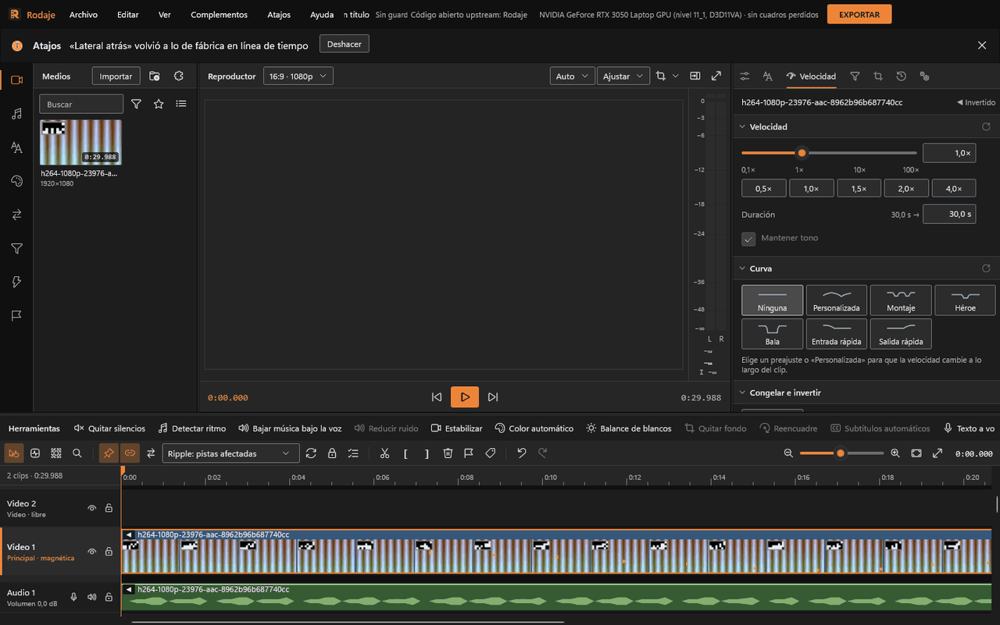

# Edición

Todo lo que pasa en la línea de tiempo. Los atajos son los del estilo Rodaje; los de Ágil y Clásico están en [Atajos](atajos.md). Cada operación es un paso del historial: **Ctrl+Z** la deshace, también las que hace la IA. El historial completo se consulta con **Ctrl+H** o desde el botón **Historial** de la barra de estado inferior.

## La línea de tiempo

- **Barra de herramientas** (de izquierda a derecha): herramienta normal (V), envolvente (E), selección, zoom (Z), roll (Y), slide (U), cuchilla (C), **Recorte Ripple** (B), slip (D) y rango (G), cada una con su marca junto al puntero; el selector de huecos (**Dejar huecos**, **Pista principal magnética** o **Ripple global**), **ajuste** (N) y el ámbito del ripple (pistas afectadas, todas las pistas o todas las pistas con marcadores y regiones); **fundido cruzado automático**, **bloquear envolventes** e **ignorar grupos**; las acciones cortar (S), recortar inicio (Q) y final (W), borrar (Supr), marcador (M), región (R), deshacer y rehacer; y el zoom.
- **Pistas.** Cada cabecera tiene el nombre, ocultar o silenciar y bloquear. **Alto:** arrastra el borde de abajo de la cabecera (doble clic vuelve al de siempre) o elige Compacta, Normal, Alta o Muy alta en su menú; se guarda con el proyecto. La primera pista de video es la **principal**; las de audio muestran su volumen («Volumen 0,0 dB»). Clic derecho en una cabecera: añadir pista de subtítulos, usar una pista de video para subtítulos, grabar voz en off, ecualizador y compresor de la pista. También puedes gestionar pistas desde el menú **Secuencia** (**Añadir pista de video**, **Añadir pista de audio** y **Añadir pista de subtítulos**).
- **Clips.** Color por tipo, nombre, tira de película o forma de onda, rombos de keyframes, envolvente de volumen. Delante del nombre, un indicador de velocidad cuando no es 1× («2,0×», «◀ 0,5×», «❚❚ Congelado» o la mini curva).
- **Zoom y desplazamiento.** La rueda sube y baja por las pistas (si se ven todas, desplaza en el tiempo), Mayús+rueda desplaza en el tiempo, Ctrl+rueda hace zoom alrededor del puntero y Alt+rueda cambia el alto de la pista bajo el puntero (con el estilo Clásico, la rueda hace zoom como en Premiere). Ctrl++ y Ctrl+- acercan y alejan; Mayús+Z ajusta toda la secuencia a la vista, cosa que también pasa sola al abrir un proyecto y con el primer clip; Ctrl+Alt+Z hace zoom a la selección. El botón central arrastra la vista y, al arrastrar un clip cerca de un borde, la vista se corre sola, más rápido cuanto más cerca.
- **Alto de la línea de tiempo.** Ocupa el 42 % del alto de la ventana (nunca menos de lo que deja ver tres pistas) y se adapta al cambiar su tamaño. El separador con la pestaña se arrastra; doble clic alterna entre «Más visor» (30 %) y «Más línea de tiempo» (55 %), y las tres están en Ver › Distribución.
- **Herramientas rápidas.** El botón «Herramientas» de la barra de la línea de tiempo abre silencios, ritmo, color, subtítulos, voz y texto por grupos; las que no aplican a lo seleccionado se ven atenuadas y dicen por qué.

## Seleccionar

Clic selecciona (dentro de una selección, deja solo ese clip; arrastrar mueve la selección entera); Ctrl+clic suma o quita; arrastrar en vacío dibuja un recuadro y marca un rango. Ctrl+A selecciona todo. Un clic en una transición la selecciona (y vacía la selección de clips).

## Cortar y borrar

| Qué | Cómo |
|---|---|
| Cortar en el cursor | S (o Ctrl+B): corta los clips seleccionados o el de la principal bajo el cursor; si ninguno de los seleccionados pasa por el cursor, lo avisa |
| Cortar en todas las pistas | Ctrl+Mayús+B |
| Recortar hasta el cursor | Q borra lo que queda a la izquierda del cursor; W, lo de la derecha |
| Borrar | Supr o Retroceso. El selector de huecos determina si se deja un espacio, solo se imanta la pista principal o se corre lo que sigue con ripple global |

## Herramientas

| Herramienta | Qué hace |
|---|---|
| Cuchilla (C) | Un clic corta el clip y sus enlazados en ese cuadro (se pega al cursor y a los marcadores con el ajuste). Con Mayús, corta todas las pistas. |
| Recorte Ripple (B) | Arrastrar un borde recorta y corre lo que sigue, independientemente del selector de huecos. |
| Slip (D) | Arrastrar un clip muestra otra parte de su material sin moverlo ni cambiar su duración (como Alt + arrastrar). |
| Rango (G) | Arrastrar marca la entrada y la salida de la secuencia, aunque pases sobre clips; un clic las quita. Sirve para las ediciones de tres puntos y para R (región). |

## Edición con el teclado

- **J, K, L**: lanzadera hacia atrás, detener y hacia adelante; cada pulsación dobla la velocidad hasta ×8.
- **Elegir un borde:** un clic (sin arrastrar) en el borde de un clip lo marca con una línea. **,** y **.** lo recortan un cuadro a la izquierda o a la derecha (con **Recorte Ripple**, ripple global o en la pista principal magnética, corre lo que sigue). Sin borde elegido, **,** y **.** insertan y sobrescriben desde el origen.
- **Alt+← / Alt+→** corre la selección un cuadro (con sus enlazados y su grupo), sin pisar nada; mantenla para seguir. Los empujones seguidos son un paso del historial.

## Mover, recortar, slip, roll y slide

- **Mover:** arrastra el cuerpo. No pisa nada en pistas libres; con **ajuste** (N) se pega a bordes, cursor, marcadores y regiones. Alt al arrastrar ignora el ajuste. En la principal magnética lo **reordena**: sacarlo cierra el hueco y meterlo lo abre, también en las pistas de sus enlazados; con ripple global se corre el contenido de todas las pistas según el ámbito.
- **Recortar:** arrastra un borde. Un globo muestra el resultado. **Recorte Ripple** siempre corre lo que sigue; el selector de huecos controla el comportamiento del resto de las ediciones.
- **Slip:** Alt + arrastrar el cuerpo mueve el contenido dentro del clip sin cambiar su sitio ni su duración.
- **Estirar (velocidad):** Alt + arrastrar un borde cambia la velocidad para que el mismo material dure lo arrastrado (de 0,1× a 100×). Ver [Velocidad](#velocidad-y-reversa).
- **Roll:** con la herramienta de roll (Y; Mayús+Y en Ágil, N en Clásico), o con **Ctrl+Alt** sobre un borde, se arrastra un corte entre dos clips pegados: uno crece lo que el otro pierde y nada más se corre. Agarrar el borde de entrada (o la mitad izquierda del clip) mueve el corte con el anterior.
- **Slide:** con la herramienta de slide (U; Mayús+U en Ágil), o con **Ctrl+Alt** sobre el cuerpo, el clip corre entre sus vecinos pegados, que se recortan para seguir tocándolo; su contenido no cambia.
- En los dos, el puntero lleva su marca («]|[» roll, «[↔]» slide), un globo dice cuántos cuadros se corrió y el **visor muestra lado a lado los dos cuadros del corte**: en el roll, el último del clip que sale y el primero del que entra; en el slide, el último del vecino de la izquierda y el primero del de la derecha. Van con los enlazados, se pegan al cuadro y a los puntos de ajuste y no pasan del material que haya.
- **Esc** cancela cualquier arrastre en curso.

## Grupos, colores y huecos

- **Agrupar (Ctrl+G)** junta los clips elegidos: un clic en uno elige el grupo entero y arrastrarlo mueve a todos, también si están en la misma pista. **Desagrupar (Ctrl+Mayús+G)** los suelta; los enlaces de audio y video siguen. Con **ignorar grupos** se mueve solo el clip agarrado.
- **Color** (menú del clip): rojo, naranja, amarillo, verde, turquesa, azul, violeta, rosa o el de siempre. Tiñe el clip y su borde superior.
- **Huecos:** «Cerrar todos los huecos» (en el menú **Secuencia** o con clic derecho en el clip o en la cabecera) junta los clips de la pista; los huecos que desincronizarían clips enlazados de otras pistas se dejan y un aviso dice cuántos. «Ir al hueco siguiente / anterior» lleva el cursor al próximo tramo vacío (sin tecla de fábrica).

## Control de huecos

El selector de la barra indica cómo responderán las ediciones que pueden dejar huecos: **Dejar huecos** no corre los clips posteriores; **Pista principal magnética** mantiene sus clips pegados; **Ripple global** corre lo posterior en todas las pistas. El ámbito de ripple elige si se desplazan las pistas afectadas, todas las pistas o también los marcadores y regiones. **Ctrl+L** avanza entre esos tres modos. Al soltar un medio en la pista principal se **inserta** en el corte más cercano; en las demás pistas **sobrescribe** lo que haya (con Ctrl, inserta).

## Audio y video enlazados

Un video con sonido entra como dos clips enlazados que se mueven, cortan y recortan juntos. En el menú del clip: **Desenlazar** / **Enlazar**, **Separar audio**, **Copiar atributos** y **Pegar atributos** (todo, efectos, transformación, velocidad o volumen). El interruptor **ignorar grupos** edita solo el clip agarrado (mover, empujar con Alt+←/→, recortar y Supr) sin romper el enlace.

**Aviso de desfase.** Si un clip enlazado queda corrido respecto de su pareja del mismo medio (por moverlo con ignorar grupos, o porque su pista estaba bloqueada al correr las demás), muestra a la derecha un aviso rojo con los cuadros: «+3», «−12». En su menú, **Volver a sincronizar** › «Mover a su lugar» o «Deslizar su contenido». Insertar, mover, cortar y cerrar huecos nunca desincronizan.

**Multicámara.** Elige en la biblioteca dos o más tomas del mismo momento (Ctrl+clic) y, en su menú, **Crear multicámara con la selección**: Rodaje las sincroniza por el sonido (unos segundos por minuto de grabación) y pone la primera al final de la pista principal. Con el cursor sobre esa toma, **1** a **9** cortan al ángulo de ese número desde el cursor hasta el siguiente corte, también mientras se reproduce; el sonido sigue siendo el de la primera. En **Preferencias (`Ctrl+,`) › General** eliges qué pistas de video reciben su audio al soltar un medio y cuántas pistas traen los proyectos nuevos.

## Edición de tres y cuatro puntos

1. En la biblioteca, clic derecho en el medio › **Abrir en el visor de origen**. El reproductor pasa a mostrar solo ese medio; **Mayús+2** alterna entre origen y programa.
2. **I** marca la entrada y **O** la salida (en el visor que se ve). **Alt+X** las quita. La barra de contexto bajo las herramientas muestra las marcas, los selectores V/A con su pista de destino y las marcas de la secuencia.
3. **,** inserta y **.** sobrescribe el tramo en el cursor (o entre las marcas de la secuencia). También accesibles desde el menú **Secuencia** (**Insertar desde el origen**, **Sobrescribir desde el origen**). La barra de contexto y el menú Secuencia traen además:
   - **Reemplazar (Mayús+.)**: cambia el clip bajo el cursor por el origen, en su lugar y con su duración; el cuadro del cursor del origen (o su entrada, si está marcada) queda en el cursor de la secuencia (**Secuencia › Reemplazar desde el origen**).
   - **Ajustar a rellenar (Ctrl+Mayús+.)**: el tramo del origen llena el clip bajo el cursor (o las marcas de la secuencia) cambiando la velocidad (**Secuencia › Ajustar a rellenar desde el origen**).
   - **Superponer (Mayús+,)**: la imagen va encima, en la primera pista de video libre o en una nueva (**Secuencia › Superponer desde el origen**).
4. Con cuatro puntos de distinta duración pregunta **Ajustar velocidad** o **Recortar**.

## Clips compuestos

Selecciona varios clips y pulsa **Alt+G** (Crear clip compuesto): quedan como uno solo. **Doble clic** entra a editar su secuencia; las migas de pan en la barra de contexto vuelven al proyecto. **Alt+Mayús+G** descompone. El compuesto lleva sus propios efectos, transformación, opacidad, máscaras, mezcla y transiciones, como cualquier clip.

## Velocidad y reversa

Pestaña **Velocidad** del panel derecho (Ctrl+R la abre con el clip seleccionado):

- Deslizador de 0,1× a 100× con imanes en 0,25, 0,5, 1, 2, 4 y 10; la velocidad escrita («1,5», «150 %», «x2»); botones rápidos; la duración resultante («5,0 s → 3,3 s»), que también se puede escribir para obtener la velocidad exacta.
- **Mantener tono**, activo de fábrica: el audio no se agudiza ni se agrava. Por encima de 8× se oye granuloso y por debajo de 0,25× metálico; sigue sonando.
- **Congelar** (Mayús+R) mete 3 s del cuadro del cursor. **Invertir** reproduce al revés, cuadro exacto; con videos de más de 1080p necesita un proxy, que se genera solo.
- **Curva:** Ninguna, Personalizada, Montaje, Héroe, Bala, Entrada rápida y Salida rápida. En Personalizada, arrastra los puntos (doble clic añade o quita, de 2 a 64) sobre el editor: altura logarítmica de 0,1× a 10×.
- Desde el teclado, sobre la selección: **Ctrl+Alt+.** más rápido y **Ctrl+Alt+,** más lento.
- Con velocidad distinta de 1×, los keyframes y la envolvente del clip siguen al material, no a la línea de tiempo.

## Transiciones

- Categoría **Transiciones** de la biblioteca: de fábrica, **Fundido cruzado**, **Fundido a color**, **Barrido**, **Empujar**, **Fundido con zoom**, **Fundido con desenfoque**, **Deslizar**, **Zoom con desenfoque**, **Giro**, **Barrido con luz**, **Fallo digital**, **Quemado de película**, **Destello**, **Disolución por luma** y **Empujar con rebote**; para el audio, **Fundido de potencia constante** (el habitual), **de ganancia constante** y **exponencial**; más las de los paquetes instalados. Cada una muestra su miniatura y se anima al pasar el puntero.
- Arrástrala al **corte** entre dos clips pegados (cae en el más cercano). Dura 0,5 s; arrastra la manija de afuera para cambiar la duración. Si el corte ya tenía una, cambia el tipo y conserva la duración. Las de audio van solo en pistas de audio.
- **Ctrl+T** pone la **transición por defecto** en el corte del clip seleccionado (al final; si no tiene vecino, al principio) o, sin selección, en el corte más cercano al cursor. En pistas de audio pone el fundido de audio por defecto. Para cambiarla: selecciona una transición y, en el menú ⋯, **Usar como transición por defecto** (guarda tipo, duración, alineación y curva).
- Con **fundido cruzado automático** encendido, cada corte sin transición de la pista principal muestra un símbolo: un clic crea un fundido de 0,5 s.
- Con la transición seleccionada en la línea de tiempo, el Inspector activa su pestaña propia **Transición** (ocultando temporalmente la pestaña Propiedades). Muestra arriba su **vista previa animada** (un clic la pausa) y debajo:
  - **Tipo** y **Duración**. En el menú ⋯, **Esta duración en toda la pista** o **en todas las transiciones** (cada una se acorta si no cabe), en un paso.
  - **Alineación**: al final del clip que sale, centrada o al inicio del que entra. Alineada a un lado, solo se arrastra la manija de afuera.
  - **Dirección**: una rueda (arrastra; con Mayús, sin pasos de 15°) y atajos de 0°, 90°, 180° y 270°; en Empujar, cuatro flechas.
  - **Color del borde** (barrido y luma, con su ancho) o **de la luz** (barrido con luz, destello, quemado): una muestra que abre el selector.
  - **Disolución por luma**: el degradado (lineal, radial, reloj, rombo, nubes, persianas), **Invertir** y una **imagen** gris propia (lo oscuro cambia primero).
  - **Desenfoque de movimiento** en las que mueven la imagen (empujar, deslizar, giro, rebote): 50 % es el obturador de cine.
  - **Curva del avance**: Lineal, Suave, Entrada, Salida, Rebote, Elástico o **Bézier**, con manejadores en la gráfica. El punto de la gráfica sigue a la vista previa. La misma curva vale para el cruce de audio.
  - «Quitar transición» deja el corte seco. Supr también la quita.
  Al deseleccionar la transición, el inspector vuelve automáticamente a la pestaña Propiedades.
- **Guardar como transición…** (menú ⋯ de Propiedades) convierte los keyframes de transformación de un clip en una transición propia.

## Marcadores y regiones

- **M** deja un marcador en el cursor («Marcador N»). En la regla, arrastrarlo lo mueve y clic derecho lo borra. Los marcadores se convierten en capítulos al exportar.
- **R** crea una región («Región N») sobre el rango marcado; si no hay, sobre la entrada y la salida de la secuencia (I y O); si no, sobre la selección o el clip bajo el cursor. Las regiones sirven como rangos de exportación.
- La categoría **Marcadores** de la biblioteca lista marcadores y regiones en orden de tiempo, cada uno con su color: ir al marcador anterior o al siguiente, «Marcador» y «Región» para añadir, doble clic o Intro para ir ahí, F2 o el lápiz para **editar** (nombre, color y nota), Supr o la papelera para quitar. El color elegido (rojo, naranja, amarillo, verde, turquesa, azul, violeta, rosa o el de siempre) se ve en la regla, la línea y la banda de la región; una nota se marca con un icono y se lee al pasar el ratón. Cada cambio es un paso del historial.
- **Detectar ritmo** deja un marcador «Pulso» en cada tiempo de la música (ver [Audio](audio.md#detectar-ritmo)).

## Medios: reemplazar, volver a enlazar, carpetas vigiladas

- **Reemplazar el clip seleccionado** (menú del medio en la biblioteca) cambia el medio de un clip conservando cortes, efectos y keyframes. Si el nuevo es más corto, avisa y pregunta «Reemplazar y acortar».
- Si al abrir un proyecto faltan archivos, el diálogo **Falta un medio** ofrece «Buscar en carpeta…» (reconoce el archivo aunque haya cambiado de nombre: «¿Es este?») o «Elegir…». «Más tarde» deja el proyecto abierto con esas capas vacías y un aviso con «Volver a enlazar».
- **Archivo › Carpetas vigiladas...**: lo nuevo que llegue a esas carpetas (hasta tres niveles) aparece al pie de la biblioteca y en la barra de avisos con «Importar».
- Clic derecho en un medio: añadir, **Generar proxy**, mostrar en el Explorador, quitar si no se usa. Medios tiene además carpetas, búsqueda, filtros, favoritos y vista de lista (ver abajo).

## Biblioteca: organizar y encontrar

- **Vista:** cuadrícula con portada o **lista** (botón de la derecha) con resolución, duración, fps, códec, fecha de grabación y cámara, leídos del archivo en segundo plano. **Pasar el ratón** por una portada recorre el medio cuadro a cuadro.
- **Valoración y marcas** (menú del medio, también para varios elegidos con Ctrl o Mayús): de una a cinco estrellas, **favorito** o **rechazado** (se ve atenuado y con una X). **Etiquetas…** pone etiquetas separadas por comas («boda, exteriores»).
- **Buscar** mira nombre, archivo, etiquetas, códec, resolución, fps, fecha («2026-10») y cámara en todas las carpetas.
- **Filtros** (botón del embudo): tipo, valoración mínima, marca, etiqueta y «Esconder rechazados». **Colecciones inteligentes:** «Guardar estos filtros como colección…» las guarda con nombre; son reglas, no listas, así que lo que se importe o se marque después entra solo.
- **Subclips:** abre el medio en el visor de origen, marca I y O y en su menú elige **Crear subclip con las marcas del origen**. Aparece tras su medio con la etiqueta «Subclip»; se arrastra o se añade con doble clic como un medio, con solo su tramo.
- **Avisos:** «Sin conexión» si el archivo ya no está donde dice el proyecto (menú › **Volver a enlazar…**) y «Repetido» si el mismo archivo o el mismo contenido está dos veces (la ayuda dice con cuál).
- Todo esto organiza la vista y se guarda con la biblioteca de este proyecto en este equipo, no en el `.rodaje`.

## Proyecto, guardado y recuperación

- **Ctrl+N** nuevo (pregunta «¿Guardar los cambios?» si hay), **Ctrl+O** abrir, **Ctrl+S** guardar, **Ctrl+Mayús+S** guardar como. El `.rodaje` es JSON legible; los medios se referencian por ruta.
- **Archivo › Proyectos recientes:** los últimos diez proyectos abiertos o guardados, el más reciente arriba, con la ruta abreviada (la completa se lee al pasar el ratón). Los archivos que ya no existen desaparecen de la lista solos; «Vaciar la lista» la deja en blanco.
- **Guardado atómico y copias `.bak`:** cada guardado escribe primero en un archivo temporal seguro y crea una copia de respaldo `.bak` previa en la misma carpeta del proyecto. Se evitan pérdidas o corrupciones de proyecto ante cortes repentinos o bloqueos de sincronizadores en la nube (como OneDrive).
- **Plantillas:** Archivo › Proyecto nuevo desde plantilla (Horizontal 16:9 1080p y 4K, Vertical 9:16, Cuadrado 1:1, Retrato 4:5, más las tuyas) y Guardar como plantilla...
- **Autoguardado:** copias en `%LOCALAPPDATA%\Rodaje\Autoguardado` tras 5 s sin cambios y, si no paras de editar, como mucho cada 2 min (10 por sesión). El intervalo se cambia en **Preferencias › General › Autoguardado** (de 1 a 30 min). La barra de estado, abajo a la izquierda, dice «Guardado hace N min» y, con cambios sin guardar y una copia más nueva, «Copia automática hace N min». Tras un cierre inesperado, al abrir Rodaje avisa «Hay una copia de «X» del … con cambios sin guardar» con **Recuperar**, que la valida y guarda como «X (recuperado).rodaje».
- **Formato del proyecto:** menú **Secuencia › Formato del proyecto…** o el botón de la cabecera del reproductor (16:9, 9:16, 1:1, 4:5, 4:3, 21:9 o Personalizado), cuadros por segundo (23,976 a 60) y «Resolución y más opciones…» (720p a 4K o ancho y alto propios de 16 a 8192, pares).
- **Espacios de trabajo:** Ver › Espacio de trabajo: Edición, Color (panel derecho ancho en Filtros), Audio (línea de tiempo alta) y los tuyos («Guardar la distribución actual como…»).
- **Pantalla completa:** F o doble clic en el visor; mover el ratón muestra los controles; Esc sale. **Visor en otra pantalla** (Ver) abre el visor a pantalla completa en el monitor más grande donde no está el editor.
