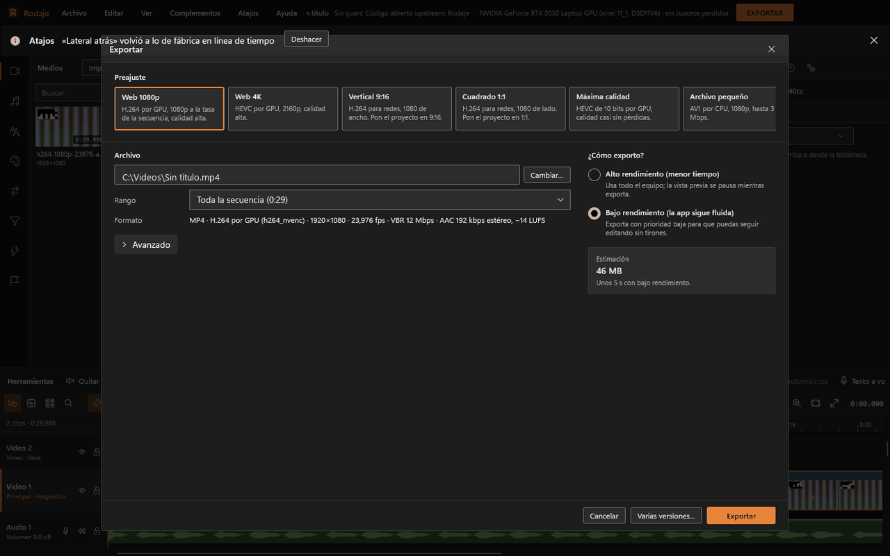
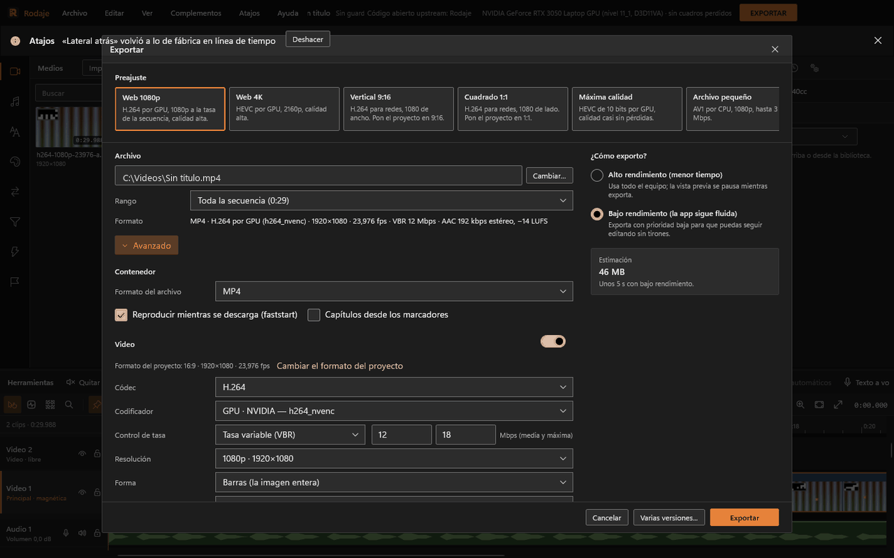
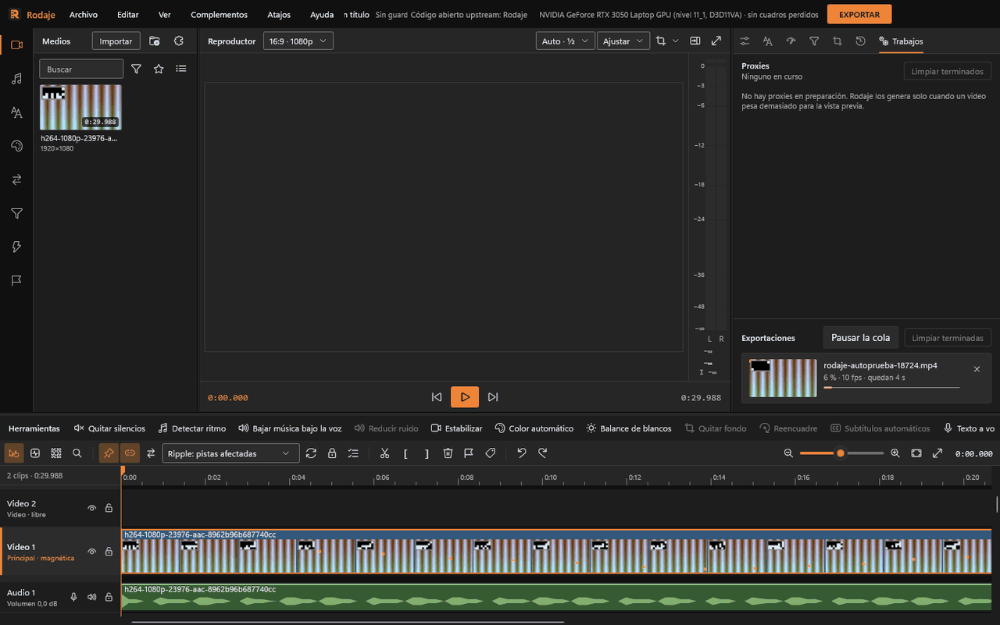

# Exportar

Se abre con **Archivo › Exportar...**, el botón naranja **EXPORTAR** de la barra superior o **Ctrl+E** (en el estilo Clásico, Ctrl+M). Aparece como una página sobre el editor; Esc la cierra. Al pulsar «Exportar» la página se cierra y sigues editando: el trabajo va a la cola de Trabajos.

## Preajustes

Tarjetas arriba, en este orden:

| Preajuste | Qué hace |
|---|---|
| **Web 1080p** | H.264 por GPU, 1080p a la tasa de la secuencia, calidad alta. MP4, VBR 12 Mbps (máx. 18), AAC 192 kbps, −14 LUFS |
| **Web 4K** | HEVC por GPU, 2160p, calidad alta. VBR 45 Mbps (máx. 68) |
| **Vertical 9:16** | H.264 para redes, 1080 de ancho (1080×1920) a 30 fps. Pon el proyecto en 9:16 |
| **Cuadrado 1:1** | H.264 para redes, 1080 de lado |
| **Máxima calidad** | HEVC de 10 bits por GPU, calidad constante 18 (casi sin pérdidas), AAC 320 kbps |
| **Archivo pequeño** | AV1 por CPU, 1080p, hasta 3 Mbps, Opus 96 kbps. Lento pero muy compacto |
| **Maestro ProRes 422 HQ** | ProRes 422 HQ de 10 bits en MOV con PCM de 24 bits, para seguir editando o entregar |
| **GIF animado** | 480 px de ancho a 15 fps, sin audio |
| **Solo audio** | AAC de 256 kbps en M4A, normalizado a −14 LUFS |
| **Personalizado** | Lo que elijas en Avanzado. Se marca solo en cuanto cambias algo que ya no coincide con un preajuste |

Los preajustes propios salen con el prefijo «Propio · ».

## La vista sencilla

- **Archivo**: ruta de salida y «Cambiar…». Si la carpeta no existe o el nombre no vale, lo dice en rojo y apaga «Exportar». Si el archivo ya existe, pregunta «¿Reemplazar el archivo?» al exportar.
- **Rango**: «Toda la secuencia», «Lo seleccionado» (del primer clip seleccionado al último) o cada región de la línea de tiempo como entrada y salida.
- **Formato**: una línea con lo que va a salir («MP4 · H.264 por GPU (h264_nvenc) · 1920×1080 · 23,976 fps · VBR 12 Mbps · AAC 192 kbps estéreo, −14 LUFS»).
- **Estimación** de tamaño y tiempo. Con tasa fija es exacta; en calidad constante lleva «≈», porque el tamaño depende de la imagen.

### Forma del proyecto

La salida toma la forma de la secuencia y el lado corto del preajuste: «Web 4K» sobre un proyecto 9:16 sale 2160×3840. Si el preajuste es para otra forma, una nota ofrece «Cambiar el formato del proyecto», que cierra Exportar y abre el selector de formato del reproductor. Solo si en Avanzado eliges una resolución de otra forma aparecen las opciones de barras, recortar o estirar.

### ¿Cómo exporto?

- **Alto rendimiento (menor tiempo)**: usa todo el equipo; la vista previa se pausa mientras exporta.
- **Bajo rendimiento (la app sigue fluida)**: exporta con prioridad baja para que puedas seguir editando sin tirones. Es el valor de fábrica.

Con menos de 4 GB de VRAM, en los dos modos la vista previa pasa a proxies y a calidad «Mitad» mientras se exporta.

## Avanzado

- **Contenedor**: MP4, MOV, MKV, WebM, M4A, GIF… Casillas «Reproducir mientras se descarga (faststart)» y «Capítulos desde los marcadores» (cada marcador abre un capítulo con su nombre; sin nombre, «Capítulo N»).
- **Video**: códec (H.264, HEVC, AV1, VP9, ProRes…), codificador (GPU · NVIDIA, Windows o CPU), control de tasa (calidad constante, VBR con media y máxima, CBR, tamaño objetivo con dos pasadas), resolución, forma, cuadros por segundo, bits por canal, perfil, velocidad del codificador y «Cuadro clave cada … s». El interruptor de la derecha quita el video (solo audio).
- **Audio**: códec (AAC, Opus, PCM…), tasa, frecuencia, canales y «Normalizar sonoridad»: «−14 LUFS (plataformas de video y música)», «−16 LUFS (pódcast)» o «−23 LUFS (televisión, EBU R128)».
- **Preajustes propios**: «Guardar como preajuste…» (hasta 50; se guardan en tus ajustes), «Importar…» y «Guardar en archivo…» (`.rodaje-preajuste`, para compartirlos), «Quitar».

Las listas solo ofrecen lo que los codificadores de tu equipo pueden hacer en ese contenedor. Si un ajuste no es posible, Rodaje lo corrige y explica por qué («WebM no admite H.264 en este equipo: se usa VP9»). Sin GPU ni Media Foundation, H.264 pasa a AV1 por CPU.

## Varias versiones de una vez

El botón **«Varias versiones...»** del pie abre «Exportar varias versiones»: una casilla por preajuste (de fábrica y propios). Se guardan en la carpeta elegida con el nombre del preajuste al final («mi video - Vertical 9:16.mp4»), con el rango y el rendimiento de ahora. Un preajuste de otra forma que el proyecto (Vertical sobre 16:9) conserva su forma recortando al centro.

## La cola, en Trabajos

Panel derecho › pestaña **Trabajos** (o Ver › Trabajos), sección «Exportaciones»:

- Una a la vez; dos si el equipo tiene 8 hilos y 6 GB de VRAM y ninguna pide alto rendimiento. Las demás esperan: «En cola · N.º», con «Empezar antes» y «Empezar después».
- Cada trabajo muestra la miniatura del último cuadro, el estado («Preparando», «Midiendo la sonoridad», «Mezclando el audio», «Exportando», «Pasada 1 de 2», «Cerrando el archivo»), el porcentaje, los fps y el tiempo que queda. La X cancela.
- **Pausar la cola**: lo que está en marcha termina, pero no empieza nada más.
- Al terminar: «Abrir carpeta» y «Reproducir». La barra de avisos también lo anuncia.
- Si falla: el motivo en español y qué hacer (reintentar, exportar sin lo que falta, elegir otra carpeta…). Ver [Solución de problemas](solucion-de-problemas.md#la-exportación-falla).

La cola se guarda en disco. Si cierras Rodaje con exportaciones pendientes, al abrirlo pregunta «Exportaciones sin terminar»: **Reanudar** (la que estaba a medias empieza de nuevo) o **Descartar**.

## Qué se comprueba al terminar

Cada archivo se verifica con `ffprobe` antes de darlo por bueno: que tiene video y audio, el códec y el perfil pedidos, el tamaño, la tasa de cuadros, la distancia entre cuadros clave, que video y audio empiezan en 0, la duración del audio, los capítulos y, en MP4 y MOV, que el índice está al principio (faststart). Si algo no coincide, el trabajo falla con «El archivo se escribió, pero no es lo que se pidió: …».

## Exportar un fotograma

**Archivo › Exportar fotograma...** (Ctrl+Mayús+E) guarda el cuadro del cursor como imagen PNG o JPEG; el aviso dice el cuadro y el tamaño.
