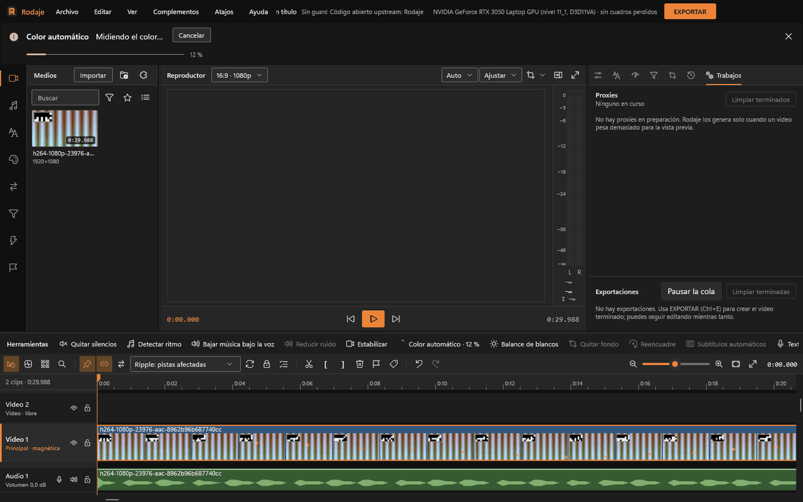

# IA local

Toda la IA de Rodaje corre en tu equipo: nada se envía a internet. Cada función vive en un **módulo**, un programa aparte con sus modelos que se instala desde [Complementos](complementos.md) (sección «Módulos de IA») y que la distribución completa ya trae. Lo que un módulo propone se aplica como un paso normal del historial: **Ctrl+Z lo deshace**.

## Qué módulo hace qué

| Módulo | Funciones en la app | Modelos | Dónde corre |
|---|---|---|---|
| **Subtítulos automáticos** (`modulo-subtitulos`) | Subtítulos automáticos, con el tiempo de cada palabra | Whisper large-v3-turbo (550 MB), small (180 MB) y base (57 MB), según el equipo | GPU por Vulkan (turbo, unos 1,5 GB de VRAM; small, 0,7) o CPU |
| **Traducir subtítulos** (`modulo-traducir`) | Traducir pista…, a 20 idiomas conservando los tiempos | Qwen3-4B-Instruct (unos 2,5 GB; se baja desde Complementos, no cabe en la distribución completa) | GPU por Vulkan (entero, unos 3,3 GB de VRAM) o CPU; si no cabe entero, reparte las capas que quepan |
| **Texto a voz** (`modulo-voz`) | Texto a voz… | Kokoro-82M (170 MB) y 34 voces | CPU |
| **Audio con IA** (`modulo-audio-ia`) | Reducir ruido; detección de voz para el ducking | DeepFilterNet3 (9 MB) y Silero VAD (2 MB) | CPU |
| **Visión con IA** (`modulo-vision`) | Quitar fondo, Reencuadre automático | MODNet (26 MB), BiRefNet-lite (115 MB), YuNet (rostros) y RT-DETRv2 (personas, 81 MB) | GPU por DirectML (cualquier GPU con DirectX 12; unos 1,3 GB de VRAM, 2,8 GB en calidad alta) o CPU |
| **RAW de cine** (`modulo-raw`) | Importar CinemaDNG… | Sin modelos (LibRaw) | CPU |

No usan módulos, aunque están en la misma barra: Quitar silencios, Detectar ritmo, Estabilizar, Color automático, Balance de blancos automático y Grabar voz. Funcionan siempre.

### Según el equipo

Rodaje mira la GPU (VRAM propia y compartida, si es integrada), la RAM libre y los hilos de la CPU, y decide para cada función qué modelo usa, dónde corre y cuánto hace a la vez (D-037). Funciona desde un portátil sin GPU o con una integrada y 8 GB de RAM hasta una GPU de 24 GB con 32 hilos:

| Equipo | Subtítulos | Traducir | Quitar fondo |
|---|---|---|---|
| Sin GPU o integrada con poca memoria | Whisper small en la CPU (base con «Rápida») | Qwen3-4B en la CPU | MODNet en la CPU (o en la integrada); «Alta» va por la CPU, muy lenta |
| 2 GB de VRAM | Whisper small en la GPU, dos tramos a la vez | Repartido: 10 de 36 capas en la GPU | MODNet en la GPU; «Alta» por la CPU |
| 4 GB (RTX 3050) | Whisper large-v3-turbo en la GPU, dos tramos a la vez | Repartido: 25 de 36 capas en la GPU | Las dos calidades en la GPU |
| 8 GB o más | turbo en la GPU (con 12 GB, tres tramos a la vez; con 24, cuatro) | Entero en la GPU | Las dos en la GPU; con «Máxima», MODNet a más resolución |

- **Antes de empezar**, cada diálogo dice cuánto tardará en este equipo y dónde corre («En este equipo: unos 40 s (GPU · Whisper large-v3-turbo)»). La primera vez es una estimación; después usa lo que tardó de verdad. Si la memoria no alcanza, lo avisa y ofrece la alternativa (por ejemplo, «Usar la calidad normal (MODNet)»).
- **Medido en una RTX 3050 de 4 GB y 16 hilos** (12 s de voz, 3 s de video): subtítulos en 4,5 s con la GPU y 12,5 s sin ella (3 min de voz: 17,7 s con dos tramos a la vez en la GPU, frente a 29,6 con uno; en la CPU, 111 s frente a 167, con el mismo acierto); traducir tres subtítulos en 10 s (24 de 36 capas en la GPU) y 32 s en la CPU; quitar el fondo de 90 cuadros en 9,5 s (GPU) o 19 s (CPU). Con solo 2 GB de VRAM todo termina, pero la calidad alta va por la CPU: 15 cuadros en casi 4 minutos.
- **Ver › Calidad de la IA:** «Automática (según el equipo)», «Rápida» (modelos menores y menos resolución) o «Máxima» (lo mejor que quepa, aunque tarde más).
- Sin GPU, o si la GPU falla a mitad, cada módulo pasa a la CPU solo: tarda más, pero termina.
- La memoria de video se reparte: la vista previa se queda con 3/8 de la VRAM (como mucho 3 GB) y el resto es para la IA. Con hasta 8 GB corre un modelo pesado (más de 1 GB) a la vez; con 12 GB, dos; con 24, tres. Los demás esperan con «Esperando memoria de video» en Trabajos. En equipos con pocos hilos o 8 GB de RAM, los trabajos por CPU van de a uno («Esperando la CPU»).
- Mientras corre un módulo en la GPU, la vista previa pasa a proxies.
- Un módulo que lleva 2 minutos sin trabajo se cierra solo y libera la memoria.

## Dónde están

- **Menú Herramientas (nivel superior):** Todo el conjunto de funciones de inteligencia artificial y automatización se encuentra centralizado: *Subtítulos automáticos...*, *Traducir pista...*, *Texto a voz...*, *Reducir ruido...*, *Bajar música bajo la voz...*, *Quitar silencios...*, *Detectar ritmo...*, *Quitar fondo...*, *Reencuadre automático...*, *Estabilizar...* y *Color automático*.
- **Barra Herramientas rápida**, encima de la línea de tiempo: Botones de acceso directo con icono y estado (habilitado/atenuado según selección). Al ejecutarse, muestra el spinner animado de progreso (`LongActions`).
- **Menú contextual del clip (clic derecho):** Acceso inmediato a las funciones aplicables al clip específico (por ejemplo, *Reducir ruido...* en clips de audio, o *Quitar fondo...* en video).
- **Categoría Módulos de IA en la Biblioteca (riel izquierdo):** Muestra el estado de cada módulo, si está descargado, y permite administrarlos directamente.
- **Preferencias (`Ctrl+,`):** En la pestaña *Rendimiento e IA* puedes ajustar los límites de memoria VRAM asignada a los modelos, concurrencia de procesamiento y calidad por omisión (*Automática*, *Rápida* o *Máxima*).

Si falta el módulo, el botón lo dice: «Hace falta el módulo «Audio con IA». Instálalo desde Complementos.»

Mientras una acción corre, su botón gira con el porcentaje y la barra de avisos muestra el avance y «Cancelar». Al terminar queda un aviso con **Deshacer**.

## Cada función

**Subtítulos automáticos.** Selecciona un clip con voz. Diálogo: «Idioma de la voz» (Detectar el idioma, Español, Inglés, Portugués), la lista de subtítulos con sus tiempos (un clic lleva el cursor), «Transcribir de nuevo» y «Aplicar». Deja clips de texto con el estilo «Subtítulo» en una pista de subtítulos (si no hay, crea «Subtítulos»), partidos a 42 caracteres por línea, dos líneas, de 1 a 7 s, cortando en pausas. Cada subtítulo guarda sus palabras con su hora: ver [Títulos y subtítulos](titulos-y-subtitulos.md). Límite: tres horas por clip.

**Traducir pista.** Clic derecho en un subtítulo › Traducir pista…: «Pista», «Idioma del original» (Detectar o uno de la lista) y «Traducir a». Crea una pista nueva encima, «<pista> (<idioma>)», con los mismos tiempos; la original no cambia. Idiomas: español, inglés, portugués (Brasil y Portugal), francés, italiano, alemán, neerlandés, catalán, gallego, euskera, polaco, ruso, ucraniano, turco, árabe, hindi, japonés, coreano y chino simplificado.

**Texto a voz.** Escribe o pega el texto («[pausa 1]» mete un silencio de 1 s) o usa «Usar el texto del clip seleccionado». Idioma (español de España o de Latinoamérica, portugués de Brasil, inglés de EE. UU. o del Reino Unido), voz (34, marcadas «(mujer)» u «(hombre)»), velocidad (0,5× a 2×), tono (±6 semitonos), pausa entre frases y en comas; «Escuchar» antes de «Insertar en el cursor». Deja un WAV en la carpeta de medios generados y un clip «Voz: …» en la primera pista de audio libre o en una nueva «Voz». Con el clip de voz seleccionado, el mismo diálogo ofrece «Regenerar».

**Reducir ruido.** Selecciona el clip; escucha «A: original» / «B: limpio», elige «Cuánto ruido se quita» (hasta 48 dB) y dónde se guarda el archivo limpio. Crea «<nombre> (sin ruido)» en la biblioteca y el clip pasa a usarlo; el original queda intacto. Límite: una hora.

**Bajar música bajo la voz** (ducking). Ver [Audio](audio.md#bajar-música-bajo-la-voz-ducking). Con «Audio con IA» instalado detecta la voz con Silero; sin él, por la energía del audio.

**Quitar fondo.** Calidad «Normal · personas, rápido (MODNet)» o «Alta · bordes finos y objetos, lento (BiRefNet)». «Empezar» analiza y «Aplicar» deja una máscara de imagen sobre el clip (un video en escala de grises en medios generados). Se ajusta en la pestaña Máscaras (invertir, opacidad).

**Reencuadre automático.** Formato «9:16 · vertical», «1:1 · cuadrado» o «4:5 · retrato»; «Seguir» rostros (YuNet) o personas de cuerpo entero (RT-DETRv2); «Suavidad». «Analizar» deja keyframes de posición y escala que siguen al sujeto y, si hace falta, cambia el formato de la secuencia.

**Importar CinemaDNG.** Archivo › Importar CinemaDNG...: elige un `.dng` de la secuencia, «Balance de blancos» (el de la toma o luz de día), «Exposición» (±3 EV) y «Calidad del revelado» (alta o rápida). Se guarda una copia ProRes 422 HQ en medios generados y entra en la biblioteca; los DNG no cambian.

## Si un módulo falla

Los avisos terminan siempre con «El proyecto no cambió.»:

- ««X» dejó de responder y se cerró.» Vuelve a intentarlo; si se repite, reinstala el módulo desde Complementos.
- ««X» se quedó sin memoria. Cierra otros programas o prueba con un tramo más corto.»
- ««X» necesita otra versión de Rodaje.» Actualiza Rodaje o el módulo.
