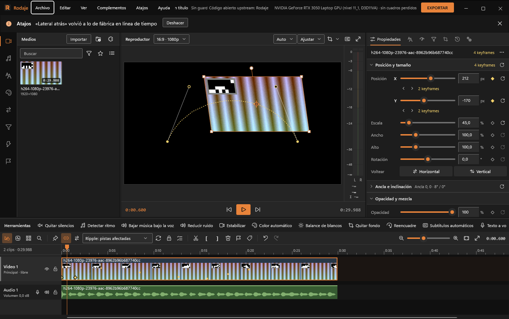
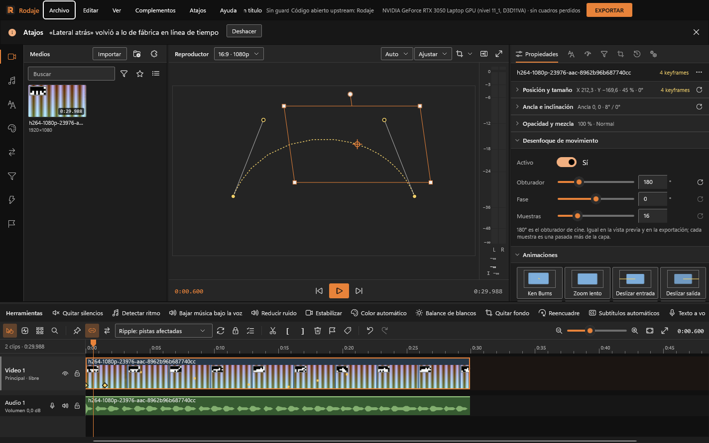
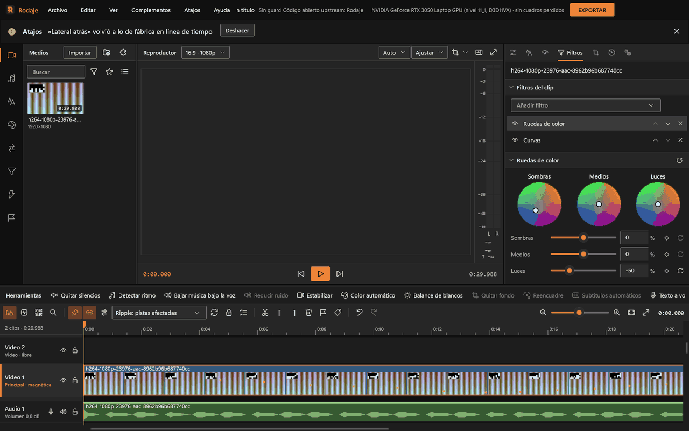
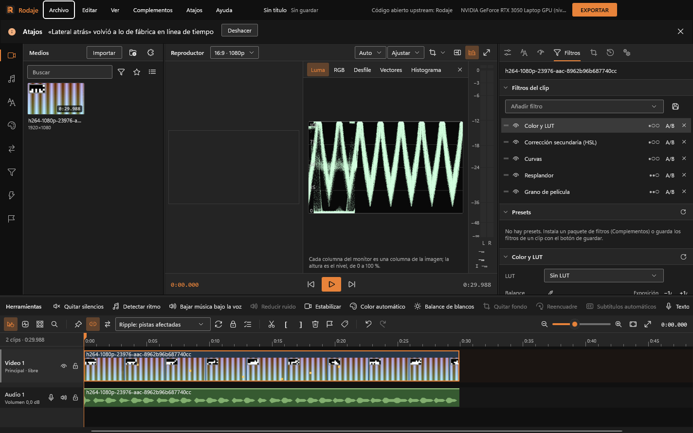
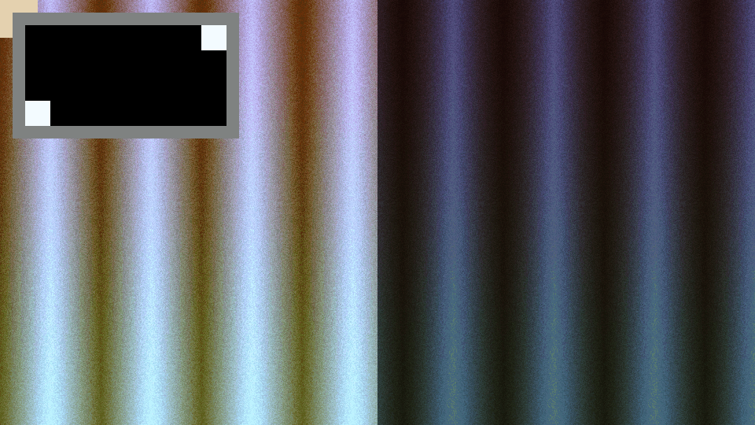
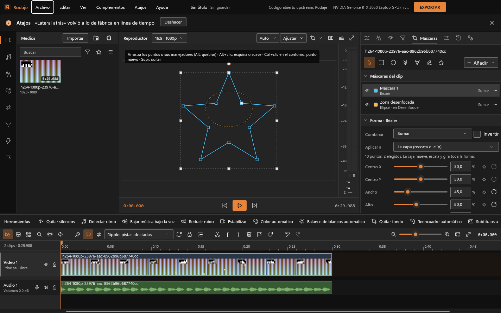

# Imagen

Efectos, color, máscaras, croma y recorte. Todo se calcula en la GPU, se ve al instante en el visor y se anima con keyframes. La exportación compone siempre a resolución completa.

## Dónde está cada cosa

- **Propiedades** (panel derecho): la transformación del clip en secciones plegables: «Posición y tamaño» (X, Y, escala, ancho, alto, rotación y voltear), «Ancla e inclinación», «Opacidad y mezcla» (opacidad y modo de mezcla), «Desenfoque de movimiento», «Animaciones», «Gráfica» y «Audio». Ver [Transformar y animar](#transformar-y-animar). Transformar y el Modo de mezcla se editan exclusivamente aquí; no se duplican en la pila de Filtros.
- **Filtros**: la pila de filtros y efectos del clip («Añadir filtro», el ojo para activar o desactivar, subir, bajar, quitar) y, debajo, los parámetros del filtro elegido.
- **Máscaras**: su pestaña propia (recortar el clip o limitar un efecto a una zona; incluye «Vincular a seguimiento…» para conectar con el rastreador).
- **Seguimiento**: pestaña centralizada para todo el rastreo del clip (puntos, esquinas, regiones, máscaras y estabilización); ver [Seguimiento](seguimiento.md).
- Biblioteca › **Efectos** (viñeta, desenfoque, nitidez, recortar, croma, estabilizar…) y **Filtros** (Color y LUT, Ruedas de color, Curvas y los looks de los paquetes): doble clic o arrastrar al clip los aplica.

Cada parámetro va en una fila: etiqueta, deslizador, valor con unidad, rombo de keyframe y restablecer. Por debajo de 340 px de ancho el deslizador baja a una segunda línea. **Arrastra la etiqueta** a los lados para cambiar el valor (Mayús: fino; Ctrl: grueso); doble clic en ella lo restablece.

**La pila de filtros.** Arrastra una fila por su asa para cambiar el orden (se aplican de arriba abajo). El ojo apaga el filtro; **A/B** lo apaga solo en el visor para comparar, sin tocar el proyecto ni la exportación. Los puntos a la derecha dicen cuánto pesa en la GPU (la ayuda da los milisegundos por cuadro en tu resolución).

**Presets.** Debajo de la pila, cada preset instalado o tuyo con una miniatura del cuadro actual; un clic lo aplica. El botón de guardar, junto a «Añadir filtro», guarda los filtros de imagen del clip como preset propio («Mis filtros»), listo para otros clips o para publicarlo en un paquete.

## Efectos de fábrica

| Efecto | Qué hace | Parámetros |
|---|---|---|
| Transformar | Posición, escala, rotación, opacidad, ancla, inclinación, volteo y desenfoque de movimiento | X e Y en píxeles, escala 1–400 % (y ancho y alto por separado), rotación ±360°, opacidad 0–100 %, ancla en píxeles, inclinación ±85°, voltear horizontal y vertical, obturador 0–720° con su fase y de 2 a 64 muestras |
| Color y LUT | Corrección básica y tabla de color | Exposición (±4 EV, con botones de 1/3 de paso), contraste, saturación, temperatura, matiz, luces, sombras (±100 %), proteger la piel, LUT e intensidad de la LUT; cuentagotas de blanco |
| Corrección secundaria (HSL) | Cambia solo un color | Tono, ancho y suavidad del tono, saturación y luma mínimas y máximas, suavidad; girar tono, saturación, exposición; cuentagotas, invertir y «Ver máscara» |
| Ruedas de color | Un tinte y un nivel para sombras, medios y luces | Tres ruedas y tres niveles |
| Curvas | Curva general y por canal | Pestañas RGB, R, G, B |
| Viñeta | Oscurece los bordes | Cantidad, tamaño, suavidad |
| Desenfoque | Gaussiano, de lente (con forma de disco, en luz lineal), direccional o radial | Tipo, radio 0–100 px; ángulo (direccional); centro (radial) |
| Nitidez | Máscara de enfoque | Cantidad 0–200 %, radio 0,5–10 px, umbral (no realza lo más fino: ruido, piel) |
| Grano de película | Grano que cambia en cada cuadro | Cantidad, tamaño, color, «En los medios» |
| Resplandor | Las luces se abren en un halo | Umbral, radio, intensidad |
| Aberración cromática | Separa rojo y azul | Radial o lateral, separación, ángulo |
| Reducción de ruido | Suaviza el ruido respetando los bordes y, al reproducir y exportar, con el cuadro anterior | Fuerza, entre cuadros, detalle |
| Espejo y pantalla dividida | Refleja una mitad o repite la imagen | Modo (izquierda, derecha, arriba, abajo, cuatro, mosaico), eje, copias |
| Distorsión de lente | Barril o cojín | Cantidad, acercamiento |
| Recortar | Quita bordes, libre o con proporción | Izquierda, arriba, derecha, abajo; proporción Libre, 16:9, 9:16, 1:1, 4:5, 4:3 |
| Croma (fondo verde) | Vuelve transparente un color | Color clave con cuentagotas, tolerancia, suavidad, quitar derrame, limpiar borde |
| Estabilizar | Quita el temblor | Intensidad; recorte automático o sin recorte. Se analiza desde Estabilizar… |
| Máscara | Deja ver solo una parte o limita un efecto | Ver [Máscaras](#máscaras) |
| Pixelar | Bloques del color promedio de su zona | Tamaño del bloque; con una máscara, tapa caras o matrículas |
| Anclaje de esquinas | Lleva cada esquina a otro lugar con perspectiva (pantallas, carteles) | Cuánto se corre cada esquina en X e Y, en píxeles; se llena solo desde [Seguimiento](seguimiento.md) |

En los títulos solo se aplican desenfoque, nitidez y pixelar.

## Keyframes

- El **rombo** de cada fila añade o quita un keyframe en el cursor (hueco sin animación, lleno con keyframes, con recuadro si hay uno en el cursor). Con keyframes, cambiar el valor crea o ajusta el del cuadro del cursor; sin ellos, cambia el valor fijo.
- Debajo aparecen «Keyframe anterior» y «siguiente», cuántos hay y la **curva hasta el siguiente**: Lineal, Suave, Entrada (arranca despacio), Salida (llega frenando), Rebote, Elástico, Bézier (una curva propia que se ajusta en la gráfica) o Mantener.
- **Arrastra la etiqueta** de cualquier fila a los lados para cambiar el valor sin ir al deslizador: Mayús afina, Ctrl va de diez en diez.
- Menú de la fila: Restablecer y Quitar keyframes (pregunta antes). El menú ⋯ de la cabecera: Restablecer todo y Guardar como transición… (con dos keyframes o más).
- Los rombos se ven también en el clip de la línea de tiempo. A velocidad distinta de 1× los keyframes siguen al material.

## Transformar y animar

- **En el visor**, con la pestaña Propiedades a la vista y un clip de video elegido: arrastra la imagen para moverla, una esquina para escalarla desde el ancla y el círculo de arriba para girarla (Mayús, de 15 en 15°). Al mover, el centro y los bordes se pegan al centro, a los tercios y a los bordes del cuadro y la guía se ve; **Alt** suelta el imán. Cada arrastre es un paso del historial y **Esc** lo cancela.
- **Ancla**: la cruz del visor es el punto sobre el que escala, gira e inclina. Arrastrarla no mueve la imagen (la posición se corrige sola). También en «Ancla e inclinación».
- **Trayectoria**: con keyframes de posición, la línea punteada es el camino de la capa y cada keyframe tiene dos manejadores. Arrastra uno para curvar el camino (el otro se alinea; con Alt quedan sueltos). La capa recorre la curva a velocidad pareja y la curva del keyframe de X (Suave, Bézier…) decide dónde acelera.
- **Voltear** horizontal o vertical espeja la imagen alrededor de su centro; **Ancho** y **Alto** la estiran por separado; **Inclinación** la tuerce.
- **Desenfoque de movimiento**: enciéndelo en su sección. 180° es el obturador de cine (más grados, más estela); la fase corre el obturador antes o después del cuadro y las muestras dan la suavidad (16 por defecto; más cuesta más). Se ve igual en la vista previa y en la exportación; durante una transición la capa sale sin él.
- **Animaciones**: Ken Burns, Zoom lento, Deslizar entrada y salida, Sacudida de cámara, Latido, Giro y Zoom de impacto. Un clic pone sus keyframes a lo largo del clip partiendo del tamaño y la posición que ya tiene; después se ajustan como cualquiera. Un paso del historial.
- **Gráfica**: elige el parámetro animado (o toca su fila) y mira su curva de **Valor** o de **Velocidad**. Arrastra un rombo para cambiar su valor y, a los lados, su instante (pegado a los cuadros; con Mayús, solo el valor). Con clic derecho sobre un rombo eliges la curva que sale de él (o de todos los elegidos, si ya estaba entre ellos). Si el tramo que sale del keyframe elegido es Bézier, aparecen sus dos manejadores: arrástralos para dar forma a la curva (puede pasarse del valor y volver).

## Color

1. **Color y LUT** para lo básico: exposición, contraste, saturación, temperatura, matiz, luces y sombras.
2. **Ruedas de color**: arrastra el punto de cada rueda para teñir sombras, medios o luces (rojo a 0°, verde a 120°, azul a 240°); el deslizador de cada zona sube o baja su nivel. Doble clic vuelve al centro.
3. **Curvas**: un clic añade un punto, arrastrar lo mueve entre sus vecinos, doble clic o clic derecho lo quita. General (RGB) o por canal.
4. **Color automático** y **Balance de blancos automático** (Herramientas o menú del clip) fijan temperatura, matiz y exposición (y contraste, en Color automático) y avisan con lo que cambiaron y **Deshacer**.
5. **LUT**: en la fila «LUT» de Color y LUT elige una de los paquetes instalados o «Cargar .cube…» (tablas 3D de 2 a 65 puntos). «Intensidad de la LUT» la mezcla con la imagen original.

6. **Balance con cuentagotas:** en Color y LUT, «Blanco» y un clic en el visor sobre algo que debería ser gris o blanco: fija temperatura y matiz.
7. **Proteger la piel:** en Color y LUT, deja los tonos de piel fuera de la saturación, la temperatura y el matiz.
8. **Corrección secundaria (HSL):** «Cuentagotas» y un clic sobre el color a cambiar; ajusta ancho y suavidad mirando «Ver máscara» (blanco = elegido) y luego gira el tono, satura o cambia la exposición solo de ese color.
9. **Curvas de ajuste:** en Curvas, «Tono › tono» cambia un color por otro, «Tono › sat.» satura o apaga cada color y «Luma › sat.» según el brillo (por ejemplo, quitar color a las sombras).

**Monitores:** el botón de monitores de la cabecera del visor abre forma de onda (luma o RGB), desfile RGB, vectorscopio (los cuadros marcan los colores al 75 %; la línea, la piel) e histograma. Miden la imagen compuesta en tiempo real.

**Antes y después:** el botón del visor divide la imagen con una cortina; a la izquierda se ve sin color, LUT, viñeta, ruedas ni curvas; a la derecha, con todo. Arrastra el asa. Solo es vista previa.

## Máscaras

Pestaña **Máscaras** (o menú del clip › Máscaras), con el clip elegido y el cursor encima. Recortan el clip o limitan un efecto (desenfocar solo una cara, corregir el color solo de una zona).

**Dibujar.** Elige una herramienta y trabaja en el visor (las letras valen con el puntero sobre el visor):

| Herramienta | Tecla | Cómo |
|---|---|---|
| Elegir y editar | V | Mover, cambiar el tamaño, girar y editar puntos |
| Rectángulo, Elipse | R, E | Arrastra; con Mayús, cuadrado o círculo |
| Pluma Bézier | P | Clic pone una esquina; arrastrar saca una curva; clic en el primer punto (o Intro) cierra |
| Pluma de trazo | Mayús+P | Una línea con grosor; Intro la termina |
| A mano alzada | F | Dibuja el contorno; al soltar queda una Bézier suave |
| Estrella | | Arrastra; queda como Bézier editable |

Con la pluma, Retroceso quita el último punto y Esc cancela. **Añadir** trae formas centradas (rectángulo, elipse, polígono, estrella, línea), el **sujeto de «Quitar fondo» como Bézier** (el contorno del cuadro del cursor) y **Desenfocar una zona** o **Pixelar una zona**: el efecto con una elipse suave que lo limita, lista para llevarla sobre la cara y seguirla.

**Editar en el visor.** Se ven todas las máscaras del clip, cada una en su color; la elegida lleva su caja: arrastrar dentro la mueve, las esquinas y los bordes cambian el tamaño (Mayús: proporción) y el círculo de arriba la gira (Mayús: de 15° en 15°). En una Bézier o una pluma:

- Clic en un punto lo elige; Mayús+clic suma o quita; arrastra un recuadro para elegir varios; Ctrl+A, todos. Arrastrar mueve los elegidos; las flechas, de a 1 px (Mayús: 10).
- Los puntos elegidos muestran sus manejadores: arrastrarlos curva el contorno y el del otro lado sigue alineado; con Alt se quiebran.
- Alt+clic (o doble clic) en un punto lo pasa de esquina (cuadrado) a suave (círculo) y al revés.
- Ctrl+clic (o doble clic) en el contorno agrega un punto sin cambiar la curva. Supr quita los elegidos.

**La lista.** Ojo para ver u ocultar, color, nombre y cómo se combina. Arrastra para reordenar. El menú «⋯» renombra, cambia el color, duplica, convierte en Bézier, sube, baja o quita.

**La máscara elegida:**

- **Combinar**: **Sumar** (unión), **Restar**, **Intersecar** o **Diferencia** con las de arriba del mismo destino; **Invertir** deja ver lo de afuera. Las máscaras de proyectos anteriores se intersecan, como antes.
- **Aplicar a**: la capa (recorta el clip) o solo un efecto de la pila: color, viñeta, croma, ruedas, curvas, desenfoque, nitidez o pixelar. Así se corrige el color de una zona o se desenfoca una cara sin recortar el clip.
- **Uso** (en «Aplicar a»): «Recortar la capa» (lo de siempre) o «Limitar efectos»: la máscara no recorta y marca dónde van los efectos que tienen «Dónde» (desenfoque, nitidez, grano, resplandor, aberración, reducción de ruido): toda la imagen, dentro o fuera de esas máscaras. Por ejemplo, desenfocar una cara.
- **Caja**: centro, ancho, alto y rotación, con keyframes. Convertir un rectángulo o una elipse en Bézier (botón «A Bézier») conserva la forma.
- **Borde**: borde suave, expansión (agranda o achica), esquinas redondeadas (rectángulo), grosor (pluma) y opacidad. Con puntos elegidos, **Borde ×** (Bézier) o **Grosor ×** (pluma) cambia solo ahí: borde variable.
- **Forma animada** (Bézier y pluma): el rombo pone un keyframe de la forma en el cursor; las flechas van al anterior y al siguiente. Con la forma animada, editar puntos cambia el keyframe del cursor. «Quitar la animación» deja la forma del cursor.
- **Seguimiento**: pulsa «Vincular a seguimiento…» para abrir la pestaña **Seguimiento** con la máscara y su destino preseleccionados, o para enlazarla a un rastreo existente. Todo el proceso de análisis y ajuste se centraliza en un único lugar sin duplicación de controles.
- **Vista en el visor**: **Imagen** (como se exporta), **Máscara** (en gris: blanco lo que se ve) o **Superpuesta** (lo que tapa, en rojo). Solo vista previa.

La máscara de **Sujeto (Quitar fondo)** cambia sola en cada cuadro; su borde suave y la expansión no se le aplican. Para editarla a mano, «Añadir» › «Sujeto de «Quitar fondo» como Bézier».

## Croma

Añade **Croma (fondo verde)** al clip. Pulsa **Cuentagotas** y haz clic en el fondo del visor (Esc cancela): se toma el promedio de 5×5 píxeles de ese cuadro, sin color ni croma aplicados. Ajusta tolerancia y suavidad; «Quitar derrame» limpia el reflejo verde en los bordes y «Limpiar borde» cierra el contorno.

## Recortar

Añade **Recortar**. Mientras el filtro está elegido con Filtros a la vista, el visor muestra la imagen entera con lo quitado en sombra y ocho asas; con una proporción fija, la esquina crece desde la opuesta y el borde mueve también el otro lado. Al elegir una proporción pasa al recorte más grande centrado. Cada arrastre es un paso del historial.

## Modos de mezcla

En **Propiedades › Opacidad y mezcla**: Normal, Sumar, Multiplicar, Trama, Superponer, Luz suave, Luz fuerte, Oscurecer, Aclarar, Diferencia, Exclusión, Sobreexponer color y Subexponer color. Se edita directamente en esta sección del clip; no se añade como filtro en la pila ni aparece duplicado.

## Estabilizar y funciones de IA (Acciones largas)

- **Estabilizar:** Menú contextual del clip › **Estabilizar...** o **Herramientas › Imagen › Estabilizar...**. Analiza el movimiento y muestra el resultado («Temblor: A → B px por cuadro² (N % menos). Acercamiento: N %»). Ajusta la intensidad y decide si recorta el borde automáticamente. Pone el filtro Estabilizar al principio de la pila.
- **Quitar fondo y Reencuadre automático:** Disponibles en **Herramientas › Imagen** y en el menú contextual de clips con video. Ambas operaciones se ejecutan mediante el sistema de **Acciones largas** (`LongActions`): muestran progreso continuo con indicador animado y botón de cancelación inmediata limpia, sin congelar la interfaz. El diálogo de **Reencuadre automático** muestra con anticipación las dimensiones de proyecto que resultarán del formato seleccionado antes de aplicar.

## Zonas seguras

Botón del visor: **Ninguno**, **Clásicos (acción y títulos)** (acción 93 %, títulos 90 % y la cruz del centro), los juegos de fábrica para apps de video («Horizontal con controles (16:9)», «Vertical corto con barra lateral (9:16)», «Vertical corto con botones abajo (9:16)», «Vertical corto con pie amplio (9:16)», «Vertical corto con pie y lateral (9:16)», «Historia vertical (9:16)»), los de los paquetes y los tuyos. Las zonas que tapa la interfaz se sombrean con su etiqueta; los márgenes van en línea discontinua. Si el juego es para otra forma, lo avisa.

**Nuevas zonas propias…** abre el editor sobre el visor: Añadir zona, nombre y etiqueta, arrastrar para mover y estirar por las esquinas, Guardar (queda en `complementos\propios`) o Cancelar. «Editar «…»» reescribe el mismo juego.

## Calidad de la vista previa

En el botón del visor o en **Archivo › Preferencias...** (pestaña **Rendimiento**), **Calidad de la vista previa**: Automática, Completa, Mitad o Cuarto. En Automática, si la GPU no llega al reproducir, baja un escalón (la cabecera dice «Auto · ½») y vuelve a completa en pausa. En Preferencias se configura además **Proxies en la vista previa**: Automático, Siempre que haya o Nunca (originales), y «Generar proxies al importar videos pesados». Nada de esto afecta a la exportación.
