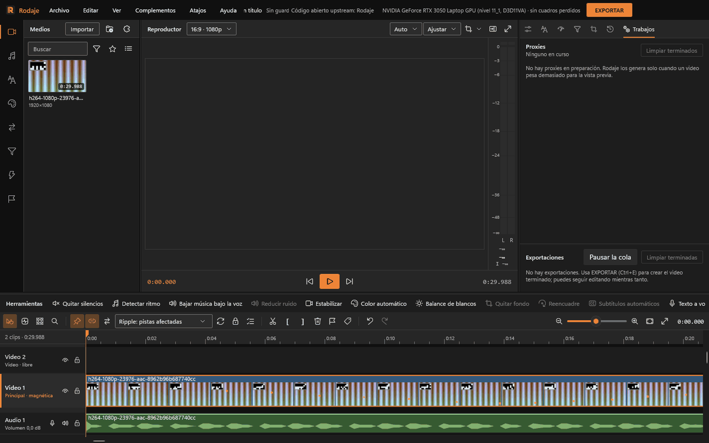
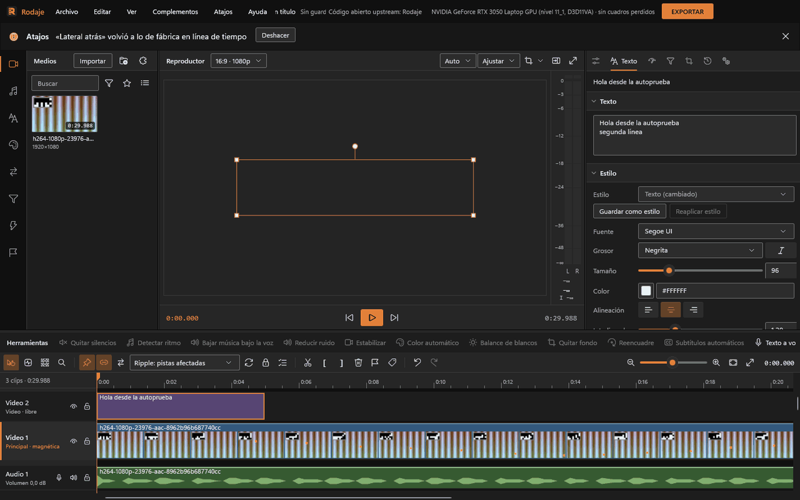
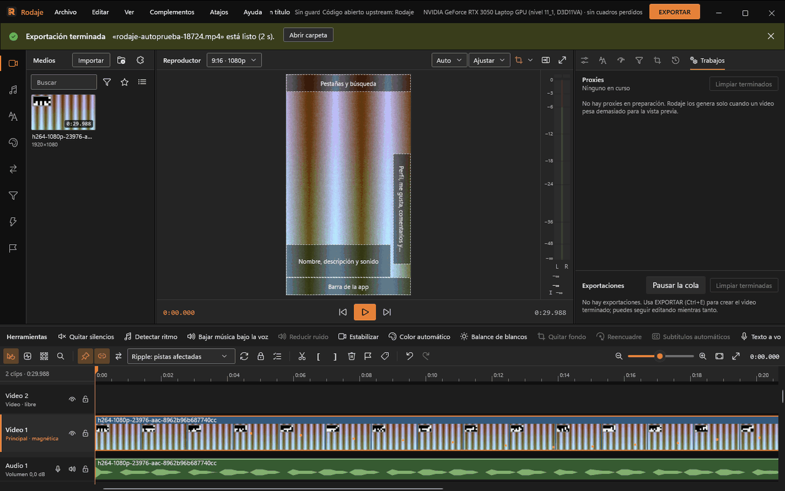

# Tu primer proyecto

Diez minutos: importar un video, cortarlo, ponerle música, un título y sacarlo en vertical para redes. Los atajos son los del estilo Rodaje (el de fábrica).

La ventana principal de Rodaje está organizada en cinco áreas ergonómicas:
- **Biblioteca (panel izquierdo):** Organizada mediante un riel de categorías (Medios, Audio, Texto, Transiciones, Filtros, Efectos, Módulos de IA y Marcadores) con vista de cuadrícula o lista detallada.
- **Reproductor y visor (centro):** Monitor de previsualización a pantalla completa o dividida, con controles de transporte y medidores de sonoridad estéreo / LUFS a la derecha.
- **Inspector (panel derecho):** Pestañas contextuales que se adaptan al elemento seleccionado (*Propiedades / Transformar*, *Texto*, *Color y Filtros*, *Máscaras*, *Seguimiento*, *Transición* e *Historial*). Los trabajos en segundo plano se supervisan cómodamente desde el icono en la barra de estado inferior.
- **Barra de herramientas:** Acceso rápido a herramientas de edición y automatizaciones de IA sobre la línea de tiempo.
- **Línea de tiempo (área inferior):** Pistas de video y audio con pista principal magnética, miniaturas de película y envolventes de volumen.

## 1. Elige el formato

Un proyecto nuevo inicia en 16:9 (1920×1080 a 30 fps). Para crear contenido en vertical (TikTok, Reels, Shorts), pulsa en el selector de formato en la cabecera del reproductor («16:9 · 1080p») o entra en **Secuencia › Formato del proyecto...** y elige **9:16 Vertical · videos cortos**. También puedes iniciar desde **Archivo › Proyecto nuevo desde plantilla › Vertical 9:16 (videos cortos)**.

En «Ajustar clips» decide cómo responder ante medios con distinta proporción de aspecto: **Encajar** (completo con barras protectoras), **Rellenar** (expande hasta llenar el cuadro recortando sobrantes) o **Mantener tamaño**. Todo cambio puede revertirse con `Ctrl+Z`.

## 2. Importa

Arrastra tus videos a la biblioteca, pulsa **Importar** o **Ctrl+I**. Cada medio muestra su portada real, su duración y su resolución. Si un video es pesado (4K, 10 bits, tasas altas), Rodaje genera un **proxy** en segundo plano para que la vista previa vaya suelta; el porcentaje sale sobre la portada y en Trabajos. La exportación usa siempre los originales.

**Doble clic** en un medio lo pone al final de la pista principal, con su audio en la primera pista de audio. También puedes arrastrarlo a la pista y la posición que quieras.

## 3. Reproduce y corta

- **Espacio** reproduce y pausa. **J, K, L** van hacia atrás, paran y avanzan (L dobla la velocidad con cada pulsación, hasta ×8). **←** y **→** van cuadro a cuadro; **Inicio** y **Fin**, a los extremos.
- Pon el cursor donde quieras cortar y pulsa **S**. El clip queda en dos.
- Selecciona el trozo que sobra (un clic) y pulsa **Supr**. En la pista principal, que es **magnética**, los clips de después se pegan para cerrar el hueco (cabecera «Principal · magnética»).
- Para quitar el principio o el final de un clip sin seleccionar nada: cursor en el punto y **Q** (borra lo que queda a la izquierda) o **W** (a la derecha).
- Arrastra los **bordes** de un clip para recortarlo; arrastra el **cuerpo** para moverlo o reordenarlo.
- **Ctrl+Z** deshace cualquier paso; **Ctrl+Mayús+Z** rehace. La pestaña **Historial** del panel derecho lista todos los pasos y un clic vuelve a cualquiera.

Si hay partes habladas con silencios, **Quitar silencios** en la barra de Herramientas los corta solos; ver [Audio](audio.md#quitar-silencios).

## 4. Música bajo la voz

1. Importa la canción. En la biblioteca, categoría **Audio**, arrástrala a una pista de audio libre (si no hay, suéltala en el espacio vacío debajo: se crea una).
2. Recórtala por los bordes o con S y Supr para que dure lo que el video.
3. Selecciona el clip de música y pulsa **Bajar música bajo la voz** en Herramientas. El diálogo «Bajar música bajo la voz» analiza dónde habla la voz de la otra pista y baja la música 12 dB en cada tramo (ajustable, igual que cuánto antes baja y cuánto tarda en subir). **Aplicar** deja keyframes de volumen en la canción.
4. Para que la canción no empiece de golpe, en el panel derecho › **Propiedades › Audio** pon un fundido de «Entrada» y de «Salida» de 1 s.

Los medidores a la derecha del reproductor muestran el nivel. Para dejar la mezcla al nivel que piden las plataformas, al exportar elige «Normalizar sonoridad: −14 LUFS» (ya viene en el preajuste Vertical 9:16).

## 5. Un título

1. Pon el cursor donde debe aparecer y pulsa **T** (o **Añadir texto** en Herramientas, o Editar › Añadir texto). Aparece un título de 5 s en una pista de video encima y se abre la pestaña **Texto**.
2. Escribe el texto en el cuadro; cada línea nueva es una línea del título.
3. En **Estilo** elige fuente, grosor, tamaño, color, alineación. Abre **Borde**, **Sombra** o **Fondo** si lo necesitas. «Guardar como estilo» lo deja en la biblioteca (categoría Texto) para la próxima vez.
4. En el visor, arrastra el título para moverlo y una esquina para escalarlo; el asa de arriba lo gira.
5. **Entrada y salida** anima la aparición (los bordes por los que entra y sale).
6. Alarga o acorta el clip del título por sus bordes como cualquier otro.

Si prefieres subtítulos de lo que se dice, **Subtítulos automáticos** en Herramientas los transcribe con el tiempo de cada palabra; ver [Títulos y subtítulos](titulos-y-subtitulos.md).

## 6. Zonas seguras (opcional)

El botón de zonas seguras del reproductor sombrea lo que las apps tapan en vertical: «Vertical corto con barra lateral (9:16)», «Vertical corto con botones abajo (9:16)», «Historia vertical (9:16)»… Mueve el título fuera de esas zonas. No se exportan.

## 7. Guarda y exporta

- **Ctrl+S** guarda el proyecto (`.rodaje`). El autoguardado hace copias mientras trabajas y, si Rodaje se cerrara de golpe, al volver ofrece **Recuperar**.
- Pulsa **EXPORTAR** (Ctrl+E). Elige el preajuste **Vertical 9:16** (H.264, 1080×1920, 30 fps, AAC, −14 LUFS), la carpeta y el nombre, y **Exportar**. Deja marcado «Bajo rendimiento» si quieres seguir editando sin tirones; «Alto rendimiento» termina antes.
- La página se cierra y el avance sale en **Trabajos**. Al terminar, «Abrir carpeta» o «Reproducir». Un minuto de 1080p con dos capas y efectos sale en unos 9 s con una GPU NVIDIA.
- ¿Quieres también la versión horizontal? En Exportar, **Varias versiones...** y marca «Web 1080p» además de la vertical: salen las dos de una vez.

Todo lo demás, por temas: [Edición](edicion.md), [Imagen](imagen.md), [Audio](audio.md), [Títulos y subtítulos](titulos-y-subtitulos.md), [IA local](ia-local.md), [Exportar](exportar.md), [Complementos](complementos.md), [Atajos](atajos.md).
