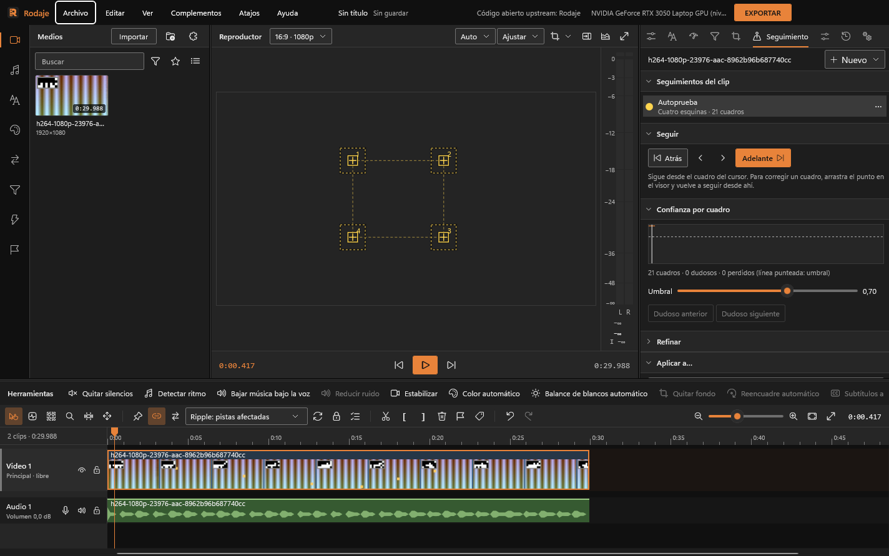

# Seguimiento

Seguir algo que se mueve en un clip (una cara, un cartel, una pantalla, una matrícula) y pegarle otra cosa: un título, una imagen con perspectiva, una máscara, un desenfoque. O quitar el temblor tomando ese punto como referencia. Todo queda como keyframes normales que se retocan después.

## Seguir

1. Elige un clip de video, lleva el cursor sobre él y abre la pestaña **Seguimiento** (o menú del clip › Seguimiento).
2. **Nuevo** › el tipo:

   | Tipo | Sigue | Para |
   |---|---|---|
   | Un punto | Posición | Un título o una pegatina que acompaña algo; estabilizar por un punto |
   | Dos puntos | Posición, escala y giro | Algo que se acerca o gira |
   | Cuatro esquinas | Perspectiva | Reemplazar una pantalla, un cartel o un cuadro |
   | Región | La caja entera (posición, escala y giro) | Superficies grandes con poca textura en las esquinas |

3. En el visor, arrastra cada punto (la cruz numerada) sobre algo con textura: una esquina, un borde con contraste, un logo. El **recuadro lleno** es el patrón que se busca y el **punteado**, dónde se busca en el cuadro siguiente; arrastra sus esquinas para cambiarlos. Un patrón más grande es más estable; una zona más grande aguanta movimientos más rápidos.
4. **Adelante** o **Atrás** siguen hasta el final o el inicio del clip; las flechas, de a un cuadro. El cursor acompaña y los puntos se ven moverse. **Parar** deja lo seguido hasta ahí. Una corrida entera es un paso del historial.

## Revisar y corregir

- **Confianza por cuadro**: la línea es cuánto se parece el patrón en cada cuadro (de 0 a 1); la punteada, el **umbral**. Bajo el umbral, el cuadro es **dudoso** (naranja, en la gráfica y en el visor); muy por debajo, el punto se **perdió** (rojo): se estima con su velocidad o con los otros puntos y se sigue buscando en una zona más grande hasta reencontrarlo. Clic en la gráfica va a ese cuadro; **Dudoso anterior** y **siguiente** saltan entre los que hay que mirar.
- **Corregir a mano**: en un cuadro seguido, arrastra el punto adonde va (queda con confianza 1) y pulsa **Adelante** o **Atrás**: se vuelve a seguir desde ahí y solo se reemplaza ese tramo.
- **Refinar**: **Rellenar los dudosos** pone la recta entre los buenos de los lados; **Suavizar** quita el temblor (±N cuadros) sin achatar el movimiento parejo ni mover lo corregido a mano; **Borrar lo seguido después del cursor** para empezar de nuevo desde ahí.
- La lista guarda todos los seguimientos del clip (se guardan con el proyecto). El menú ⋯ renombra, borra lo seguido o quita.

## Aplicar a…

Elige qué hacer, a qué y **Aplicar**. El cuadro del cursor es la referencia: ahí lo aplicado queda como está (ese es el desfase) y en los demás se mueve como lo seguido. Los cuadros perdidos no ponen keyframe: se interpola entre los vecinos. Un paso del historial.

| Opción | Qué hace |
|---|---|
| Otro clip sigue la posición | El título, la pegatina o la imagen elegida (encima del clip) se mueve con el punto, donde está ahora |
| … posición, escala y giro | Además crece y gira con los dos puntos (o con la caja) |
| Anclaje de esquinas en otro clip | Las cuatro esquinas de un video o una imagen van a los cuatro puntos, con perspectiva: una pantalla reemplazada. Agrega el efecto **Anclaje de esquinas** con sus keyframes |
| Una máscara de este clip sigue la forma | Una máscara nueva (elipse) o una existente se mueve, escala y gira; con cuatro esquinas, una Bézier también se deforma |
| Desenfocar o pixelar la zona seguida | Agrega el desenfoque o el pixelado con una elipse suave que sigue a los puntos |
| Estabilizar este clip en lo seguido | Mueve el clip al revés para que lo seguido quede quieto; con **Recorte automático** acerca lo justo para no ver bordes (lo dice al aplicar; hasta 2,5×) |

**Anclaje de esquinas** también se agrega a mano desde Filtros: ocho valores (cuánto se corre cada esquina, en píxeles) con keyframes. Si las esquinas se cruzan, la capa sale sin anclaje.

## Consejos

- Lo mejor es una esquina con contraste en las dos direcciones. Un borde recto o una zona lisa se desliza.
- Con desenfoque de movimiento fuerte, agranda el patrón.
- Si el clip tiene un **Recortar**, los puntos están en la imagen recortada; la rotación del archivo se tiene en cuenta.
- Para seguir una máscara, en la pestaña **Máscaras** pulsa **«Vincular a seguimiento…»**: te llevará directamente a esta pestaña con la máscara y su modo preseleccionados, centralizando todo el rastreo en un único panel.
